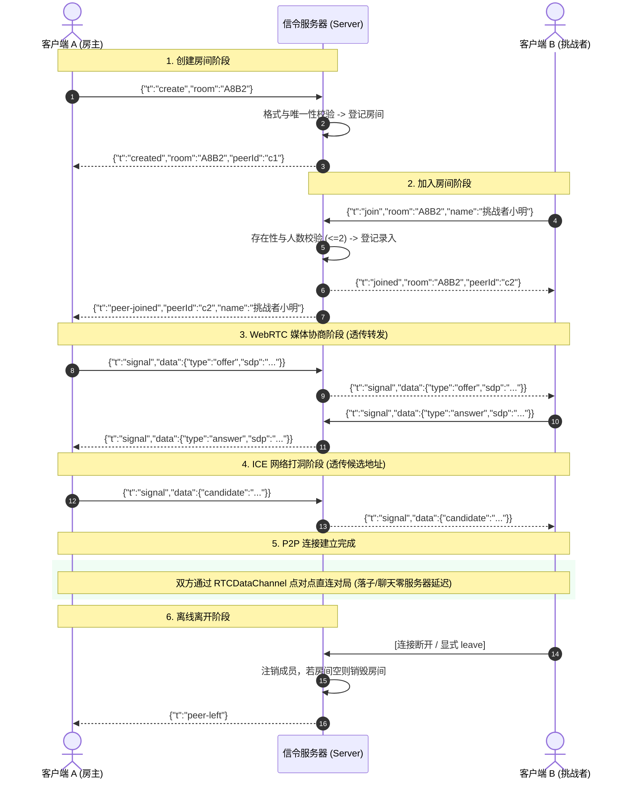

# @webrtc-gomoku/server

> 轻量级 WebRTC 房间信令与生产级静态文件托管服务。  
> 基于 **Node.js + TypeScript + ws + tsup** 构建，具备毫秒级可测性、工业级安全防线与全自动心跳保活。

---

## HTTPS 与局域网语音

支持原生 HTTPS + WSS，未设置证书时保持 HTTP 默认。示例：从仓库根执行 `TLS_CERT_FILE=.certs/lan-cert.pem TLS_KEY_FILE=.certs/lan-key.pem PORT=3443 pnpm start`。两项配置缺一或不可读时拒绝启动。证书创建、手机信任、开发/公网配置见 [HTTPS 与语音说明](../../docs/https.md)。

## 服务大厅与会话防护

独立 `/lobby` 页面支持在线棋友、定向邀请、快速匹配与公开建房。已登记的大厅会话每秒最多处理 30 个请求；超出返回 `RATE_LIMITED`，满一秒恢复，其他会话不受影响。每 IP 最多 10 个连接、每浏览器最多 2 个大厅会话等配额仍同时生效。

座位被新连接接管后，旧物理连接永久失去写权限；允许响应 ping，禁止 leave、信令和再次 create/join，避免迟到操作销毁恢复后的座位。Node 尚未同步 Rust 的合并发布机制；实现边界与验证见[大厅文档](../../docs/m6-lobby/README.md)。

## 💡 架构核心认知：信令服务器是干什么的？

在 WebRTC 点对点通信体系中，信令服务器充当的是**「红娘 / 穿针引线人」**的角色：

1. **不中转游戏数据**：信令服务器**完全不转发**五子棋的落子、悔棋、聊天等对局流量。
2. **只负责建连握手**：两台浏览器在互联网两端无法感知对方的公网 IP 和 NAT 端口时，通过 WebSocket 连接信令服务交换双方的 **SDP（媒体协商描述）** 与 **ICE Candidate（网络打洞候选地址）**。
3. **握手即脱离**：一旦两端完成打洞并建立起浏览器底层的 `RTCDataChannel` 点对点直连通道，信令服务器甚至断开也不会影响正在进行的对局！

---

## 🌟 核心特性

- ⚡️ **极简高效的信令中继管道**：
  - 基于高吞吐的原生 `ws` 库构建，专注于 1v1 房间分配与信令透传，全服务内存常驻仅 ~30MB。
- 🧱 **SOLID 依赖反转架构（DIP & ISP）**：
  - 核心房间簿记模块 [`rooms.ts`](src/rooms.ts) 与底层 WebSocket 彻底解耦，仅依赖最小契约接口 `RoomClient`；
  - 单元测试可在**脱离网络端口**的环境下毫秒级执行，告别端口冲突与假死连接。
- 🛡️ **原子化前置校验（Zero Accidental Eviction）**：
  - 铁律约束：**所有房间号格式、存在性、容量校验在数据状态迁移前执行完毕**；
  - 避免因用户误输不存在的房间号而意外丢失原本正常的对局会话。
- 💓 **半开与假死连接心跳清理（Dead Connection Pruning）**：
  - 针对手机锁屏、断网未发 FIN 包导致的 TCP 半开假死问题，内置 30 秒定时 ping-pong 探针，未响应者自动 `terminate` 强杀释放房间名额。
- 🔍 **双向 O(1) 瞬时索引簿记**：
  - 内存同时维护正向映射 `rooms`（房间号 -> 成员列表）与反向映射 `membership`（客户端ID -> 房间号），任意查询与离线清理均为 $O(1)$ 复杂度。
- 🔒 **企业级静态资源托管安全防护**：
  - **P0 级 URI 容错**：拦截畸形字符（如 `/%` 或 `/%zz`），返回 400 保护 Node.js 进程不发生崩溃；
  - **P2 级路径穿越防范**：利用 `path.relative` 严格检测相对偏移，杜绝 `../../etc/passwd` 等恶意读取；
  - **云原生就绪**：提供 `/healthz` 健康检查端点，无缝对接 Kubernetes / Docker 存活探针。
- 📱 **局域网多设备自发现引导**：
  - 启动时自动扫描本机网卡并打印局域网 IP（如 `http://192.168.1.108:3000`），同 Wi-Fi 下手机直接输入或扫码即玩。

---

## 🏗️ 架构与时序图

### 1. 服务端分层架构

```mermaid
flowchart TD
    subgraph Client [客户端集群]
        WebA[浏览器 A: 房主]
        WebB[浏览器 B: 挑战者]
    end

    subgraph Server [信令与静态托管服务 apps/server]
        HTTP[HTTP Server :3000]
        Static[http.ts: 静态托管 + /healthz 探针]
        WSS[server.ts: WebSocket /signal]
        Registry[rooms.ts: RoomRegistry 房间注册中心]
        
        HTTP --> Static
        HTTP --> WSS
        WSS <-->|适配 asClient| Registry
    end

    WebA -->|GET / 网页静态资源| HTTP
    WebB -->|GET / 网页静态资源| HTTP
    WebA <-->|WS /signal 信令| WSS
    WebB <-->|WS /signal 信令| WSS

    WebA <-.->|RTCDataChannel P2P 直连对局 (不经服务器)| WebB
```

### 2. WebSocket 信令握手生命周期时序



---

## 📜 协议信令报文定义

前后端通信统一采用 JSON 格式，判别属性为 `t`（Type）：

### 客户端上行报文 (`ClientSignalingMsg`)

| 类型 `t` | 负载字段 | 描述 |
| :--- | :--- | :--- |
| `create` | `{ room: string }` | 请求创建指定 4 位大写房间号 |
| `join` | `{ room: string, name?: string }` | 请求加入房间，附带玩家昵称（限长 20 字符） |
| `signal` | `{ data: unknown }` | 透传 WebRTC SDP Offer/Answer 或 ICE Candidate 数据 |
| `leave` | 无 | 主动退出当前所在房间 |

### 服务端下行报文 (`ServerSignalingMsg`)

| 类型 `t` | 负载字段 | 描述 |
| :--- | :--- | :--- |
| `created` | `{ room: string, peerId: string }` | 房间创建成功回执，附带分配的临时 Peer ID |
| `joined` | `{ room: string, peerId: string }` | 成功加入房间回执 |
| `peer-joined` | `{ peerId: string, name: string }` | 向房主广播有对手进入对局 |
| `peer-left` | 无 | 向对手广播当前房间有玩家离开/掉线 |
| `signal` | `{ data: unknown }` | 透传来自对手的 SDP 或 ICE 打洞数据 |
| `error` | `{ message: string }` | 业务错误通知（如房间不存在、房间已满等） |

---

## 📂 源码目录结构

```text
apps/server/
├── src/
│   ├── rooms.ts           # 房间注册中心（纯内存 RoomRegistry 状态机）
│   ├── http.ts            # HTTP 静态资源托管与 /healthz 健康探针
│   └── server.ts          # 服务入口（HTTP + WebSocket 路由分发、心跳与优雅停机）
├── test/
│   ├── rooms.test.ts      # 房间状态机逻辑单测（16 个用例，零网络纯内存测试）
│   └── http.test.ts       # 静态托管与安全防范单测（10 个用例）
├── package.json           # 模块配置与启动脚本
└── tsconfig.json          # TypeScript 编译配置
```

---

## 🛠️ 常用开发与运维命令

```bash
# 进入仓库根目录运行（推荐 Monorepo 统一调度）：

# 1. 开发模式（基于 tsx 监听文件变动热重启）
pnpm --filter @webrtc-gomoku/server dev

# 2. 运行自动化单元测试（Vitest 毫秒级测试套件）
pnpm --filter @webrtc-gomoku/server test

# 3. 生产打包构建（通过 tsup 打包成高性能纯 Node.js CJS 文件）
pnpm --filter @webrtc-gomoku/server build

# 4. 生产环境启动
pnpm --filter @webrtc-gomoku/server start
```

### 环境变量说明

| 环境变量 | 默认值 | 作用说明 |
| :--- | :--- | :--- |
| `PORT` | `3000` | HTTP/HTTPS 与 WS/WSS 共用的监听端口 |
| `TLS_CERT_FILE` | 未设置 | PEM 证书链文件；与私钥同时设置时启用 HTTPS/WSS |
| `TLS_KEY_FILE` | 未设置 | PEM 私钥文件；相对路径均以仓库根为基准 |
| `HOST` | `0.0.0.0` | 绑定的网络接口（`0.0.0.0` 允许局域网外部设备访问） |

---

## 🧪 自动化测试设计（SOLID 实践）

服务端单元测试遵循严谨的 **TDD（测试驱动开发）** 规范：
- **无网测试**：`rooms.test.ts` 全程使用模拟客户端（`vi.fn()`），无需拉起真实端口，避免本地 `EADDRINUSE` 端口占用问题。
- **并发安全与边界覆盖**：
  - 房间号正则校验（大小写敏感、长度不符被拦截）
  - 1v1 满员防护（第 3 名玩家加入被拒绝）
  - 换房原子性迁移（换房失败保留当前对局）
  - 房间空时生命周期销毁（零内存遗留）
- **安全渗透测试**：`http.test.ts` 覆盖了 `%` 畸形 URI 注入以及 `../../` 目录越界遍历拦截验证。
