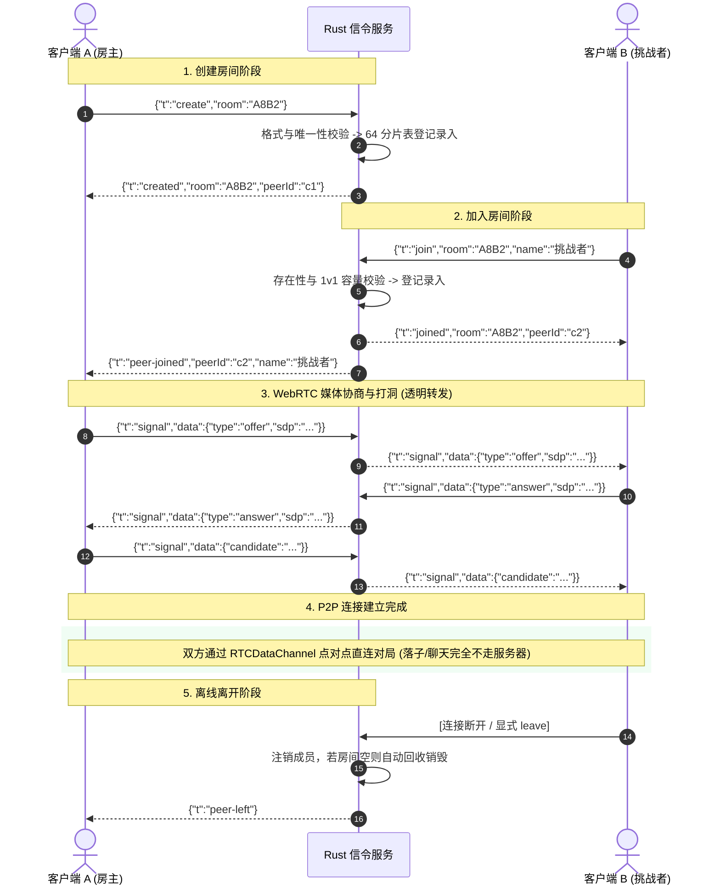

# gomoku-signaling (Rust)

HTTPS 与局域网语音配置见 [部署说明](../../docs/https.md)。Rust 支持原生 HTTPS/WSS，也可使用反向代理统一管理公网证书。

> 高性能 WebRTC 五子棋房间信令与单页客户端托管服务（M3 v2.0，Rust 重写版）。  
> 基于 **Rust 2021 + Tokio 异步多线程运行时 + Axum 0.7 + Hyper 1.0** 构建。10 万长连接是设计目标，尚无对应压测验收；大厅配额和实测范围见下文。

## 原生 HTTPS 与局域网语音

当前入口依赖 Unix 信号处理，以下 Rust 服务命令适用于 macOS/Linux；Windows 可使用 Node HTTPS 服务。

完成 [证书配置与设备信任](../../docs/https.md)后，从仓库根运行 `pnpm build:web && pnpm start:https:rust`；也可显式启动（同样需要先构建前端）：

```bash
TLS_CERT_FILE=.certs/lan-cert.pem TLS_KEY_FILE=.certs/lan-key.pem \
  GOMOKU_REDIS_ENABLED=false GOMOKU_HOST=0.0.0.0 GOMOKU_PORT=3443 GOMOKU_PUBLIC_DIR=packages/web/dist \
  cargo run --manifest-path apps/signaling-rust/Cargo.toml
```

网页、`/config`、`/healthz` 和 WSS `/signal` 共用 3443 端口。浏览器访问证书 SAN 包含的 `https://局域网IP:3443/lobby`，手机仍需信任 CA 并允许麦克风访问。

| 环境变量 | 说明 |
|---|---|
| `TLS_CERT_FILE` | PEM 证书链，与私钥成对配置时启用 HTTPS |
| `TLS_KEY_FILE` | 匹配的未加密 PEM 私钥；支持 rustls 可读取的 PKCS#8/PKCS#1/SEC1 格式 |
| `GOMOKU_REPO_ROOT` | 可选证书路径根；仓库内默认从工作目录向上发现 workspace，独立部署默认工作目录 |

两项 TLS 变量均未配置时保留 HTTP/WS；只配置一项、不可读、PEM 无效或密钥不匹配均在监听前报错退出，不降级为 HTTP。相对路径不依赖编译机器目录；也可通过环境变量注入外部证书绝对路径。TLS 1.2/1.3 使用 rustls 的安全默认套件，ALPN 提供 HTTP/1.1，以兼容现有 WebSocket Upgrade。TLS 握手受现有 `ws_handshake_timeout_secs` 限制，停机取消未完成握手，已连接 WSS 继续使用原有关闭/排空机制。

TLS 文件和环境变量在进程启动时读取，不属于 SIGHUP 或管理端配置热重载项；更新证书后重启。其他配置热重载行为保持原有规则。公网证书自动续期可交给 [Caddy 反代](../../docs/https.md#5-公网生产域名--caddy-tls-终止)。

## 服务大厅（首版）

Rust 服务现在支持与 Node 版相同的大厅协议：在线棋友、2–12 字昵称与重名处理、搜索/每页 20 人、公开房间、定向邀请、快速匹配，以及刷新后的原房间恢复。`/config` 返回 `capabilities.lobby=true` 和 `capabilities.invites=true`，前端无需切换实现。

大厅在线名册、邀请和匹配队列当前按**单个 Rust 节点**维护。每个浏览器最多 2 个大厅标签会话，每节点最多 2,000 个大厅在线会话；大厅新建/匹配在本节点房间总数达到 1,000 时拒绝准入，传统房号联机仍使用 `limits.max_rooms` 配额。公开房间最多返回 100 条，空闲房间优先展示。邀请 30 秒过期，拒绝/过期后同组冷却 60 秒，匹配等待 60 秒超时。邀请及建房操作有 3 秒间隔，大厅突发请求每会话每秒最多 30 次；这些限制与既有全局/单 IP WebSocket 连接配额同时生效。

所有大厅入座都复用既有 `RoomTable`、`SeatRegistry` 和 Redis 房间准入路径；两人都成功入座后才发出 `lobby-seat`，失败时回滚，避免留下半个房间。座位凭证只发给本人，公开名册不含凭证、IP 或信令内容。落子、聊天、悔棋仍通过 P2P 数据通道传输。

大厅每次发布只构建一次公共用户/房间投影，排序与公共状态由所有会话共享；查询在下次发布或状态变更前复用该投影，个人筛选、分页和座位信息仍独立生成。房间准入期间保持协调锁以保证邀请、取消与回滚的事务顺序。恢复接管后，旧物理连接永久失去写入权限，即使它先发送 `leave` 或 `ping` 清空本地房间，也不能再次创建或加入房间。

**发布机制（`2f6655e`）**：断线和旧协议房间操作只使公共投影失效、标记待发布，由每秒任务合并发送一次；没有变化就不广播。邀请/匹配结果、座位凭证与房内离线通知仍定向即时发送；列表查询只回复请求者，不触发全员广播。座位过期回收也会使投影失效，防止房间人数停留在旧值。浏览器的 5 秒查询仍经 WebSocket，尚未实现 HTTP 分页与增量协议。

本地 Linux release（2 CPU、512MiB、Redis 关闭）验证了 2000 会话和 1000 个双人房的信令座位；2000 会话、100 个公开房间的消息正文下行约 48Mbps。持续状态变更仍可能触发每秒全量快照，不能据此推定生产稳定容量。数据与复现命令见[容量复审](../../docs/m6-lobby/capacity-review.md)，未修复问题和后续验收见[大厅待办](../../docs/m6-lobby/tasks.md)。

**无需 Redis 的本地大厅**（仓库根目录）：

```bash
pnpm --filter @webrtc-gomoku/web build
GOMOKU_REDIS_ENABLED=false GOMOKU_HOST=127.0.0.1 GOMOKU_PORT=3110 \
  GOMOKU_PUBLIC_DIR=packages/web/dist \
  cargo run --manifest-path apps/signaling-rust/Cargo.toml
# 打开 http://127.0.0.1:3110/lobby
```

**启用现有 Redis 跨节点房间信令/恢复**：先启动 Redis，再设 `GOMOKU_REDIS_ENABLED=true GOMOKU_REDIS_URL=redis://127.0.0.1:6379`。每个节点设置独立 `GOMOKU_NODE_ID`。这会启用传统房间准入、跨节点中继和座位恢复；**不会把大厅名册/邀请/匹配队列合并为跨节点全局大厅**。如要让在线棋友互相发现，首版应将大厅流量路由到同一节点。

验证命令（仓库根目录）：

```bash
cargo test --manifest-path apps/signaling-rust/Cargo.toml
cargo build --manifest-path apps/signaling-rust/Cargo.toml
cargo fmt --manifest-path apps/signaling-rust/Cargo.toml --check
cargo clippy --manifest-path apps/signaling-rust/Cargo.toml --all-targets -- -D warnings
# 已启动上面的 Rust 服务时：
BASE=http://127.0.0.1:3110 node test/lobby-e2e.js
BASE=http://127.0.0.1:3110 LONG_TESTS=1 node test/lobby-protocol.e2e.js
BASE=http://127.0.0.1:3110 REQUIRE_P2P=1 pnpm test:e2e
```

---

## 💡 架构核心认知：信令服务器是干什么的？

在 WebRTC 点对点通信体系中，信令服务器充当的是**「红娘 / 穿针引线人」**的角色：

1. **不中转游戏数据**：信令服务器**完全不转发**五子棋的落子、悔棋、聊天等对局流量。
2. **只负责建连握手**：两台浏览器在互联网两端无法感知对方的公网 IP 和 NAT 端口时，通过 WebSocket 连接信令服务交换双方的 **SDP（媒体协商描述）** 与 **ICE Candidate（网络打洞候选地址）**。
3. **握手即脱离**：一旦两端完成打洞并建立起浏览器底层的 `RTCDataChannel` 点对点直连通道，信令服务器甚至断开也不会影响正在进行的对局！

> ⚠️ **协议冻结红线**：协议（WS 消息集合 / 字段名 / 5 条标准错误文案）与前端 [`packages/shared/src/types.ts`](../../packages/shared/src/types.ts) **逐字节冻结对齐**，前端在 Node 版与 Rust 版之间切换时无需改动任何一行代码！

---

## 📊 Node.js 版 vs Rust 版对比

仓库内提供了两套信令服务端实现，协议完全一致，可根据业务规模按需选型：

| 维度 | Node.js 单机版 (`apps/server`) | Rust 集群版 (`apps/signaling-rust`) |
| :--- | :--- | :--- |
| **设计定位** | 极简原型，适合个人学习与快速部署 | 工业级生产服务，面向极高并发与生产运维 |
| **容量边界** | 大厅最多 2000 会话；未经同规格容量验收 | 大厅最多 2000 会话；本地压测范围见容量复审；100000 连接 / 50000 房间是通用信令默认配额 |
| **内存与 CPU 开销** | 以目标负载实测为准 | 以目标负载实测为准；Linux musl 可构建静态二进制 |
| **集群多节点对战** | 仅支持单机内存 | **原生支持 Redis Pub/Sub 跨节点分布式中继**（无需 Sticky Session） |
| **锁竞争控制** | 单线程事件循环 | **64 槽位分片读写锁（64-Shard Table）+ 无锁原子计数** |
| **配置热更新** | 重启进程生效 | **零停机 SIGHUP 热重载**（无缝更新日志级别与限流配额） |
| **流控防护** | 基础连接统计 | **有界异步通道背压（Backpressure）+ 慢客户端主动熔断** |

---

## 🌟 核心架构特性

- ⚡️ **64 分片并发房间注册表（64-Shard Table）**：
  - 在 10 万连接 / 5 万房间并发下，避免全局单一读写锁竞争；
  - 房间号 Hash 取模路由至 64 个独立 `RwLock<HashMap>` 分片，搭配无锁 `AtomicU64` 计数器，保证多核心 CPU 算力线性释放。
- 🧱 **SOLID 依赖反转设计（DIP & ISP）**：
  - 核心逻辑严格单向无环：`protocol ◄ rooms ◄ transport ◄ http ◄ main`；
  - `relay` 跨节点中继通过 [`rooms::LocalDelivery`](src/rooms/mod.rs) 特征反向回投，完全不反向依赖具体的传输实现。
- 🌊 **有界通道背压控制（Backpressure & Slow Client Drop）**：
  - 每个 WebSocket 拥有专属的有界通道 `mpsc::Sender<ServerMsg>`；
  - 采用非阻塞 `try_send`，在客户端网络拥塞导致队列堆满时立即标记熔断并切断连接，杜绝慢连接拖垮服务端内存。
- 🚀 **性能优化 F4：后台 TTL 异步刷新（零 Redis RTT）**：
  - 将高频落子通信热路径与 Redis 解耦，后台守护协程按 `room_ttl / 3` 周期批量刷新 Redis 键；
  - 信令转发热路径 **0 额外 Redis 网络往返（RTT）**。
- 🔄 **零停机配置热重载（SIGHUP Hot Reload）**：
  - 基于 `ArcSwap` 实现无锁原子配置快照切换；
  - 发送 `kill -HUP <pid>` 即可在线调整日志级别 (`tracing`) 与连接限流配额，无需断开用户对局。
- 🛡️ **工业级静态托管与防护**：
  - URI 畸形字符崩溃拦截（P0 400 Bad Request）；
  - 基于 `path.relative` 的目录穿越渗透拦截（P2 403 Forbidden）；
  - 支持 SPA 单页应用 index.html 路由回退，提供标准 `/healthz` 与 `/metrics` Prometheus 指标。

---

## 🏗️ 架构与交互时序图

### 1. 服务端分层架构图

```mermaid
flowchart TD
    subgraph Client [客户端集群]
        WebA[浏览器 A: 房主]
        WebB[浏览器 B: 挑战者]
    end

    subgraph RustServer [Rust 信令服务 apps/signaling-rust]
        HTTP[Axum HTTP /ws]
        Static[static_files: 静态托管 + /healthz]
        Router[transport::router: 信令分发路由器]
        Shards[rooms::RoomTable: 64 分片并发房间表]
        RelayMod[relay: 跨节点中继总线]

        HTTP --> Static
        HTTP --> Router
        Router <--> Shards
        Router <--> RelayMod
    end

    subgraph Cluster [分布式集群后端]
        Redis[(Redis Pub/Sub & Lua Scripts)]
    end

    WebA -->|HTTP 静态页面| HTTP
    WebB -->|HTTP 静态页面| HTTP
    WebA <-->|WebSocket /signal| HTTP
    WebB <-->|WebSocket /signal| HTTP

    RelayMod <-->|跨机房信令广播| Redis

    WebA <-.->|RTCDataChannel P2P 直连对局 (不经服务器)| WebB
```

### 2. WebSocket 信令握手时序图



---

## 📜 协议信令报文定义

### 客户端上行报文 (`ClientSignalingMsg`)

| 类型 `t` | 负载字段 | 描述 |
| :--- | :--- | :--- |
| `create` | `{ room: string }` | 请求创建指定 4 位大写字母/数字房间号 |
| `join` | `{ room: string, name?: string }` | 请求加入房间，附带玩家昵称（限长 20 字符） |
| `signal` | `{ data: unknown }` | 透传 WebRTC SDP Offer/Answer 或 ICE Candidate 数据 |
| `leave` | 无 | 主动退出当前所在房间 |

### 服务端下行报文 (`ServerSignalingMsg`)

| 类型 `t` | 负载字段 | 描述 |
| :--- | :--- | :--- |
| `created` | `{ room: string, peerId: string }` | 房间创建成功回执，附带分配的临时 Peer ID |
| `joined` | `{ room: string, peerId: string }` | 成功加入房间回执 |
| `peer-joined` | `{ peerId: string, name: string }` | 向房主广播有对手进入对局 |
| `peer-left` | 无 | 向对手广播当前房间有玩家离开/掉线 |
| `signal` | `{ data: unknown }` | 透传来自对手的 SDP 或 ICE 打洞数据 |
| `error` | `{ message: string }` | 业务错误通知（严格与 5 条标准文案对齐） |

---

## 🚀 快速开始与部署

### 1. 本地运行

```bash
cd apps/signaling-rust

# 可选：自定义配置（不创建则全部使用内置默认值）
cp config.example.toml config.toml

cargo run --release
# 日志：信令服务器已启动 addr=0.0.0.0:3000
```

静态目录按 `[配置值, packages/web/dist, dist, public]` 顺序**回退探测**第一个存在的目录；前端产物请放到 `packages/web/dist`（或构建后复制到 `public/`）。

### 2. Docker Compose 一键起（服务 + Redis）

```bash
cd apps/signaling-rust
docker compose up --build
# 浏览器打开 http://localhost:3000
```

镜像在构建阶段用 pnpm 构建 `packages/web` 并把产物打进 `/app/public`，开箱即用。

### 3. 多架构镜像构建

```bash
# 在仓库根目录执行（build context = 仓库根，含前端构建阶段）
docker buildx build --platform linux/amd64,linux/arm64 -t gomoku-signaling .
```

镜像以非 root（uid `10001`）运行，`HEALTHCHECK` 走 `/healthz`。

### 4. 手动构建各平台二进制（免 Docker）

适用于轻量服务器（如腾讯云/阿里云轻量应用服务器），无需安装 Docker。  
依赖全部为纯 Rust（无 OpenSSL 等 C 依赖），Linux 下可**静态链接**，拷到同架构任何发行版都能跑。

```bash
# 目标机原生构建（最稳）：
cd apps/signaling-rust
cargo build --release --locked
# 产物：target/release/gomoku-signaling
```

**平台目标架构速查表**

| 目标平台 | target triple | 备注 |
|---|---|---|
| Linux x86_64（主流云服务器） | `x86_64-unknown-linux-gnu` | 或 musl 静态版 |
| Linux arm64（鲲鹏 / Ampere / 苹果 M 系列虚机） | `aarch64-unknown-linux-gnu` | 或 musl 静态版 |
| Linux 静态通用（老发行版 / Alpine） | `x86_64-unknown-linux-musl` | **推荐**：无 glibc 依赖 |
| macOS Apple Silicon | `aarch64-apple-darwin` | M 系列 Mac 原生 |
| Windows | `x86_64-pc-windows-msvc` | 当前入口仍需适配 Unix 信号处理；可先使用 Node 服务 |

**部署：二进制 + `public/` 两步走**

```bash
# 1. 构建前端产物
pnpm --filter @webrtc-gomoku/web build        # 产物在 packages/web/dist

# 2. 组装部署目录
mkdir -p /opt/gomoku
cp target/release/gomoku-signaling /opt/gomoku/
cp -r packages/web/dist/* /opt/gomoku/public/

# 3. 单节点无 Redis 启动与验收
GOMOKU_REDIS_ENABLED=false /opt/gomoku/gomoku-signaling &
curl -s localhost:3000/healthz                # 期望 {"ok":true,...}
```

### 5. 单节点部署：**不需要 Redis**

**Redis 是可选的。** 它只服务于**跨节点**能力——同房间两人落在不同节点时的信令中转、房间号全局唯一（`SET NX EX`）、跨节点 1v1 容量判定。单节点部署下本地 `RoomTable` 已能完成全部功能，**无需启动 Redis**：

```toml
[redis]
enabled = false
```

等价写法：环境变量 `GOMOKU_REDIS_ENABLED=false`，或 `GOMOKU_REDIS_URL=""`。

| 场景 | `enabled = true` 但 Redis 不可达 | `enabled = false` |
|---|---|---|
| 本地建房 / 加入 / 信令 | ✅ 可用 | ✅ 可用 |
| 跨节点中继 | ❌ 不可用 | ❌ 不可用 |
| 后台重连任务 | 常驻，1s→30s 指数退避 | **完全不启动** |
| 日志输出 | 每 30s 一条 `warn` | 启动时一条 `info`，之后静默 |
| `gomoku_redis_connected` 指标 | `0`（含义＝**故障**） | `0`（含义＝**按配置关闭**，非故障） |

---

## 🔌 服务端点（HTTP & WS Endpoints）

| 方法 | 路径 | 说明 |
|---|---|---|
| `GET` | `/healthz` | 存活探针：`{ok:true, rooms, uptime}`（字段/类型与 v1 一致） |
| `GET` | `/config` | 下发 ICE、`capabilities` 和大厅超时时间（`Cache-Control: no-cache`） |
| `GET` | `/metrics` | Prometheus 文本指标（`gomoku_*`） |
| `GET` | `/signal` | WebSocket 升级入口（信令中继通道） |
| `GET/POST`| `/admin/config` | 管理面：读脱敏配置 / 内存态补丁热更新（需 Bearer Token） |
| `GET` | `/*` | 静态托管（SPA fallback / 403 / 404） |

### 1. `/config` 的 TURN 显隐控制
`iceServers` 始终包含 STUN 段。TURN 段**仅当** `ice.turn_url` 非空 **且** `ice.turn_credential_exposed = true`（默认 `true`）时才明文下发。生产环境若不希望向前端暴露 TURN 凭据，置 `turn_credential_exposed = false`。

### 2. `/admin/config` 安全管理面
- `admin.token` 为空时，整个 `/admin/*` 直接返回 **404**（彻底关闭管理端点）；
- Token 错误返回 **401**，正确返回 **200**；
- `GET` 返回**全脱敏**配置（`turn_credential` / `admin.token` / `redis.url` 内嵌密码均脱敏为 `***`）；
- `POST` 接受部分配置补丁，返回 `{applied, restart_required}`，**仅作用于当前内存态，绝不覆写硬盘上的 config.toml**。

---

## ⚙️ 配置规范（三层合并机制）

```
内置默认值  <  config.toml  <  环境变量（GOMOKU_*）
```

- 配置文件路径通过环境变量 `GOMOKU_CONFIG_FILE` 指定（默认 `./config.toml`）；
- 数组类型环境变量采用**英文逗号分隔**（例如 `GOMOKU_CORS_ORIGINS=https://a,https://b`）；
- 启动时执行严格的 **Fail-Fast 参数校验**（端口越界、超时为 0 等错误直接拒绝启动并明确指出原因）。

| 配置键 | 环境变量 | 默认值 | 作用说明 |
|---|---|---|---|
| `server.host` | `GOMOKU_HOST` | `0.0.0.0` | 监听主机地址 |
| `server.port` | `GOMOKU_PORT` | `3000` | 监听端口号 |
| `server.public_dir` | `GOMOKU_PUBLIC_DIR` | `public` | 静态文件根目录 |
| `server.allowed_ws_origins` | `GOMOKU_ALLOWED_WS_ORIGINS` | `[]` | 允许的 WebSocket 来源列表（空 = 不校验） |
| `server.trust_proxy_headers` | `GOMOKU_TRUST_PROXY_HEADERS`| `false` | 是否信任前置代理头 X-Forwarded-For |
| `timeouts.ws_ping_interval_secs` | `GOMOKU_WS_PING_INTERVAL` | `30` | 心跳发送周期（秒） |
| `timeouts.ws_idle_timeout_secs` | `GOMOKU_WS_IDLE_TIMEOUT` | `60` | 连接空闲假死超时阈值（秒） |
| `timeouts.ws_handshake_timeout_secs`| `GOMOKU_WS_HANDSHAKE_TIMEOUT`| `10` | WebSocket 握手超时限制（秒） |
| `timeouts.shutdown_drain_secs` | `GOMOKU_SHUTDOWN_DRAIN` | `15` | 优雅停机排空最大等待时间（秒） |
| `limits.max_connections` | `GOMOKU_MAX_CONNECTIONS` | `100000` | 服务端允许的最大总长连接数 |
| `limits.max_connections_per_ip` | `GOMOKU_MAX_CONNECTIONS_PER_IP`| `10` | 单 IP 允许建立的最大连接数（防 CC） |
| `limits.max_rooms` | `GOMOKU_MAX_ROOMS` | `50000` | 内存允许的最大并发房间总数 |
| `limits.max_message_bytes` | `GOMOKU_MAX_MESSAGE_BYTES` | `65536` | 单帧信令消息体字节数上限（64KB） |
| `limits.broadcast_queue_capacity` | `GOMOKU_BROADCAST_QUEUE_CAPACITY`| `256` | 每个长连接发送缓冲区容量 |
| `redis.enabled` | `GOMOKU_REDIS_ENABLED` | `true` | 是否启用 Redis 跨节点中继 |
| `redis.url` | `GOMOKU_REDIS_URL` | `redis://127.0.0.1:6379` | Redis 数据库连接串 |
| `redis.room_ttl_secs` | `GOMOKU_ROOM_TTL` | `3600` | Redis 房间记录键的 TTL 过期时间（秒） |
| `cluster.node_id` | `GOMOKU_NODE_ID` | `<hostname>-<rand8>` | 集群中本节点的唯一编号 |
| `logging.level` | `GOMOKU_LOG_LEVEL` | `info` | 日志输出级别（trace/debug/info/warn/error） |
| `logging.format` | `GOMOKU_LOG_FORMAT` | `text` | 日志输出格式（`text` 纯文本 或 `json` 格式） |
| `admin.token` | `GOMOKU_ADMIN_TOKEN` | `""` | 管理端 Bearer 鉴权凭据（空 = 关闭管理端） |

---

## ⚖️ 负载均衡与分布式集群方案

房间状态（`RoomTable`）虽然在节点内存中分片存储，但**全局唯一性**与**跨节点容量校验**均由 Redis Lua 原子脚本保证：
- `create` / `join` / `leave` 执行 Redis 原子操作（`SET NX EX` / `SCARD` / `SREM`）；
- 跨节点信令通过每房间专属的 Redis Pub/Sub 频道广播；
- 节点准入失败时自动幂等回滚 Redis 成员记录，防止脏占位；
- **核心优势**：前置负载均衡器（Nginx / ALB / SLB）可使用最简单的**轮询分发策略**，**完全不需要会话保持（Sticky Session）**！

---

## 🧪 自动化测试与工程质量红线

整个 Rust 工程已配备全面的单元测试与集成测试，覆盖了协议逐字节冻结、并发容量、网络超时与故障降级：

```bash
# 格式化与静态检查
cargo fmt --check
cargo clippy --all-targets -- -D warnings

# 运行全量 Rust 单元与集成测试
cargo test
```

### 生产质量铁律
1. **热路径零异常**：信令转发与握手热路径中严禁出现 `unwrap()` / `expect()` 导致服务崩溃；
2. **热路径零阻塞**：热路径严禁执行磁盘文件 I/O、严禁打印无谓的调试日志、严禁使用无界通道 `unbounded_channel`；
3. **架构单向流动**：模块引用依赖必须保持单向无环，`relay` 只能通过 `LocalDelivery` 特征反向回投；
4. **确定性测试**：集成测试采用本机 Loopback TCP 与内部模拟，无需外置真实 Redis 依赖即可全自动化运行。
