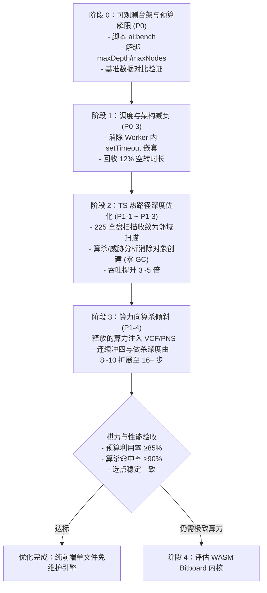

# 五子棋 AI 性能与棋力优化实施方案（M6 · 纯前端算力）

> **目标**：在保持零服务端、单文件 HTML 可离线分发的前提下，通过消除调度空转、解限预算配置、优化 TypeScript 热路径与强化算杀，让 AI 在 3 秒内将算力转化为决定性棋力。

---

## 1. 现状剖析与优化路线决策

根据基线 CPU Profile 实测（Node 22 / hard 档 / 3s 预算）：
- **CPU 耗时瓶颈**：`windowCode` 18.5% + `analyzeThreats` 12.0% + `pointScore` 9.7% + `winsAt` 9.3% + `findWinningPoints` 6.5% ≈ **56%**，搜索热点主要集中在“重复重算”与“全盘 225 格全量扫描”。
- **预算空转瓶颈**：Hard 档人为设定的 `maxDepth: 12` 和 `maxNodes: 60000` 导致 AI 仅用时 1.47s（49% 预算）即因撞墙提前终止，时间尚未用满。
- **调度损耗**：Web Worker 内部沿用 32ms 分片宏任务，`setTimeout(0)` 嵌套 4ms 钳制导致 3s 内约 12% 纯等待空转。

### 路线对比与结论

| 方案 | 改造方式 | 预期提速 | 工程代价与风险 | 决策结论 |
|---|---|---|---|---|
| **A 档** | TS 引擎 1:1 直译 Rust/WASM | 1.3～2x | 维护两套代码，破坏单文件 HTML 体积 | **坚决不做** |
| **B 档** | Bitboard(4×u128) + SIMD + 线性内存重构 | 5～15x | 耗时 2～3 周，双引擎行为漂移，需大量差分测试 | **P2 备选**（仅当 TS 榨干仍不足时） |
| **C 档** | **TS 预算解限 + 邻域裁剪 + 零分配 + Worker 去空转** | **3～5x** | **1～2 天**，完全符合单文件与 TDD 规范 | **当前主路线（P0+P1）** |

---

## 2. 总体实施阶段规划

---

## 3. 分阶段详细实施方案

### 阶段 0：可观测数据台架与预算解限（P0-1 & P0-2）

#### P0-1：测试台架脚本 `scripts/ai-bench.mjs`
* **目标**：提供可复现的性能量化工具 `pnpm ai:bench`。
* **功能**：
  * 支持 20 个固定 seed 局面；
  * 输出表格与 JSON 报告：包含 `depth`、`nodes`、`nps`、`cutoff`（终止原因）、`elapsedMs` 及首选着法；
  * 冻结基准快照 `baseline.json`，用于检测优化后选点是否漂移（G2 护栏指标）。

#### P0-2：解绑预算错配
* **目标**：以 `timeBudgetMs: 3000` 作为主控，放宽 `maxDepth: 16`，`maxNodes: 200000`。
* **收益**：预算利用率由 49% 提升至 $\ge 85\%$，消灭提前撞墙问题。

---

### 阶段 1：Web Worker 调度去空转（P0-3）

* **现状**：Worker 线程中每 32ms 通过 `setTimeout(0)` 让出，因浏览器 4ms 钳制导致 360ms/3s 浪费。
* **改进**：
  * Worker 线程内采用大步长运行（每 200ms 或 4096 节点轮询一次 cancel 标志）；
  * 主线程保持轻量分片，Worker 满载运算，白捡约 12% 算力。

---

### 阶段 2：TypeScript 算法剪枝与零 GC 优化（P1-1 ~ P1-3）

1. **`dependency.ts` 邻域收敛（P1-2）**：
   * 将 `orderAttackCandidates` 和 `findWinningPoints` 中全盘 225 格扫描，改为只扫描 `st.neighbor > 0` 范围；
   * 候选集由 225 格缩小至 20～35 格，单次开销下降 70% 以上。
2. **威胁分析零分配（P1-3）**：
   * 消除 `emptyCells.map().sort().map()` 以及递归中创建的 `Set<number>`；
   * 复用定长 TypedArray 缓冲区，降低 GC 耗时。
3. **走法排序缓存（P1-1）**：
   * 候选点排序分值复用增量缓存或单步记忆，避免重复展开 4 方向 × 9 槽位的 `windowCode`。

---

### 阶段 3：算杀预算倾斜（P1-4）

* 将阶段 2 回收的 3～5 倍算力直接注入算杀：
  * `VCF_NODE_LIMIT`：6,000 $\to$ 24,000；
  * `PNS_NODE_LIMIT`：20,000 $\to$ 80,000；
  * `PNS_TIME_BUDGET_MS`：1,200ms $\to$ 2,000ms；
* 达成 M3 指标：算杀题集命中率 $\ge 90\%$，单题耗时 P95 $\le 1.8\text{s}$。

---

## 4. 质量保障与护栏红线（遵循 AGENTS.md）

1. **TDD 流程**：任何参数与逻辑改动必须先写失败测试，全绿后再提交；
2. **G1 棋力不回退**：`bench-tactics.test.ts` 20 题 Hard 档维持 20/20 全绿；
3. **G2 选点稳定**：金标准局面集首选手一致率 $\ge 95\%$；
4. **G4 保底不破**：单文件打包体积增量 $\le 40\text{KB}$，断网完全可运行。
