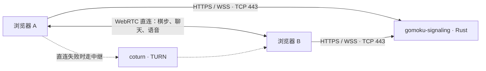

# 阿里云 HTTPS、服务与日常运维

核对日期：2026-10-20（北京时间）。应用版本：`ab01f0b`。服务器地址通过私有配置或环境变量提供，不写入可提交文档。本文根据服务器当前的 systemd 配置、进程、监听端口和证书脚本核对，不代表其他机器的默认配置。

入口分别为 `https://<服务器IP>/lobby`、`https://<服务器IP>/`、`https://<服务器IP>/healthz`。旧 HTTP 8317 入口已改为 HTTPS 443。

## 1. 先记住这些管理命令

从本地登录；后续服务器命令均按 root 会话书写。使用 `zxr` 登录时，先通过 `sudo -i` 获得管理权限。

```bash
# 在本地仓库根目录加载私有地址；没有私有配置时交互输入
if test -f .workbuddy/private/aliyun-host.env; then
  . .workbuddy/private/aliyun-host.env
else
  printf '服务器公网 IP：'
  read -r GOMOKU_PUBLIC_IP
fi
ssh "root@$GOMOKU_PUBLIC_IP"
```

登录服务器后执行：

```bash
# 游戏服务：查看、重启、实时日志
systemctl status gomoku-signaling --no-pager
systemctl restart gomoku-signaling
journalctl -u gomoku-signaling -f

# 证书续签：查看下一次检查时间、最近结果
systemctl list-timers gomoku-https-renew.timer --all --no-pager
journalctl -u gomoku-https-renew.service -n 50 --no-pager

# 手动执行一次续签检查；未到续签时间会正常跳过
systemctl start gomoku-https-renew.service
```

在本地已加载地址的终端验证公网 HTTPS，无需忽略证书错误：

```bash
curl --noproxy '*' -fsS "https://$GOMOKU_PUBLIC_IP/healthz"
```

本机实际地址保存在 `.workbuddy/private/aliyun-host.env`，该目录被 Git 忽略，不随提交分发。新开终端需重新加载；SSH 不会自动把本地变量传给远程 shell，服务器上可按第 5 节从证书配置自动读取地址。

`journalctl -f` 用 Ctrl+C 退出，只退出日志查看，不停止服务。重启游戏服务会断开大厅和信令连接，内存中的房间与恢复状态可能丢失，安排在低峰执行。

## 2. 部署了哪些服务，“两个进程”分别是什么

前端是预先构建的静态文件，由同一个 Rust 程序提供网页、HTTPS、WSS 和大厅。服务器没有为这个应用另起 Node 或 Vite 服务，也没有使用 Nginx/Caddy 反向代理。



| systemd 单元 | 程序与作用 | 运行方式 / 端口 | 如何管理 |
|---|---|---|---|
| `gomoku-signaling.service` | Rust：网页、配置、健康检查、大厅、WebRTC 信令 | 以 `zxr` 身份常驻；TCP 443 | `systemctl … gomoku-signaling` |
| `coturn.service` | `turnserver`：STUN/TURN，帮助不同网络的浏览器连接 | 以 `coturn` 身份常驻；TCP/UDP 7001，UDP 中继范围 7002–7101 | `systemctl … coturn` |
| `mihomo.service` | 服务器出站代理；证书脚本通过它访问 GitHub / ACME | 常驻；脚本使用回环地址 `http://127.0.0.1:7890` | `systemctl … mihomo` |
| `gomoku-https-renew.timer` | 定期触发证书检查 | 定时器，不是常驻业务进程 | `systemctl … gomoku-https-renew.timer` |
| `gomoku-https-renew.service` | 短时运行 LEGO；必要时签发、安装证书并重启游戏服务 | `Type=oneshot`；验证期间临时监听 TCP 80 | 查看该单元日志和执行结果 |

游戏服务配置了 `Restart=always`、`RestartSec=3`，异常退出后由 systemd 自动拉起；通过 `systemctl stop` 主动停止时不会被这条规则重新启动。游戏、coturn、Mihomo 和续签定时器均已设为开机启用。

### Rust 的多个条目可能只是线程

本次核对到 **1 个 Rust 进程、3 个线程**：主线程和 2 个 `tokio-rt-worker`。`top -H` 或显示线程的 htop 会出现多个条目，不表示部署了多套游戏服务。用同一个 PID 下的 SPID 区分：

```bash
GOMOKU_PID=$(systemctl show gomoku-signaling --property=MainPID --value)
ps -T -p "$GOMOKU_PID" -o pid,spid,comm
systemctl show gomoku-signaling -p MainPID -p ActiveState -p SubState -p NRestarts
```

### 服务器上也确实存在两个 Mihomo 进程

| 进程标识 | 归属 | 结论 |
|---|---|---|
| 以 service 的 `MainPID` 为准 | `mihomo.service` | 当前由 systemd 管理的代理实例，监听续签脚本使用的 7890 端口 |
| 通过 `pgrep` 查另一实例 | `session-*.scope`，旧登录会话 | 另一个独立的 Mihomo 实例；本次未清理，尚未确认是否仍有其他用途 |

两个 Mihomo 使用相同配置目录，但只有前一个归属于 `mihomo.service`。`systemctl restart mihomo` 管理该 service 实例，不会同时管理旧会话实例。清理旧实例前应核对监听端口、日志和用途，再按具体 PID 处理；`pkill mihomo` 会同时影响当前代理。

查当前进程和归属，不依赖上面的历史 PID：

```bash
systemctl show mihomo -p MainPID -p ExecStart
pgrep -ax mihomo
ss -lntup
# 将下面的 PID 替换为刚查到的进程号，查看 systemd 归属
systemctl status PID --no-pager
```

## 3. 公网 IP 证书是怎样安装的

公网使用 **Let’s Encrypt 正式 IP 证书**，覆盖配置中的服务器公网 IP。本地的 `pnpm https:setup` / mkcert 用于开发环境；这台公网服务器的浏览器信任来自公共 CA，手机无需安装开发根证书。

这里“安装证书”指把证书链和配套私钥放入服务可读的目录，并配置 Rust TLS 读取；没有向手机或电脑额外导入 CA。

已完成的步骤：

1. 从 [LEGO 官方 v5.5.2 发布页](https://github.com/go-acme/lego/releases/tag/v5.5.2)下载 Linux amd64 二进制，使用同一发布页的 SHA256 清单校验，独立安装证书工具。
2. 先使用 Let’s Encrypt staging 验证 HTTP-01 签发流程，再使用正式环境签发。staging 证书没有用于线上服务。
3. HTTP-01 验证期间，LEGO 临时监听公网 TCP 80，CA 从公网验证这个 IP 的控制权；游戏服务仍独立运行。
4. 正式证书与私钥在服务器生成并保存。安装脚本检查证书 IP、有效期和公私钥匹配关系，再复制到按证书指纹分隔的目录。
5. 原子切换 `.certs/current` 链接。Rust 从该链接读取证书，直接监听 TCP 443；systemd 仅授予服务绑定低端口所需的 `CAP_NET_BIND_SERVICE`。

TLS 配置位于 `gomoku-signaling.service` 的 `https.conf` drop-in，内容为：

```ini
[Service]
Environment="TLS_CERT_FILE=.certs/current/fullchain.pem"
Environment="TLS_KEY_FILE=.certs/current/privkey.pem"
Environment="GOMOKU_HOST=0.0.0.0"
Environment="GOMOKU_PORT=443"
Environment="GOMOKU_PUBLIC_DIR=public"
AmbientCapabilities=CAP_NET_BIND_SERVICE
CapabilityBoundingSet=CAP_NET_BIND_SERVICE
```

这些环境变量会覆盖应用 `config.toml` 中对应设置。因此，即使 TOML 仍保留旧端口，实际也按 drop-in 中的 443 运行。用 `systemctl cat gomoku-signaling` 查看合并配置，编辑 systemd 单元或 drop-in 后需要 `systemctl daemon-reload`，再重启服务。

IP 证书采用 `shortlived` 配置，有效期约 160 小时，必须自动续签，见 [Let’s Encrypt 官方说明](https://letsencrypt.org/2026/01/15/6day-and-ip-general-availability)。证书颁发者和到期时间按第 5 节实时查询，避免把旧证书的时间当成续签后的状态。

## 4. 自动续签如何工作

`gomoku-https-renew.timer` 每天在北京时间 **00、06、12、18 点**触发检查，每次额外随机延迟最多 15 分钟。`Persistent=true` 会在定时器重新启动时补执行错过的检查。

实际调用链：

```text
gomoku-https-renew.timer
  → gomoku-https-renew.service（短时任务）
    → renew（flock 防止并发）
      → lego run（检查是否到续签时间）
        → 需要续签：HTTP-01 验证、获取新证书
          → install-certificate（校验、安装、切换链接）
            → restart gomoku-signaling
            → 通过回环地址校验证书及 HTTPS /healthz
```

- **未到续签时间**：输出 `Skip renewal` 后成功退出，不换证书、不重启游戏服务。续签时机由 LEGO / ACME 的续签信息与短期证书策略决定，不是每 6 小时重新签发。
- **取得新证书**：安装新证书后重启 Rust。当前 TLS 在进程启动时读取证书，尚不支持证书热重载，因此这一步会短暂中断游戏服务。
- **重启或健康检查失败**：脚本会恢复上一个证书链接，并再次尝试启动服务；失败信息记录在续签 service 日志中。
- **一次任务完成**：`gomoku-https-renew.service` 显示 `inactive (dead)` 是正常现象；判断结果看 `Result=success`、`ExecMainStatus=0`。定时器应保持 `active (waiting)`。

续签脚本显式使用 Mihomo 的回环代理访问 ACME，IP 自检通过 `NO_PROXY` 绕过代理。单元中的 `After=mihomo.service` 只规定启动顺序，不会自动拉起停止的 Mihomo；代理停止时应检查并恢复 `mihomo.service`。

```bash
systemctl status gomoku-https-renew.timer --no-pager
systemctl list-timers gomoku-https-renew.timer --all --no-pager
systemctl show gomoku-https-renew.service -p Result -p ExecMainStatus -p ActiveState
journalctl -u gomoku-https-renew.service --since today --no-pager

# 正常的手动检查，不强制提前签发
systemctl start gomoku-https-renew.service
```

## 5. 文件放在哪里，怎样查看证书

为避免把某台机器的安装目录写死，先在服务器通过 systemd 解析路径。在同一 shell 会话执行一次：

```bash
GOMOKU_APP_DIR=$(systemctl show gomoku-signaling --property=WorkingDirectory --value)
GOMOKU_MAIN_UNIT=$(systemctl show gomoku-signaling --property=FragmentPath --value)
GOMOKU_UNIT_DIR=$(dirname "$GOMOKU_MAIN_UNIT")
GOMOKU_RENEW_BIN=$(systemctl show gomoku-https-renew.service --property=ExecStart --value | sed -n 's/.*path=\([^ ;]*\).*/\1/p')
GOMOKU_ACME_DIR=$(dirname "$GOMOKU_RENEW_BIN")
GOMOKU_PUBLIC_IP=$(cat "$GOMOKU_ACME_DIR/ip")
test -d "$GOMOKU_APP_DIR"
test -x "$GOMOKU_ACME_DIR/lego"
```

| 路径（基于上面的变量） | 内容 |
|---|---|
| `$GOMOKU_APP_DIR/gomoku-signaling` | Linux x86_64 musl 发布程序 |
| `$GOMOKU_APP_DIR/public/index.html` | 在线前端 |
| `$GOMOKU_APP_DIR/public/gomoku-standalone.html` | 独立单文件构建，对应 `https://<服务器IP>/gomoku-standalone.html` |
| `$GOMOKU_APP_DIR/config.toml` | 应用配置，含 ICE/TURN 配置；保留原设置，权限为 `zxr` 所有、600 |
| `$GOMOKU_APP_DIR/RELEASE` | 部署版本、构建时间与目标平台 |
| `$GOMOKU_APP_DIR/backups/` | 发布前备份，名称包含版本与 UTC 时间戳；使用下文命令查看实际目录 |
| `$GOMOKU_APP_DIR/.certs/current` | 指向当前证书版本的符号链接 |
| `$GOMOKU_APP_DIR/.certs/releases/` | 按证书指纹保存的 `fullchain.pem`、`privkey.pem`；目录 700、文件 600 |
| `$GOMOKU_ACME_DIR/lego` | LEGO 5.5.2 客户端 |
| `$GOMOKU_ACME_DIR/ip` | 当前证书覆盖的公网 IP |
| `$GOMOKU_ACME_DIR/production/accounts/` | 正式 ACME 账号资料与账号私钥 |
| `$GOMOKU_ACME_DIR/production/certificates/` | 正式证书链、私钥及元数据 |
| `$GOMOKU_ACME_DIR/staging/` | 首次签发测试资料，不供线上使用 |
| `$GOMOKU_ACME_DIR/renew` | 续签入口脚本 |
| `$GOMOKU_ACME_DIR/install-certificate` | 证书安装、服务重启、健康检查与证书回退脚本 |
| `$GOMOKU_UNIT_DIR/gomoku-signaling.service.d/https.conf` | Rust TLS 与 443 端口配置 |
| `$GOMOKU_UNIT_DIR/gomoku-https-renew.service` / `gomoku-https-renew.timer` | 续签任务与定时器 |

应用目录和证书工具目录分别保存发布包与运维脚本。当前运维脚本已安装在服务器，没有随 `ab01f0b` 提交进入仓库；仓库中的 `scripts/setup-https.mjs` 是本地 mkcert 配置工具。

以下命令只查看公有证书信息，不输出私钥：

```bash
readlink "$GOMOKU_APP_DIR/.certs/current"
openssl x509 -in "$GOMOKU_APP_DIR/.certs/current/fullchain.pem" \
  -noout -issuer -dates -ext subjectAltName
openssl x509 -in "$GOMOKU_APP_DIR/.certs/current/fullchain.pem" \
  -noout -checkend 86400

# 核对发布版本和私钥权限
cat "$GOMOKU_APP_DIR/RELEASE"
stat -c '%a %U:%G %n' "$GOMOKU_APP_DIR/.certs/current/privkey.pem"
```

`-checkend 86400` 检查未来 24 小时内是否过期，返回非零时应查看续签日志。备份应用配置、证书工具目录、部署脚本及 systemd 配置时，要按包含私钥和 TURN 凭据的敏感备份保存，不放进 Git、静态目录或聊天记录。

## 6. 启停、改配置与重新发布

| 操作 | 命令 | 影响 |
|---|---|---|
| 启动 / 停止游戏 | `systemctl start gomoku-signaling` / `systemctl stop gomoku-signaling` | 管理 HTTPS、网页、大厅与信令 |
| 重启游戏 | `systemctl restart gomoku-signaling` | 加载新程序、TLS 证书与启动配置 |
| 查看 TURN | `systemctl status coturn --no-pager`、`journalctl -u coturn -n 50 --no-pager` | 排查跨网络连接和中继 |
| 重启 TURN | `systemctl restart coturn` | 会影响正在使用该中继的连接，直连不依赖该进程 |
| 查看代理 | `systemctl status mihomo --no-pager`、`journalctl -u mihomo -n 50 --no-pager` | 排查证书签发出站网络 |
| 重启代理 | `systemctl restart mihomo` | 影响该代理实例，可能暂时影响签发检查 |
| 开启自动续签 | `systemctl enable --now gomoku-https-renew.timer` | 启用定时检查及开机启动 |
| 暂停自动续签 | `systemctl disable --now gomoku-https-renew.timer` | 停止未来触发，已运行的 oneshot 不会因此取消；短期证书随后可能过期 |
| 修改 systemd 配置后 | `systemctl daemon-reload`，再重启对应 service | 让 systemd 重新读取单元；单独 reload 不会重启应用 |

应用支持部分配置热重载，但端口、TLS 文件和 TLS 环境变量需要重启。配置项范围见 [Rust 运行说明](../apps/signaling-rust/README.md)。不要额外手工启动一个发布程序来代替 systemd 管理，否则可能与当前监听端口冲突。

这次发布的过程是：本地重新构建前端和 Linux x86_64 musl 程序 → 打包并生成 SHA256 清单 → 上传校验 → 在服务器回环测试端口启动候选实例并检查 HTTPS 与页面哈希 → 备份旧版 → 原子替换程序和静态目录 → 重启正式服务 → 公网验证。保留了原 `config.toml` 内容与权限，续签材料没有打入公开发布包。

以后重新发布时，同样保留 `.certs/`、证书工具目录和 systemd 配置，避免整目录覆盖。旧服务备份与证书版本是两套独立的回退材料：

- **应用回退**：按选定备份成组恢复程序、前端和匹配的服务配置。这次备份来自旧 HTTP 部署，若回退至该版本，需要同时恢复原端口/TLS 配置，不能只换旧程序并继续把它作为 HTTPS 服务使用。
- **证书回退**：使用 `.certs/releases/` 中上一份仍有效的证书链与对应私钥，切换 `current` 并重启；自动安装脚本在新证书加载失败时会尝试这条路径。

```bash
ls -lt "$GOMOKU_APP_DIR/backups"
ls -lt "$GOMOKU_APP_DIR/.certs/releases"
systemctl cat gomoku-signaling
```

## 7. 常见排查

| 现象 | 优先检查 |
|---|---|
| HTTPS 打不开 | `systemctl status gomoku-signaling`、`journalctl -u gomoku-signaling -n 80`、`ss -lntp`；确认监听 443，云安全组与主机网络允许 TCP 443 |
| 证书过期或浏览器警告 | 查询当前证书到期时间、续签 timer、oneshot 结果、Mihomo 状态；核对访问 IP 与证书 SAN 一致 |
| 续签日志显示 `Skip renewal` | 未到续签时间，属于正常成功；核对 `Result=success` |
| 续签 HTTP-01 验证失败 | 公网 TCP 80 是否仍可达，是否被其他服务占用；`ss -lntp` 查看。阿里云安全组和主机网络都需允许验证入站 |
| 平时 TCP 80 没有进程监听 | 当前设计如此：验证时由 LEGO 临时监听，没有常驻 HTTP 页面或 HTTP→HTTPS 跳转服务 |
| 续签连接 ACME 超时 | 检查 `mihomo.service` 和回环 7890 代理；当前脚本的出站代理与主机部署绑定 |
| 网页正常，但异地对手连不上 | 检查 coturn、TCP/UDP 7001 与 UDP 7002–7101；页面加载成功不等于 TURN 中继成功 |
| 状态页显示多个 Rust 条目 | 对比 PID / SPID，先分辨进程与 Tokio 线程 |
| 两个 Mihomo 条目 | 对照 service MainPID 与各 PID 的 systemd 归属，区分受管实例和旧登录会话实例 |

更广泛的 HTTPS 与麦克风权限说明见 [HTTPS 配置](https.md)，跨网络中继的部署与验收见 [TURN 配置](turn.md)。
