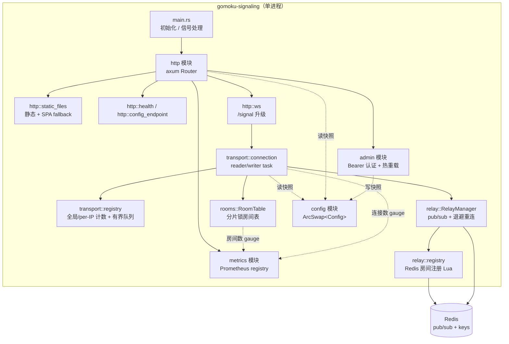
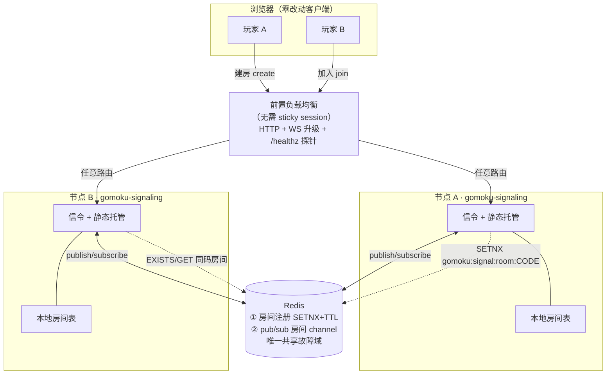
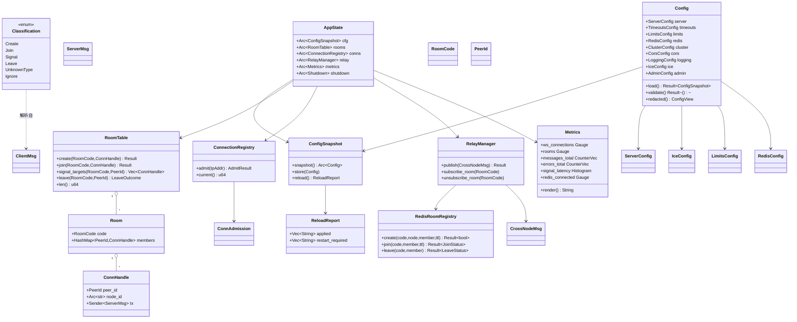
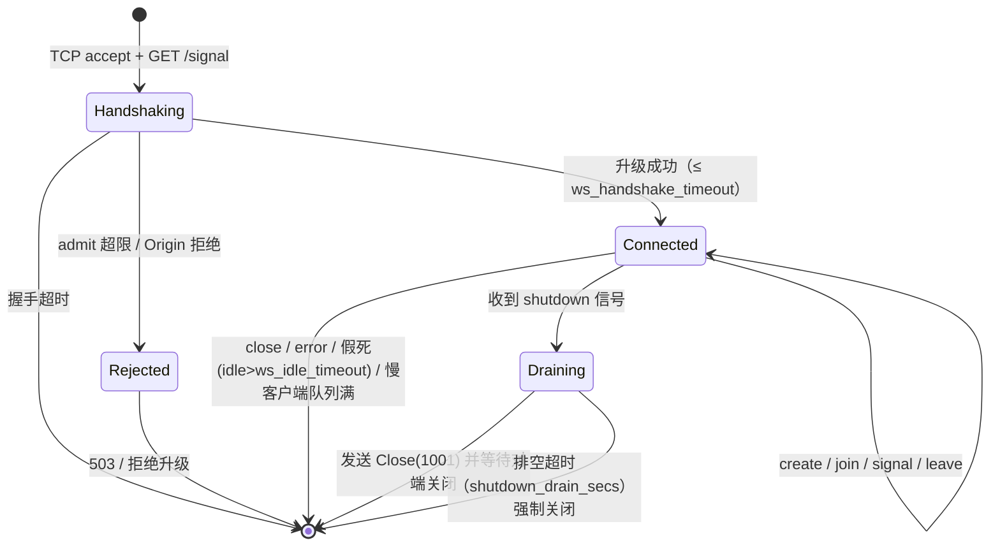
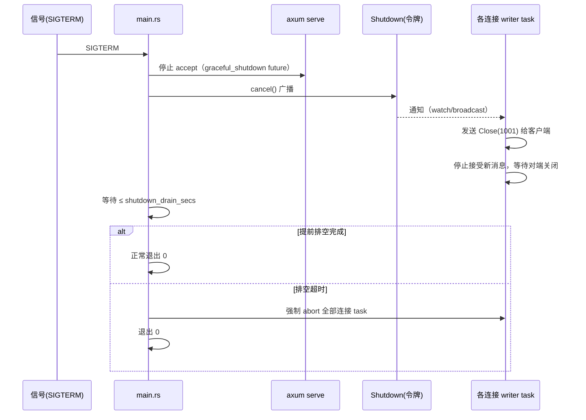

# M3 v2.0 · Rust 信令服务器 · 架构设计

| 项 | 内容 |
|---|---|
| 里程碑 | M3 · v2.0（ROADMAP.md） |
| 作者 | 高见远（Gao）· 架构师 |
| 状态 | 历史 M3 架构草案；当前实现与运行说明见服务 README |
| 契约来源 | `docs/m3-rust-signaling/prd.md`（已冻结） |
| 落点 | `apps/signaling-rust/`（与 `apps/server` 平级） |
| 技术栈 | Rust · tokio + axum + tokio-tungstenite · Redis pub/sub |
| 语言 | 中文 |

> **产品第一原则不可破坏**：单文件 HTML「零服务器 + 微信互发连接码」永远是可用的保底路径。信令服务器**仅在启用「房间联机」时需要**，本次改造不得让前端在 `/config` 不可用时崩溃——必须降级到内置 STUN 继续可用。

> **阅读边界（2026-10-22）**：以下代码块和接口为初版设计草案，未逐段追随重连、大厅、原生 HTTPS 的后续实现。完整协议以[共享类型](../../packages/shared/src/types.ts)和[大厅类型](../../packages/shared/src/lobby/types.ts)为准；可执行部署命令见 [README](../../apps/signaling-rust/README.md)。容量数值是设计目标。

---

## 0. 设计总纲（一页速览）

- **一个二进制**：`gomoku-signaling`（`apps/signaling-rust/`），同时托管静态页面 + WS 信令 + HTTP 端点。
- **职责只有两件**：① 托管静态页面；② 按房间中转 WebRTC 信令。**棋局数据永不经服务器**（DataChannel P2P）。
- **单节点**：每连接两个 tokio task（reader/writer），房间表分片锁，连接级**有界**队列做背压。
- **跨节点**：Redis 做**唯一**共享故障域。房间号全局唯一用 `SET NX EX` + Lua；事件走**按房间动态订阅**的 pub/sub channel；**无需 sticky session**。
- **协议**：v1 逐字兼容。`protocol` 模块是 Rust 侧唯一消息定义源，与 `packages/shared/src/types.ts` 逐字段对齐；`signal.data` 不透明透传。
- **配置**：三层合并（内置默认 < `config.toml` < 环境变量），`ArcSwap` 无锁读快照，SIGHUP / `POST /admin/config` 热重载。
- **质量**：`cargo fmt` / `cargo clippy` 零警告；`thiserror` 领域错误分层；热路径禁 `unwrap`；每模块单测。

---

## 1. 整体架构设计

### 1.1 进程模型与 tokio 任务拓扑

单进程、多线程 tokio runtime（`rt-multi-thread`，worker 线程数 = CPU 核数，可经 `GOMOKU_TOKIO_WORKERS` 预留配置）。任务拓扑：

| 任务 | 数量 | 职责 | 生命周期 |
|---|---|---|---|
| **accept 主循环** | 1 | axum `serve()` 监听 TCP、HTTP 路由、WS 升级 | 进程级 |
| **WS reader task** | 每连接 1 | 读 WS 帧 → 解析 → 路由（create/join/signal/leave）、更新 `last_seen`、响应 pong | 连接级 |
| **WS writer task** | 每连接 1 | 从连接级有界队列取帧 → 写 WS sink；持有 ping 定时器做心跳与假死判定 | 连接级 |
| **relay subscriber task** | 1 | 消费 Redis pub/sub；动态 SUBSCRIBE/UNSUBSCRIBE 房间 channel；派发跨节点事件 | 进程级（断线退避重连） |
| **relay publisher（连接池）** | 共享池 | 发布跨节点事件；`redis` 连接池 + 断线指数退避 | 进程级 |
| **admin/metrics HTTP** | 复用 accept | `/metrics`、`/admin/*` 由 axum router 处理 | 进程级 |
| **signal handler task** | 1 | `SIGTERM/SIGINT/SIGHUP` 处理、优雅关闭排空、热重载触发 | 进程级 |

> **隔离原则**：单连接 reader/writer task panic 只影响该连接（tokio task 隔离），由连接守卫（RAII `ConnectionGuard`）在 drop 时触发 `leave` 清理与计数回收。

### 1.2 请求 / 消息数据流（同节点 vs 跨节点）

- **HTTP 静态/端点**：`TCP accept → axum router → handler（读 ArcSwap 配置快照）→ 响应`。
- **WS 入站**：`reader task → protocol::classify → rooms::RoomTable / relay::publish`。
- **WS 出站（同节点）**：`peer.ConnHandle.tx.try_send(frame)` → 目标连接 writer task → WS sink。**不跨 task 阻塞**，队列满即断开慢客户端。
- **WS 出站（跨节点）**：`relay.publish(CrossNodeMsg)` → Redis channel → 对端节点 subscriber task → 查本地 RoomTable 找 `target` peerId → 直投其 tx。

### 1.3 单节点内部组件关系图



**依赖方向（严格单向，无环）**：

```
protocol  ◄─ rooms ◄─ transport ◄─ http ◄─ main
config    ◄─ (被所有模块只读引用，叶子)
metrics   ◄─ (被所有模块只写引用，叶子)
relay     ◄─ transport（transport 调用 relay 发布；relay 通过回调/句柄回投 transport 直投）
```

> `relay` 回投不直接依赖 `transport` 的具体类型：通过注入一个 `trait LocalDelivery { fn deliver(&self, room: &RoomCode, target: &PeerId, msg: ServerMsg) }` 由 `transport`/`rooms` 实现，符合 AGENTS.md 依赖反转。

### 1.4 双节点 + Redis 部署拓扑图



> A 建房、B 加入：B 经 `EXISTS` 发现房间存在 → 本地建成员 → 通过 channel 通知 A 的成员 `peer-joined`；此后 `signal`/`peer-left` 双向经 channel 中转。两人落不同节点也能牵线（US-6）。

---

## 2. 模块划分

| 模块 | 职责（一句话） | 对外接口（关键） | 依赖 | 文件 |
|---|---|---|---|---|
| `config` | 三层合并配置 + 校验 + 脱敏 + `ArcSwap` 快照 | `Config::load() -> Result<ArcSwap<Config>>`、`snapshot()`、`reload()`、`redacted()` | 无（叶子） | `src/config/{mod,defaults,file,env,reload}.rs` |
| `protocol` | v1 消息 serde 类型唯一定义源 + 静默/error 分类 + 错误文案常量 | `classify(&str) -> Classification`、`ServerMsg`、`encode()`、`ERR_*` 常量 | 无（叶子） | `src/protocol/{mod,messages}.rs` |
| `transport` | 连接生命周期、心跳、有界广播队列、连接注册表、优雅关闭 | `ConnectionRegistry`、`ConnHandle`、`spawn_connection()`、`Shutdown` | `config`,`protocol`,`rooms`,`relay`,`metrics` | `src/transport/{mod,registry,queue,connection,heartbeat,shutdown,router}.rs` |
| `rooms` | 本节点房间表与成员索引（分片锁） | `RoomTable::{create,join,signal_targets,leave,len}`、`RoomCode`、`PeerId` | `protocol` | `src/rooms/{mod,code}.rs` |
| `relay` | Redis pub/sub 编解码、跨节点路由、房间注册 TTL、退避重连 | `RelayManager::{publish,subscribe_room,unsubscribe_room}`、`RedisRoomRegistry::{create,join,leave}` | `config`,`protocol`,`rooms` | `src/relay/{mod,message,registry,subscriber}.rs` |
| `admin` | 令牌认证 + 管理 API + 热重载应用 | `admin_router()`、`auth()`、`apply_config()` | `config`,`protocol` | `src/admin/{mod,auth,handlers}.rs` |
| `metrics` | Prometheus 注册表与指标命名常量 | `Metrics::new()`、`Metrics::render()`、名称常量 | 无（叶子） | `src/metrics/{mod,names,middleware}.rs` |
| `http` | axum router、静态文件、SPA fallback、`/config`、`/healthz`、WS 升级 | `build_router(AppState)` | `config`,`protocol`,`transport`,`admin`,`metrics` | `src/http/{mod,router,static_files,mime,health,config_endpoint,ws}.rs` |

**模块内 `src/<module>` 与单测对称**（AGENTS.md §3）：单元测试内联 `#[cfg(test)] mod tests`；跨模块集成测试放 `tests/`。

---

## 3. 核心数据结构

### 3.1 房间表（10 万连接下无全局长锁）

**取舍**：全局长锁 `Mutex<HashMap>` 在 10 万连接 / 5 万房间下会成为热点（每连接 create/join/leave 都抢同一把锁）。采用**分片读写锁**：`SHARD_COUNT = 64`（2 的幂，`hash(code) & 63` 定位），读多写少用 `RwLock`；成员集合 ≤2，用小容量容器零堆分配优先。

```rust
pub const SHARD_COUNT: usize = 64; // 2 的幂

#[derive(Clone, PartialEq, Eq, Hash, Debug)]
pub struct RoomCode(String); // 不变式：[A-Z0-9]{4}

#[derive(Clone, PartialEq, Eq, Hash, Debug)]
pub struct PeerId(String);   // 8 位 [a-z0-9]

/// 连接级句柄：持有有界出站队列的发送端。
#[derive(Clone)]
pub struct ConnHandle {
    pub peer_id: PeerId,
    pub node_id: Arc<str>,
    pub tx: mpsc::Sender<ServerMsg>, // 有界（背压关键）
}

pub struct Room {
    pub code: RoomCode,
    pub members: HashMap<PeerId, ConnHandle>, // 容量 ≤2
}

pub struct RoomTable {
    shards: Box<[RwLock<HashMap<RoomCode, Room>>]>, // 64 分片
    room_count: AtomicU64,                          // gauge 用，热路径无锁
}

pub enum RoomError { Exists, NotFound, Full }

impl RoomTable {
    pub fn create(&self, code: RoomCode, handle: ConnHandle) -> Result<(), RoomError>;
    /// 返回房内既有成员句柄（用于广播 peer-joined）
    pub fn join(&self, code: &RoomCode, handle: ConnHandle) -> Result<Vec<ConnHandle>, RoomError>;
    /// 返回除发送者外的目标句柄（同节点直投目标）
    pub fn signal_targets(&self, code: &RoomCode, from: &PeerId) -> Vec<ConnHandle>;
    /// 返回剩余成员（用于广播 peer-left）与房间是否已销毁
    pub fn leave(&self, code: &RoomCode, peer: &PeerId) -> LeaveOutcome;
    pub fn len(&self) -> u64; // room_count.load(Relaxed)
}

pub struct LeaveOutcome { pub remaining: Vec<ConnHandle>, pub destroyed: bool }
```

**不做全局 peer→room 索引**：每个连接 task 自身持有 `current_room: Option<RoomCode>`，离开/建房时直接用它定位分片，省一张全局表与一次锁。

**`create` 语义**：`entry(code)` 若已存在 → `Err(Exists)`；`join` 语义：不存在 → `Err(NotFound)`，`members.len() >= 2` → `Err(Full)`。**重复建房/加入先离开旧房**由连接 task 在调用前显式 `leave(current_room)`（复刻 v1）。

### 3.2 连接注册表（per-IP 计数 + 全局计数 + 有界队列）

```rust
pub struct ConnectionRegistry {
    global: AtomicU64,                       // 当前连接数
    per_ip: DashMap<IpAddr, AtomicU32>,      // 分片无全局锁
    max_global: AtomicU64,                   // 热改（ArcSwap 快照读取即可，冗余缓存）
    max_per_ip: AtomicU32,
}

pub enum AdmitResult { Admitted(ConnAdmission), RejectedGlobal, RejectedPerIp }

pub struct ConnAdmission { /* RAII：drop 时 global -=1 且 per_ip -=1 */ }

impl ConnectionRegistry {
    /// 原子准入：CAS 全局计数，per_ip 用 entry 原子自增并判上限；超限立即返回，不建连接
    pub fn admit(&self, ip: IpAddr) -> AdmitResult;
    pub fn current(&self) -> u64;
}
```

- **拒绝时机**：在 WS 升级**之前**（axum handler 首行）调用 `admit`，超限直接返回 `503`（HTTP）或拒绝升级，**不分配连接资源**。
- **有界队列**：每连接 `mpsc::channel::<ServerMsg>(cap)`，`cap = limits.broadcast_queue_capacity`（默认 256，新增配置项，见 §12-Q6）。出站用 `try_send`：`Err(Full)` → 记 `gomoku_errors_total{kind="slow_client"}` → 主动关闭该连接。**禁止无限缓冲**（OOM 防护）。

### 3.3 原子计数器

热路径全部 `AtomicU64`（`metrics` 模块内）：连接数、房间数、各消息类型计数、各错误类型计数、Redis 连通 gauge。信令延迟用 `histogram`（`prometheus` crate 内部为原子桶）。**热路径无锁、无 IO**。

### 3.4 Redis 房间注册表（SETNX + TTL）与跨节点消息体

**Key 设计**（`channel_prefix` 默认 `gomoku:signal`）：

| Key / Channel | 类型 | 值 | 说明 |
|---|---|---|---|
| `{prefix}:room:{CODE}` | string | 建房者 `node_id` | `SET NX EX room_ttl`；**全局唯一**，防同码房间跨节点 |
| `{prefix}:room:{CODE}:members` | set | `{node_id}:{peer_id}` | 全局成员集合；容量判定 + TTL 刷新 |
| `{prefix}:room:{CODE}`（**channel**） | pub/sub | 跨节点事件 JSON | 节点**动态** SUBSCRIBE（首次出现本地成员时），本地清空时 UNSUBSCRIBE |

> Redis 的 key 空间与 pub/sub channel 空间互相独立，同名不冲突；此处刻意同名便于运维排查。

**Lua 原子脚本**（避免跨节点并发 join 越界）：

```lua
-- create.lua  KEYS[1]=room key KEYS[2]=members key ARGV[1]=node_id ARGV[2]=member ARGV[3]=ttl
if redis.call('SET', KEYS[1], ARGV[1], 'NX', 'EX', ARGV[3]) then
  redis.call('SADD', KEYS[2], ARGV[2]); redis.call('EXPIRE', KEYS[2], ARGV[3]); return 1
else return 0 end

-- join.lua    KEYS[1]=room key KEYS[2]=members key ARGV[1]=member ARGV[2]=ttl
if redis.call('EXISTS', KEYS[1]) == 0 then return -1 end          -- NOT_FOUND
if redis.call('SCARD', KEYS[2]) >= 2 then return -2 end           -- FULL
redis.call('SADD', KEYS[2], ARGV[1])
redis.call('EXPIRE', KEYS[1], ARGV[2]); redis.call('EXPIRE', KEYS[2], ARGV[2]); return 1

-- leave.lua   KEYS[1]=room key KEYS[2]=members key ARGV[1]=member
redis.call('SREM', KEYS[2], ARGV[1])
if redis.call('SCARD', KEYS[2]) == 0 then redis.call('DEL', KEYS[1], KEYS[2]); return 0 end
return 1
```

**跨节点消息体**（`relay::message::CrossNodeMsg`，`serde_json`）：

```rust
#[derive(Serialize, Deserialize)]
pub struct CrossNodeMsg {
    pub v: u8,                          // 协议版本，恒 1
    pub room: String,                   // 4 位房间号
    pub from_node: String,              // 发送方 node_id
    pub from_peer: String,              // 发送方 peerId
    pub kind: CrossKind,                // peer-joined | peer-left | signal
    pub target: Option<String>,         // 目标 peerId（None=广播给房内其他成员）
    #[serde(skip_serializing_if = "Option::is_none")]
    pub name: Option<String>,           // 仅 peer-joined
    #[serde(skip_serializing_if = "Option::is_none")]
    pub payload: Option<serde_json::Value>, // 仅 signal，**不透明透传，服务器不解析**
}

#[serde(rename_all = "kebab-case")]
pub enum CrossKind { PeerJoined, PeerLeft, Signal }
```

### 3.5 类图



---

## 4. 连接管理

### 4.1 WS 生命周期状态机



### 4.2 握手超时 / 心跳 / 假死判定

- **握手超时**：axum 侧对升级请求套 `tokio::time::timeout(ws_handshake_timeout_secs, ...)`；超时直接断开，不进入 Connected。
- **心跳（writer task 持有）**：`tokio::time::interval(ws_ping_interval_secs)` 每 tick：读共享 `last_seen: Arc<AtomicU64>`（epoch ms）；
  - `now - last_seen >= ws_idle_timeout_secs*1000` → 判定假死 → 发送 Close(1001) 并结束（对齐 v1「两个 ping 周期无 pong 断开」）。
  - 否则 `sink.send(Ping)`。
- **reader task** 收到 `Pong`（及任意 Message）即更新 `last_seen`，从而重置假死计时。

### 4.3 per-IP / 全局上限拒绝时机

在 `/signal` handler **入口**先 `conns.admit(peer_ip)`：`Rejected*` → 记录指标并返回 `503 Service Unavailable`（不升级、不建队列）。IP 取 `ConnectInfo<SocketAddr>`，若前置 LB 需读 `X-Forwarded-For`（默认信任，见 §12-Q7）。

### 4.4 优雅关闭排空流程



---

## 5. 消息路由

### 5.1 入站解析与校验流水线

```
WS text frame
  └─ 大小校验（> max_message_bytes → 丢弃并可能断开，记 metrics）
      └─ protocol::classify(&str) -> Classification
          ├─ Ignore        : JSON 解析失败 / 非对象 / 缺字符串 t → 静默（不回 error）
          ├─ UnknownType   : t 为字符串但非四类 → ServerMsg::Error("未知消息类型")
          ├─ Create{room?} : 大写化 + 正则校验 → RoomTable / Redis
          ├─ Join{room,name}: 大写化 + 校验 + name 截断 20 → RoomTable / Redis
          ├─ Signal{data}  : data falsy → 静默丢弃；否则查房间 → 同节点直投 / relay 发布
          └─ Leave         : leave 当前房间
```

### 5.2 路由决策表

| 消息 | 条件 | 决策 |
|---|---|---|
| `create` | 提供 room 且格式非法 | `error`「房间号需为 4 位字母或数字」 |
| `create` | Redis `SET NX` 失败（同码存在）或本地已存在 | `error`「房间 {CODE} 已存在，请更换」 |
| `create` | 成功 | 本地建 Room + Redis 注册 → `created`；若已在房先 `leave` 旧房 |
| `join` | Redis/本地均无该房 | `error`「房间 {CODE} 不存在」 |
| `join` | 全局成员 ≥2（Lua SCARD≥2） | `error`「房间已满（仅支持 1v1）」 |
| `join` | 成功 | 本地建成员 + Redis SADD → `joined`；对房内其他成员广播 `peer-joined` |
| `signal` | 发送方不在房 | 静默丢弃 |
| `signal` | `data` falsy（null/false/0/""） | 静默丢弃 |
| `signal` | 目标成员在**本节点** | 直投其 `ConnHandle.tx`（`try_send`） |
| `signal` | 目标成员在**其他节点** | `relay.publish(CrossNodeMsg{kind:Signal,target})` |
| `signal` | relay 不可用（降级） | 丢弃 + `warn` + metrics；本节点内配对不受影响 |
| 未知 `t` | — | `error`「未知消息类型」 |
| 坏 JSON / 缺 `t` | — | 静默忽略 |

### 5.3 广播 / 背压策略（禁止无限缓冲的落地）

1. 每个连接一个**有界** `mpsc` 队列（默认 256 帧）。
2. 所有出站（created/joined/peer-joined/peer-left/signal/error）统一 `try_send`。
3. `try_send` 返回 `Full` → 记 `errors_total{kind="slow_client"}` → 主动关闭该连接（先 Close(1001)，超时 abort）。
4. **绝不** `await` 阻塞在慢客户端上；**绝不**使用无界 `unbounded_channel`（编译期评审红线）。
5. 单条超大消息在**入站**即按 `max_message_bytes` 拒绝，避免放大。

---

## 6. 负载均衡

### 6.1 为什么无需 sticky session（论证）

- **无连接态共享**：房间的**权威存在性**在 Redis（`SET NX`），**成员可达性**由「按房间动态订阅的 pub/sub + 消息体 `target` peerId」决定，与客户端落在哪个节点无关。
- 任意节点收到 `join`：只需 `EXISTS` 房间 → 本地登记成员 → 经 channel 通知持有对端成员的节点。
- 任意节点收到 `signal`：本地有目标则直投，否则经 channel 广播给持有目标的节点。
- 因此 LB 可用**最朴素 round-robin / 最少连接**，无需 `ip_hash`，无需会话粘滞。断线重连落到任意节点同样可继续（客户端会重新 `join`）。

### 6.2 房间号全局唯一如何保证「两人落不同节点也能牵线」

1. `create`：Lua `SET NX EX` 抢占 `{prefix}:room:{CODE}`，失败即「已存在」→ 全局唯一。
2. `join`：Lua `EXISTS` + `SCARD<2` + `SADD` 原子完成，跨节点并发安全。
3. 事件：发布到 `{prefix}:room:{CODE}` channel；**每个持有该房本地成员的节点**订阅该 channel，收到后按 `target` 直投。→ 两人无论落哪个节点都能互相找到。

### 6.3 前置 LB 配置要求

- 必须支持 **HTTP/1.1 Upgrade** 与 WebSocket 透传（禁用响应缓冲/压缩重写）。
- 健康探针走 `GET /healthz`（`{ok, rooms, uptime}`，与 v1 一致，可直接复用）。
- 建议 `idle_timeout` > `ws_ping_interval_secs`（默认 30s），如 60s+，避免 LB 早于应用断开空闲 WS。
- 无需粘滞；如有多路径，确保 `/signal` 与静态走同一后端池。
- TLS 终止：M3 建议反代（Nginx/Caddy）终止 TLS，见 §12-Q8。

### 6.4 水平扩展步骤与容量估算

**扩展步骤**：① 起 Redis；② 起 N 个 `gomoku-signaling` 实例（同 `GOMOKU_REDIS_URL`、唯一 `node_id`）；③ 前置 LB 指向上游池；④ 扩容即加实例，缩容即先 `SIGTERM` 优雅排空。

**容量估算（参考 4C8G，PRD §6）**：
| 维度 | 目标 | 单节点资源估算 |
|---|---|---|
| 连接 | 100,000 | ≤16KB/连接（含读写缓冲）→ ≤1.6GB；RSS 目标 ≤2GB |
| 房间 | 50,000（1v1 满配） | 房间表增量 ≤200MB（分片锁 + 小 HashMap） |
| 吞吐 | ≥50,000 msg/s | 热路径无锁无 IO，单节点 CPU 主要消耗在 JSON 编解码与 channel 派发 |
| 延迟 | 同节点 P99 ≤10ms / 跨节点 P99 ≤50ms | 同节点为内存直投；跨节点为 Redis RTT + 派发 |

**扩容即线性**（无跨节点直接依赖），瓶颈为 Redis pub/sub 吞吐——需按房间 channel 数评估 Redis 容量（见 §12-Q5）。

---

## 7. 容错机制

| 场景 | 机制 |
|---|---|
| **Redis 断线** | `redis` 连接管理器自动重连，指数退避 **1s → 30s 上限**（`ConnectionManagerConfig::set_exponential_backoff_base(1s)` + `set_max_delay(30s)`）；`gomoku_redis_connected=0` 触发告警；重连期**本节点内**建房/加入/信令完全不受影响，仅跨节点暂停（降级：`create`/`join` 退回本地表判定）。 |
| **节点宕机** | 对端经 TCP 断开 → 本地 `peer-left` 立即通知；Redis 房间注册 TTL（默认 3600s）自然回收 → **防幽灵房间**。 |
| **单连接 panic** | reader/writer 各自独立 task，panic 仅终止该连接；`ConnectionGuard`（RAII）在 drop 时执行 `leave` + 计数回收，保证不泄漏。 |
| **广播队列溢出** | `try_send` `Full` → 断开慢客户端（§5.3），不堆积、不 OOM。 |
| **配置非法** | 启动/热重载时 `validate()` **fail-fast**，给出字段级错误；非法热重载**拒绝应用**并保留旧快照。 |
| **优雅关闭** | §4.4：停 accept → 广播 → 排空 ≤`shutdown_drain_secs` → 强制退出。 |
| **重复建房/加入** | 先 `leave` 旧房（旧房对端收 `peer-left`）再建/加，复刻 v1 防幽灵房间。 |

---

## 8. 性能优化策略（对照 §6 指标逐条）

| 指标 | 手段 | 依据 |
|---|---|---|
| 10 万连接 | 每连接 2 个轻量 task；无全局长锁（分片锁）；`AtomicU64` 计数 | 避免锁热点与全局扫描 |
| 10 万连接 | 心跳在**连接内**（writer 定时器 + 原子 `last_seen`），**无全局心跳扫描** | 消除 O(n)/tick 的全局遍历 |
| RSS ≤2GB | 连接级**有界**队列；入站按 `max_message_bytes` 拒绝；`Bytes` 零拷贝传递 | 单连接内存可界定 |
| 同节点 P99 ≤10ms | 信令热路径**零日志、零磁盘 IO**；`serde_json` 严格模式（`from_str` 直接借用解析）；同节点为内存直投 | 消除 syscall 与分配 |
| 跨节点 P99 ≤50ms | Redis **连接池**（默认 16）；**按房间动态订阅**减少无关流量；单次 publish | 减少 RTT 与广播放大 |
| 5 万 msg/s | 热路径无锁；`mpsc` 批量 drain；`bytes::Bytes` 复用 | 减少原子争用与拷贝 |
| 通用 | `serde_json` 严格模式（禁用 NaN 等）；字符串分配优化（`SmallVec`/`CompactString` 可选）；`ArcSwap` 配置无锁读 | 降分配与锁 |
| 通用 | socket 选项：`TCP_NODELAY`（axum/tokio 默认开启）；内核参数建议 `net.core.somaxconn`、`fs.file-max`、`ulimit -n`（Docker 中 `--ulimit nofile`） | 支撑 10 万 fd |
| 通用 | 内存分配器：Linux 可选 `jemalloc`（`tikv-jemallocator`，可选 feature） | 降低多线程分配争用 |

> **红线**：信令转发路径不得出现 `log::info!`/`println!`/`unwrap()`/磁盘写；房间事件（建房/加入/离开）才写 `info` 日志。

---

## 9. 关键实现细节

### 9.1 错误类型分层（thiserror）

```rust
#[derive(thiserror::Error, Debug)]
pub enum ConfigError {
    #[error("配置项 {key} 非法: {reason}")] Invalid { key: String, reason: String },
    #[error("配置文件读取失败: {0}")] Io(#[from] std::io::Error),
    #[error("配置文件解析失败: {0}")] Toml(#[from] toml::de::Error),
    #[error("环境变量 {var} 非法: {reason}")] Env { var: String, reason: String },
}
#[derive(thiserror::Error, Debug)]
pub enum RoomError { #[error("房间已存在")] Exists, #[error("房间不存在")] NotFound, #[error("房间已满")] Full }
#[derive(thiserror::Error, Debug)]
pub enum RelayError { #[error("Redis 不可用: {0}")] Unavailable(String), #[error("Redis 命令失败: {0}")] Command(String) }
```

各错误 `-> ServerMsg` 的映射集中在 `protocol::messages`，保证文案与 v1 逐字一致（见 §9.5）。

### 9.2 热路径禁 `unwrap`

信令转发路径（reader task 主循环、`try_send`、房间查找、JSON 编解码）**禁止** `unwrap/expect/panic!`；统一 `?` 或 `match` 兜底。评审红线（AGENTS.md §4 BLOCK）。

### 9.3 `ArcSwap` 配置快照的无锁读

`ConfigSnapshot(ArcSwap<Config>)`：热路径 `snapshot.load()` 为无锁原子读（`Arc` 引用计数）。热重载：读文件 + 环境变量 → 合并 → 校验 → 计算 diff → `store(new)`。字段生效范围取决于读取位置，不能按「连接级/全局」一概而论；CORS、日志格式、消息大小等需要重启，已有座位保留原到期时间。完整重启键与生效边界见[部署说明](deploy.md#4-信号与热重载)和 [reload.rs](../../apps/signaling-rust/src/config/reload.rs)。

### 9.4 房间号生成与冲突重试

```rust
// 4 位 [A-Z0-9]，使用 rand 的 thread_rng + 均匀分布
fn generate_room_code() -> RoomCode { /* 36^4 空间 */ }
// create：本地 + Redis 双重冲突检测，冲突则重试（上限 N=16 次，仍失败返回内部错误）
```

### 9.5 `t` 字段的 serde 处理（做到「缺字符串 t → 静默忽略」而不报错）

**不使用** `#[serde(tag = "t")]`（未知 tag 会直接报错，无法区分「静默」与「error」）。改为**两段式**：

```rust
pub enum Classification {
    Create { room: Option<String> },
    Join { room: String, name: String },      // 缺省已归一化为 ""
    Signal { data: serde_json::Value },        // 已通过 falsy 检查
    Leave,
    UnknownType,   // → error「未知消息类型」
    Ignore,        // → 静默
}

pub fn classify(raw: &str) -> Classification {
    let v: serde_json::Value = match serde_json::from_str(raw) {
        Ok(v) => v,
        Err(_) => return Classification::Ignore,        // 坏 JSON → 静默
    };
    let t = match v.get("t").and_then(|t| t.as_str()) {  // 非对象/缺 t/非字符串 → None
        Some(t) => t,
        None => return Classification::Ignore,           // 缺字符串 t → 静默
    };
    match t {
        "create" => Classification::Create { room: coerce_opt_str(v.get("room")) },
        "join"   => Classification::Join { room: coerce_str(v.get("room")), name: coerce_str(v.get("name")) },
        "signal" => {
            match v.get("data") {
                Some(d) if !is_falsy(d) => Classification::Signal { data: d.clone() },
                _ => Classification::Ignore,              // falsy data → 静默
            }
        }
        "leave"  => Classification::Leave,
        _        => Classification::UnknownType,          // 未知 t → error
    }
}

/// 复刻 v1 `String(x || '')`：string 原样；number → 十进制；null/缺失/其它 → ""
fn coerce_str(v: Option<&serde_json::Value>) -> String;
fn coerce_opt_str(v: Option<&serde_json::Value>) -> Option<String>;
/// JS 语义 falsy：null | false | 0 | ""（空对象/空数组为 truthy）
fn is_falsy(v: &serde_json::Value) -> bool;
```

### 9.6 `data` 字段不透明透传

`signal.data` 存为 `serde_json::Value`，转发时**原样**序列化进 `ServerMsg::Signal { data }` 与 `CrossNodeMsg.payload`。服务器**不解析**其内部结构（不读取 `type`/`sdp` 等字段）。*优化备选*：如需逐字节保真（对象键序），改用 `serde_json::value::RawValue`，但客户端解析 JSON 后键序无意义，默认用 `Value` 即可。

### 9.7 `name` 截断的字符边界安全

`name` 截断 **20 个 Unicode 字符**（非字节），用 `name.chars().take(20).collect::<String>()`，避免多字节字符被截断成非法 UTF-8（Rust `&str` 本身保证 UTF-8，但按字节切会 panic，故必须按 `char`）。

### 9.8 Redis key 命名（集中常量）

```rust
pub fn room_key(prefix: &str, code: &RoomCode) -> String { format!("{prefix}:room:{code}") }
pub fn members_key(prefix: &str, code: &RoomCode) -> String { format!("{prefix}:room:{code}:members") }
pub fn room_channel(prefix: &str, code: &RoomCode) -> String { format!("{prefix}:room:{code}") }
```
房间号先经 `^[A-Z0-9]{4}$` 校验才拼 key → 天然免疫注入（PRD §6.3）。

### 9.9 静态托管行为基准（复刻 `server.ts`）

- `public_dir` 回退探测：`[配置值, packages/web/dist, dist, public]` 取首个存在目录。
- MIME：含 `.mjs → text/javascript; charset=utf-8`；未知扩展名 `application/octet-stream`；一律 `cache-control: no-cache`。
- 路径穿越：`path.normalize(join(public_dir, rel))` 后 `starts_with(public_dir)` 否则 **403 Forbidden**。
- SPA fallback：无扩展名路径 404 时回退 `index.html`；有扩展名 404 直接 404。

---

## 10. 依赖包清单

**必需（Cargo.toml `[dependencies]`）**

| crate | 版本约束 | 用途 |
|---|---|---|
| `tokio` | `1.40`（`rt-multi-thread,macros,net,signal,sync,time,fs`） | 异步运行时 |
| `axum` | `0.7`（`ws,http1,tokio`） | HTTP 路由 + WS 升级（内置 tokio-tungstenite） |
| `tokio-tungstenite` | `0.24` | WS 帧类型（经由 axum 复用） |
| `tower` | `0.5` | 中间件抽象 |
| `tower-http` | `0.6`（`cors,limit,trace`） | CORS / body 大小限制 / trace |
| `serde` | `1.0`（`derive`） | 序列化 |
| `serde_json` | `1.0`（`raw_value`） | JSON 编解码（严格模式） |
| `toml` | `0.8` | `config.toml` 解析 |
| `arc-swap` | `1.7` | 配置快照无锁读 |
| `redis` | `0.27`（`tokio-comp,connection-manager,script,aio`） | Redis pub/sub + Lua + 退避重连 |
| `dashmap` | `6.1` | per-IP 计数分片无锁 map |
| `thiserror` | `2.0` | 领域错误分层 |
| `tracing` | `0.1` | 结构化日志 |
| `tracing-subscriber` | `0.3`（`env-filter,json,fmt`） | 日志订阅器（text/json） |
| `prometheus` | `0.13` | `/metrics` 指标 |
| `rand` | `0.8` | 房间号 / peerId / node_id 生成 |
| `futures-util` | `0.3` | `StreamExt`/`SinkExt` |
| `bytes` | `1.7` | 零拷贝字节缓冲 |
| `subtle` | `2.6` | admin token 常量时间比较 |

**可选（`[features]` / `[target]`）**

| crate | 用途 |
|---|---|
| `tikv-jemallocator` | Linux 多线程分配器（feature `jemalloc`） |
| `hostname` | 生成默认 `node_id`（缺失时回退 `node`） |
| `mime_guess` | MIME 兜底（可被内置 MIME 表替代） |

**dev-dependencies**：`tokio`（`test-util,macros`）、`axum`（`ws`）、`reqwest`（`json`，集成测试客户端）、`futures-util`、`tokio-tungstenite`。

---

## 11. 共享约定

| 面 | 约定 |
|---|---|
| **命名** | 模块/文件 `snake_case`；类型 `PascalCase`；常量 `SCREAMING_SNAKE`；布尔 `is_/has_` 前缀；函数动词开头 |
| **错误文案常量** | 全部集中在 `protocol::messages`（`ERR_ROOM_FORMAT`/`ERR_ROOM_EXISTS`/`ERR_ROOM_NOT_FOUND`/`ERR_ROOM_FULL`/`ERR_UNKNOWN_TYPE`），与 v1 逐字一致，禁止散落字符串字面量 |
| **WS 消息字段** | 与 `packages/shared/src/types.ts` 逐字段对齐：`t/room/peerId/name/data/message`；`data` 为 `unknown`/不透明 |
| **日志字段** | 每行含 `node_id`；连接生命周期/房间事件 `info`；错误 `warn/error`；热路径零日志；字段名 `peer_id`/`room`/`kind` |
| **指标命名** | `gomoku_` 前缀：`gomoku_ws_connections`(gauge)、`gomoku_rooms`(gauge)、`gomoku_messages_total{type}`、`gomoku_errors_total{kind}`、`gomoku_signal_latency_seconds`(histogram)、`gomoku_redis_connected`(gauge) |
| **配置键** | TOML 键 = PRD §5.2；环境变量 = `GOMOKU_` + 键大写；数组逗号分隔 |
| **时间** | 内部 `Instant`/`Duration`；`uptime` 秒（`SystemTime` 起算）；时间戳 epoch ms |
| **依赖方向** | 严格单向（§1.3），无循环；IO（Redis/时钟/随机）经参数注入以便无网单测（AGENTS.md DIP） |

---

## 12. 待明确事项（Q1–Q5 默认立场 + 新增 Q6–Q9）

> 主理人已授权按下列**建议默认立场**推进；如产品/运维有异议请在开工前回签 PRD。
> **Q7 已被主理人更正、Q9 为后续增补**（见下表标注），实现以更正后的立场为准。

| # | 问题 | 架构默认立场 |
|---|---|---|
| Q1 | TURN 凭证是否经 `/config` 明文下发？ | **默认下发**（`ice.turn_credential_exposed = true`）；关闭时 `/config` 仅返回 STUN 段，不下发 TURN credential。新增该布尔配置项。 |
| Q2 | 管理 API 改配置是否写回 `config.toml`？ | **仅内存生效**，不写回文件；重启以文件/环境变量为准。`POST /admin/config` 返回 `{applied, restart_required}`。 |
| Q3 | WS Origin 校验策略？ | **默认宽松**（保持 v1 行为，不拒绝跨 Origin 升级）；提供 `allowed_ws_origins`（默认空=不校验）按需收紧。 |
| Q4 | 压测环境与硬件基线？ | **目标基线 = Linux amd64 4C8G**（PRD 参考硬件）；macOS arm64 仅作开发机自测，不作 10 万指标承诺依据。压测报告须注明环境。 |
| Q5 | Redis 高可用形态？ | **MVP 单实例**（`GOMOKU_REDIS_URL` 可含认证）+ 文档化主从/Sentinel 方案；故障域承诺据此收窄为「Redis 单实例可用时」。 |
| Q6 | 连接级广播队列容量未在 PRD §5 出现 | **新增** `limits.broadcast_queue_capacity`（默认 256，环境变量 `GOMOKU_BROADCAST_QUEUE_CAPACITY`）。属 §5 配置项增补，需回签 PRD。 |
| Q7 | 前置 LB 下真实客户端 IP 来源？ | ⚠️ **主理人已更正**：默认**取 `SocketAddr`（socket 对端地址）**，新增 `server.trust_proxy_headers`（默认 **false**）。仅当显式置 true 时才取 `X-Forwarded-For` 最左地址。**原「默认信任 XFF」立场被否决**——该头可伪造，默认信任会击穿 per-IP 限流、使 DoS 防护失效。前置 LB 场景须显式开启。 |
| Q8 | TLS 终止方案？ | M3 建议**反代终止**（Nginx/Caddy），应用侧明文 HTTP/WS；内置 rustls 列为 P2（R20）。 |
| Q9 | Redis 是否可整体关闭？ | **新增** `redis.enabled`（默认 `true`，环境变量 `GOMOKU_REDIS_ENABLED`）。单节点部署置 false：不启动后台重连任务，无每 30s 的 `warn` 日志，跨节点功能关闭而本地功能不变。另：`redis.url` 留空视为等同禁用（`GOMOKU_REDIS_URL=""` 可直接关闭）。判定入口统一为 `RedisConfig::is_active()`。`redis.enabled` 变更**需重启**（归入 `restart_required`）。属 §5 配置项增补，需回签 PRD。 |

---

## 13. 需求 → 设计映射（可追溯）

| PRD 需求 | 落点 |
|---|---|
| R1 协议兼容 | `protocol`（§9.5/§9.6）、§5 路由决策表 |
| R2 房间管理 | `rooms`（§3.1）、§9.4 房间号生成 |
| R3 静态托管 | `http::static_files`（§9.9） |
| R4 三层配置 | `config`（§1、§9.3） |
| R5 `/config` | `http::config_endpoint` + 前端 `iceConfig.ts`（任务 T17） |
| R6 `/healthz` | `http::health` |
| R7 Redis 跨节点 | `relay`（§3.4、§6） |
| R8 Docker | `Dockerfile` + `docker-compose.yml`（任务 T18） |
| R9 心跳假死 | `transport::heartbeat`（§4.2） |
| R10 优雅关闭 | `transport::shutdown`（§4.4） |
| R11 基础防护 | `transport::registry`（§3.2、§4.3） |
| R12 `/metrics` | `metrics`（§11 命名） |
| R13 热重载 | `config::reload` + `admin`（§9.3） |
| R14 管理 API | `admin` |
| R15 CORS | `http`（tower-http CorsLayer） |
| R16 结构化日志 | `tracing`（§11） |
| R17 部署文档 | 任务 T18（README + docs） |
