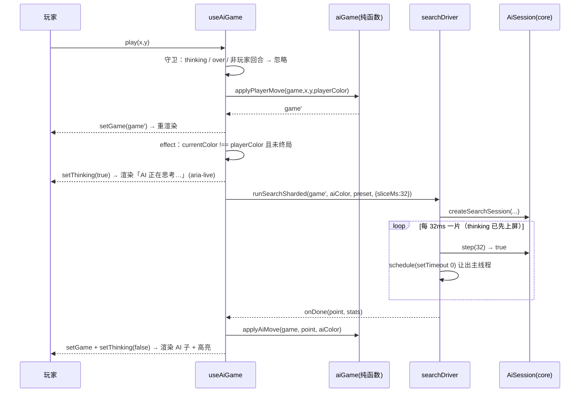

# 人机对战 · 系统设计（M5 · AI Opponent）

> 输入：`docs/m5-ai/prd.md`（许清楚）+ `AGENTS.md` 铁律 + 主理人决策 D1–D5。
> 本文只定「怎么做」，不给完整实现；API 签名 / 评分表 / 参数表为**强制契约**，工程师逐字照写。

## 1. 算法选型与理由

### 1.1 候选对比

| 候选 | 强不强 | 1s 内可行性 | 结论 |
|---|---|---|---|
| A. 纯 Minimax + 棋型评估（无剪枝/无置换表） | 中：无算杀，深 4 层就爆 | 15×15 分支 ~50，4 层 = 6M 节点 ≫ 1s | ❌ 否决 |
| B. Negamax + α-β + 置换表 + 迭代加深 + VCF 算杀 + 增量评估 | 强：能算三步连杀、能识别双威胁 | 有效分支 ~4，150k 节点覆盖 8–9 层 | ✅ 采用 |
| C. MCTS / 神经网络 | 强但需训练权重 | 体积 + 依赖双超标（S3/P0-11） | ❌ 否决 |

**为什么 B 能同时满足「强」与「1s」**：强度不来自「更深」，而来自三层确定性知识——
① **硬规则短路**（成五/堵五/唯一应手）永不依赖搜索深度，保证「不送棋」底线；
② **VCF 算杀**（连续冲四逼应）用 8–12 层深度换 250ms，专治「三步内连杀必中」；
③ **棋型评估 + 组合威胁加分**让 α-β 的走法排序接近最优，有效分支从 ~40 压到 ~4，
节点数指数下降，才使得 150k 节点能覆盖 8–9 层。

### 1.2 棋型识别方案

对「落子点 + 4 方向」各取长度 9 的窗口（中心为落子点，越界与对方子统一记为 `2`），转成字符串后用**优先级表**首命中即返回（`pattern.ts` 内 `PATTERNS` 常量表，逐行表驱动测试）：

| 类别 | 窗口模式示例（`1`=己方 `0`=空 `2`=阻挡） | 分值 |
|---|---|---|
| FIVE 五连（含长连） | `11111` | 10_000_000 |
| OPEN_FOUR 活四 | `011110` | 1_000_000 |
| FOUR 冲四 | `011112` `211110` `11011` `10111` `11101` | 100_000 |
| OPEN_THREE 活三 | `011100` `001110` `010110` `011010` | 20_000 |
| SLEEP_THREE 眠三 | `001112` `211100` `010112` `211010` `10011` `10101` | 5_000 |
| OPEN_TWO 活二 | `001100` `010100` `001010` `010010` | 800 |
| SLEEP_TWO 眠二 | `000112` `211000` `001012` `10001` | 120 |
| OPEN_ONE 活一 | `00100` `01000` `00010` | 20 |

**组合威胁（同一点跨 4 方向计数后覆盖单点分值）**——这是「会算杀、不送棋」的核心：

| 组合 | 条件 | 覆盖分值 |
|---|---|---|
| 双四（含活四参与） | `fourCount ≥ 2` | 800_000 |
| 四三 | `fourCount ≥ 1 && openThreeCount ≥ 1` | 400_000 |
| 双活三 | `openThreeCount ≥ 2` | 300_000 |

评分单调性（必须成立）：`FIVE > OPEN_FOUR > 双四 > 四三 > 双活三 > FOUR > OPEN_THREE`。

### 1.3 局面评估

`evalFor(board, me) = ownScore − oppScore × 1.1`（防守权重 1.1，略偏堵），
`ownScore/oppScore` = 全盘棋型分之和 + 组合威胁覆盖值。终局 `±10_000_000`（`MATE`）。
**增量评估**：只重算「落子点 4 方向所经线段」，禁止每节点全盘重扫。

## 2. 模块拆分（文件级）

### 2.1 core（零 IO / 零新依赖）

| 文件 | 一句话职责 |
|---|---|
| `packages/core/src/ai/types.ts` | `Difficulty` / `AiOptions` / `AiSession` / `AiSearchStats` / `AiBoard` 等纯类型 |
| `packages/core/src/ai/zobrist.ts` | 固定种子 xorshift32 生成 225×2×2 张量，产出确定性 `keyLo/keyHi` |
| `packages/core/src/ai/pattern.ts` | 9 窗口扫描 + `PATTERNS` 优先级表 + 单点/单方向棋型计数 |
| `packages/core/src/ai/evaluate.ts` | 增量局面打分与组合威胁覆盖 |
| `packages/core/src/ai/movegen.ts` | 候选点（邻域半径 2）+ 排序打分 + 分支裁剪 + 强制应手短路 |
| `packages/core/src/ai/tt.ts` | 置换表（1<<17 项 typed array，键 64 位，含 `clear()`） |
| `packages/core/src/ai/search.ts` | Negamax + α-β + TT + 迭代加深 + VCF，产出 `AiSession` |
| `packages/core/src/ai/opening.ts` | 开局策略（空盘天元 H8；玩家首手 H8 时中心 3×3 固定应答） |
| `packages/core/src/ai/config.ts` | 三档只读参数表 `DIFFICULTY_PRESETS`（唯一参数来源） |
| `packages/core/src/ai/index.ts` | 对外门面：`findBestMove` / `createSearchSession` / `openingMove` / `evaluateBoard` |
| `packages/core/src/index.ts` | 【改】追加 `export * from './ai'`（tsup 只打此入口） |

测试：`packages/core/test/ai/{config,pattern,evaluate,movegen,tt,search,session,opening,api}.test.ts` + `bench-tactics.test.ts`（PRD S1 的 20 题基准集）。

### 2.2 web

| 文件 | 一句话职责 |
|---|---|
| `packages/web/src/ai/aiGame.ts` | **纯函数**棋局操作：建局/玩家落子/AI 落子/退两步/可悔判定（无 React，可直接单测） |
| `packages/web/src/ai/searchDriver.ts` | 分片调度器：`step(32ms)` 循环 + 可注入 `schedule`/`now`，返回取消函数 |
| `packages/web/src/ai/aiStorage.ts` | localStorage 读写难度/执子（默认 `hard` + `BLACK`，异常降级不抛） |
| `packages/web/src/ai/useAiGame.ts` | React 编排：`aiGame` 状态 + thinking + 驱动 AI 回合 + 悔棋/重开/持久化 |
| `packages/web/src/components/AiPanel/AiPanel.tsx(.module.css)` | 人机设置卡（难度下拉 / 执黑执白 / 悔棋 / 重开 / thinking 文案 `aria-live`） |
| `packages/web/src/components/ModeSwitch/ModeSwitch.tsx(.module.css)` | Header 分段控件「联机对战 ↔ 人机对战」 |
| `packages/web/src/components/Board/Board.tsx` | 【改】新增**可选** props：`thinking?` `aiColor?`（缺省时行为与联机完全一致） |
| `packages/web/src/App.tsx` / `App.module.css` / `types.ts` | 【改】`mode` 视图态 + 双棋局共存 + 视图派生 |

测试：`packages/web/test/{ai-game,ai-driver,ai-storage,ai-wiring}.test.ts`
（`ai-wiring.test.ts` 沿用 `app-wiring.test.ts` 的源码结构断言风格，因为仓库无 testing-library）。

## 3. 对外 API 精确签名

```ts
// packages/core/src/ai/types.ts
export type Difficulty = 'easy' | 'normal' | 'hard';

export interface AiOptions {
  /** 档位，默认 'hard'；仅决定下面三个字段的默认值 */
  difficulty?: Difficulty;
  /** 思考预算（毫秒）。仅在传入 now 时生效 */
  timeBudgetMs?: number;
  /** 搜索深度上限（层） */
  maxDepth?: number;
  /** 节点预算。未传 now 时用此值兜底，保证无时间源也能终止 */
  maxNodes?: number;
  /** 时间源注入。core 禁止直读 Date/performance；不传 = 纯节点预算模式 */
  now?: () => number;
}

export type CutoffReason = 'time' | 'nodes' | 'depth' | 'aborted' | 'none';

export interface AiSearchStats {
  depth: number;          // 已完成的迭代加深层数
  nodes: number;          // 访问节点数
  elapsedMs: number;      // 由注入的 now 计算；无 now 时为 0
  cutoff: CutoffReason;
  bestScore: number;      // 根节点分数（negamax 视角）
  fromOpening: boolean;   // 是否命中开局策略
}

export interface AiSession {
  readonly difficulty: Difficulty;
  /** 推进一片工作；返回 true 表示还有剩余工作需继续调用 */
  step(budgetMs?: number): boolean;
  /** 当前最优解（未完成任何一层时返回 null） */
  result(): Point | null;
  stats(): AiSearchStats;
  /** 放弃搜索，此后 result() 返回已完成层的最优解 */
  abort(): void;
}
```

```ts
// packages/core/src/ai/index.ts —— 唯一对外门面
export function findBestMove(g: GameState, color: PlayerColor, opts?: AiOptions): Point | null;

export function createSearchSession(g: GameState, color: PlayerColor, opts?: AiOptions): AiSession;

/** 开局策略：空盘执黑 → (7,7)；对手首手在中心 3×3 → 中心 3×3 内固定点；其余返回 null */
export function openingMove(g: GameState, color: PlayerColor): Point | null;

/** 局面分（供 P2 评估条 / 提示复用）；me 视角，正数=me 优 */
export function evaluateBoard(g: GameState, me: PlayerColor): number;

export const DIFFICULTY_PRESETS: Readonly<Record<Difficulty, Readonly<Required<Omit<AiOptions, 'difficulty' | 'now'>>>>>;
```

**语义契约（必须由测试锁定）**
1. `findBestMove` = `createSearchSession` 后 `while (s.step()) {}` 再 `s.result()`；`opts.now` 缺省 → **不看时间**，只按 `maxNodes`/`maxDepth` 收敛 ⇒ 单测毫秒级且确定性。
2. `opts.now` 提供 → 总耗时不超过 `timeBudgetMs × 1.05`；超出即 `cutoff='time'` 返回当前最优。
3. 任何非法输入（`over === true`、坐标已被占、`g.size !== 15`）→ 返回 `null`，**不抛异常**。
4. 同输入必同输出：无 `Math.random`、无 `Date`、排序 tie-break 固定按 `idx` 升序、每次 `createSearchSession` 清空 TT。

### 3.1 web 侧驱动（分片）

```ts
// packages/web/src/ai/searchDriver.ts
export interface DriverOptions {
  sliceMs?: number;                                  // 默认 32
  now?: () => number;                                // 默认 () => performance.now()
  schedule?: (cb: () => void) => void;               // 默认 (cb) => setTimeout(cb, 0)
}
/** 启动分片搜索；返回取消函数（组件卸载 / 切模式时调用） */
export function runSearchSharded(
  g: GameState,
  color: PlayerColor,
  aiOpts: AiOptions,
  driver: DriverOptions,
  onDone: (move: Point | null, stats: AiSearchStats) => void,
): () => void;
```

驱动循环（web 层，`useAiGame` 调用）：`setThinking(true)` → React 提交渲染 → `schedule()` 让出 → `while (session.step(32)) schedule()` → `onDone` → `setThinking(false)` + 落子。**thinking 必定先于搜索上屏**，因为第一片搜索排在 `setThinking` 那次渲染提交之后。

## 4. 关键数据结构

| 结构 | 定义 | 说明 |
|---|---|---|
| 内部棋盘 | `Int8Array(225)`，索引 `idx = y * 15 + x`，值 `0/1/2` | 与 `GameState.board` 的转换**只在** `fromGameState(g)` 一处；AI 每次行动前从 `aiGame` 重建，不做增量同步（防双份真值漂移）。strict + `noUncheckedIndexedAccess` 下只允许经 `cellAt(b,x,y): Color`（越界返 `EMPTY`）/ `idxOf(x,y)` 触碰 typed array |
| Zobrist | `xorshift32`，种子 `lo=0x1F123BB5` / `hi=0x9E3779B9`，225×2 张量 | 固定种子 ⇒ 确定性；禁 `Math.random` |
| 置换表 | 1<<17 项：`keysLo/keyHi(Int32Array)`、`scores(Int32Array)`、`depths(Int8Array)`、`flags/moves(Int16Array)` | 64 位键，碰撞率 ~2⁻⁶⁴；`createSearchSession` 时 `clear()`；命中后 bestMove **必须复核为空点**才使用 |
| 走法生成 | 邻域：距任一已有子 Chebyshev ≤ 2 的空点；排序 `orderScore = attack(me)×1.0 + defense(opp)×0.9`；分支上限 root 14 / depth≤3 → 10 / 更深 → 6；**强制短路**：己方有成五点→只返该点，对方有成五点→候选收缩为堵点（≤2），与深度无关，保「不送棋」底线 | 空盘直接走开局策略 |

## 5. 时序图（玩家落子 → AI 落子 → 渲染）



## 6. 两套棋局状态共存（App.tsx 改造方案）

- **归属**：联机 `game` / `myColor` 仍由 `App` 的 `useState` 持有，**一行不改**；人机状态全部封装在 `useAiGame` 内部（`aiGame` / `playerColor` / `difficulty` / `thinking` / `aiLastMove`）。
- **切换**：新增 `mode: 'online' | 'ai'` 纯视图态（`useState`），`setMode` 不触碰 `conn`、不发消息、不清盘 ⇒ P0-1「零变更、零重连」天然成立。
- **视图派生**（单一出口，避免分支散落）：
  ```ts
  const view = mode === 'ai'
    ? { game: ai.game, myColor: ai.playerColor, connected: true, isMyTurn: !ai.thinking && currentColor(ai.game) === ai.playerColor }
    : { game, myColor, connected: boardConnected, isMyTurn: currentColor(game) === myColor };
  ```
  `<Board>` / `<GameStatus>` 只吃 `view.*`；`handleLocalMove` 按 `mode` 分流到 `ai.play` 或原联机路径。
- **隔离红线**：`onMovesReplaced` / `handleGameMessage('move'|'undo-*'|'restart-*')` / `resetRoomSession` **只允许** `setGame`，禁止 import 或引用 `useAiGame` 的任何 setter。`ai-wiring.test.ts` 用源码断言钉死：`useConnection({...})` 的参数块内不出现 `ai`。
- **AI 回合触发**：`useAiGame` 内 `useEffect` 依赖 `[ai.game.moves.length, mode, playerColor, difficulty]`，条件 `mode==='ai' && !over && currentColor(ai.game) !== playerColor`；卸载/切模式时调用 `runSearchSharded` 返回的取消函数（P0-4「思考期点击 0 变更」由此保证）。

## 7. 性能预算分解（最强档 1000ms）

| 项 | 数值 | 依据 |
|---|---|---|
| 每节点开销 | ≈ 5µs | 候选生成+排序 3.0µs（≤40 候选 × 4 方向窗口）、make/unmake+增量评估 0.8µs、TT 0.3µs、递归 0.9µs |
| 预算切分 | VCF 250ms（≈40k 节点）+ 主搜索 750ms（≈150k 节点） | 算杀先行，命中即返回 |
| 覆盖深度 | 有效分支 ≈4 ⇒ 150k 节点 ≈ 8–9 层 | 迭代加深 2→4→6→8… |
| 分片粒度 | `sliceMs = 32`，≈6.4k 节点/片，≈31 片/秒 | 单片 < 50ms（longtask 阈值）；**停止准则**：每完成一层，若 `elapsed > budget × 0.5` 则不再开新层（防「开了深一层却算不完」抖动） |
| 墙钟 | 1000 + 31×4ms(setTimeout 嵌套 clamp) ≈ **1.13s** | ≤ P95 1s 目标外 130ms 余量，仍 < 1.5s 最坏 |

## 8. 共享知识（跨文件约定，工程师必须遵守）

1. **时间/随机**：core 内禁止出现 `Date` / `performance` / `window` / `Math.random`；时间只经 `AiOptions.now`，随机只来自 `zobrist.ts` 的固定种子。默认 `now = () => performance.now()` **只允许**写在 `packages/web/src/ai/searchDriver.ts`。
2. **常量位置**：所有棋力参数（预算/深度/分支/权重/评分）只在 `ai/config.ts` 与 `ai/pattern.ts` 的 `PATTERNS` 表；UI 与调用点禁止出现魔数，UI 只传 `Difficulty`。
3. **命名与注释**：类型 `PascalCase`；函数动词开头（`findBestMove`/`fromGameState`）；布尔 `is/has/can` 前缀；棋型枚举 `UPPER_SNAKE`；注释一律中文并解释「为什么」，每个导出符号一句 JSDoc。
4. **错误处理**：core 用返回值表达失败（`null` / `CutoffReason`），不抛异常；localStorage 读写包 try/catch 并降级到默认值。
5. **测试**：每个导出 ≥1 用例（AGENTS §1 铁律 5）；文件名与源文件对称；断言行为不断言私有实现；基准集局面用显式落子序列（禁随机）。
6. **strict 约束**：`noUncheckedIndexedAccess` 下数组下标访问必须经 `cellAt`/`idxOf` 或显式 `?? 默认值`，禁止裸 `cells[i]` 参与算术。
7. **体积**：AI 代码手写零依赖；`core` 新增源码 ≤ 1200 行（对应 ≤30KB min）。

## 9. 风险与对策

| # | 风险 | 对策 |
|---|---|---|
| R1 | **TT 哈希碰撞**导致误剪枝、走出非法/劣着 | 64 位键（lo+hi 同时比对）；命中后 `bestMove` 必须复核「为空点且在当前候选集」；`createSearchSession` 清表；TT 只做剪枝不做唯一真值（exact 才直接返回分数） |
| R2 | **分片导致搜索不收敛/落子抖动**（每片看到不同最优解） | 只提交「已完成层」的 `bestRoot`；未完成层整层丢弃；`abort` 后仍返回已完成层解；固定排序 + `idx` 升序 tie-break ⇒ 同局面同预算必同解（`session.test.ts` 连跑 5 次断言相同） |
| R3 | **`noUncheckedIndexedAccess` 使 `Int8Array[i]` 变 `number \| undefined`**，算术处类型爆炸或被 `as` 滥用 | 唯一封装 `cellAt`/`idxOf`（内部一次 `?? EMPTY` + 一次收窄），其余模块禁止直接索引；`tsc --noEmit` 纳入 CI |
| R4 | **setTimeout 嵌套 clamp 4ms** 使墙钟超 1.5s | 32ms 分片（31 次让出 ≈ +124ms）；实测超限时降 `sliceMs` 到 24 或把 `timeBudgetMs` 降至 800；`stats().elapsedMs` 与墙钟双测 |
| R5 | **棋力不达标**（基准集 20/20 拿不到） | 20 题基准集在 T03 **最先**写成红测；VCF 保底 4 道算杀题；评估权重集中在 `config.ts` 可调参 |
| R6 | **双份棋盘真值漂移**（`GameState.board` 与 `Int8Array` 不一致） | 每次 `createSearchSession`/`findBestMove` 都 `fromGameState(g)` 全量重建；搜索内部用 make/unmake 配对，`try/finally` 保证回滚 |

## 10. Anything UNCLEAR（假设已按此执行，如不认同请回退）

1. **悔棋后 AI 会重下同一手**：因为「同局面必同输出」。PRD 未要求 AI 记忆被撤销局面，本设计**不引入**历史规避（保持纯函数与可测性）。若体验不接受，后续在 `useAiGame` 层加「本局已下过的点轻微降权」（不动 core）。
2. **简单档也要堵成五**：PRD S1 只要求简单档 ≥10/20，但 P0-7「对方一步成五必堵」是 Must。故硬规则短路对**所有档位**生效，难度只影响预算/深度/分支。
3. **难度切换时机**：US-2 说「下一局生效」，P1-1 又说「同一局面三档可不同落点」。取前者：`setDifficulty` 只写 `pendingDifficulty`，`restart()` 时生效。
4. **e2e 新增用例**：`test/e2e.js` 是独立 playwright 脚本，人机用例列为 T05 的 P1 项；不足时用 `ai-wiring.test.ts` + `window.__gomoku.ai` 诊断钩子替代。
