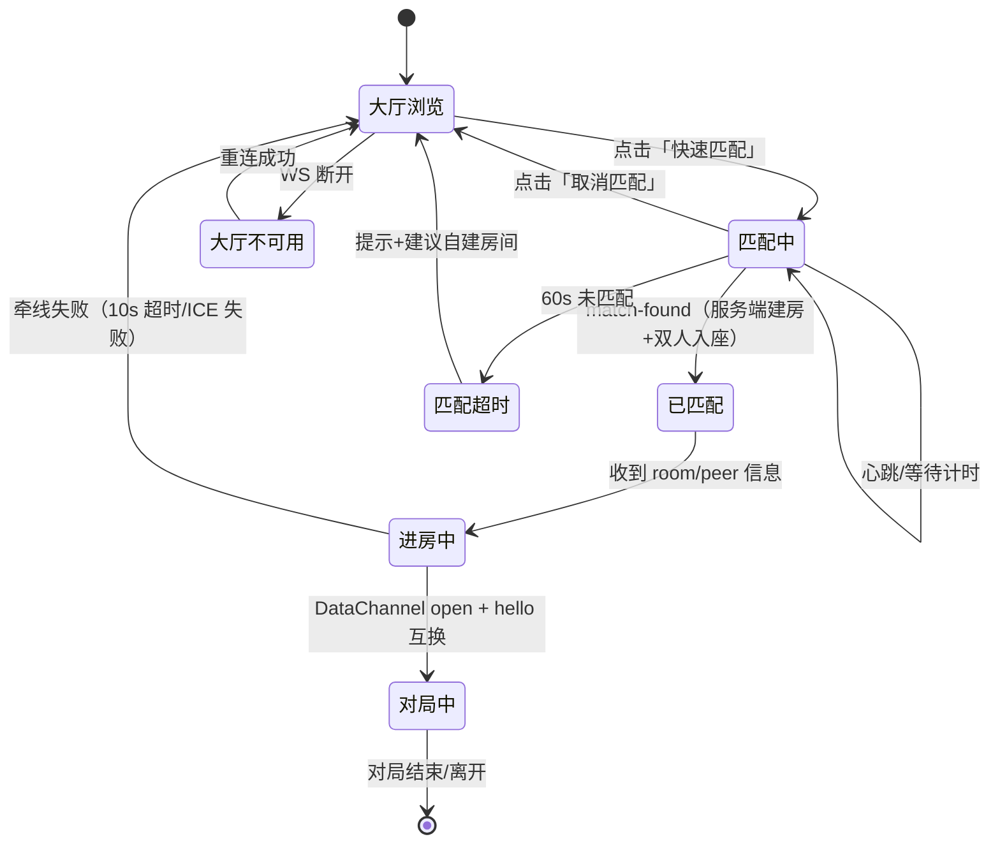
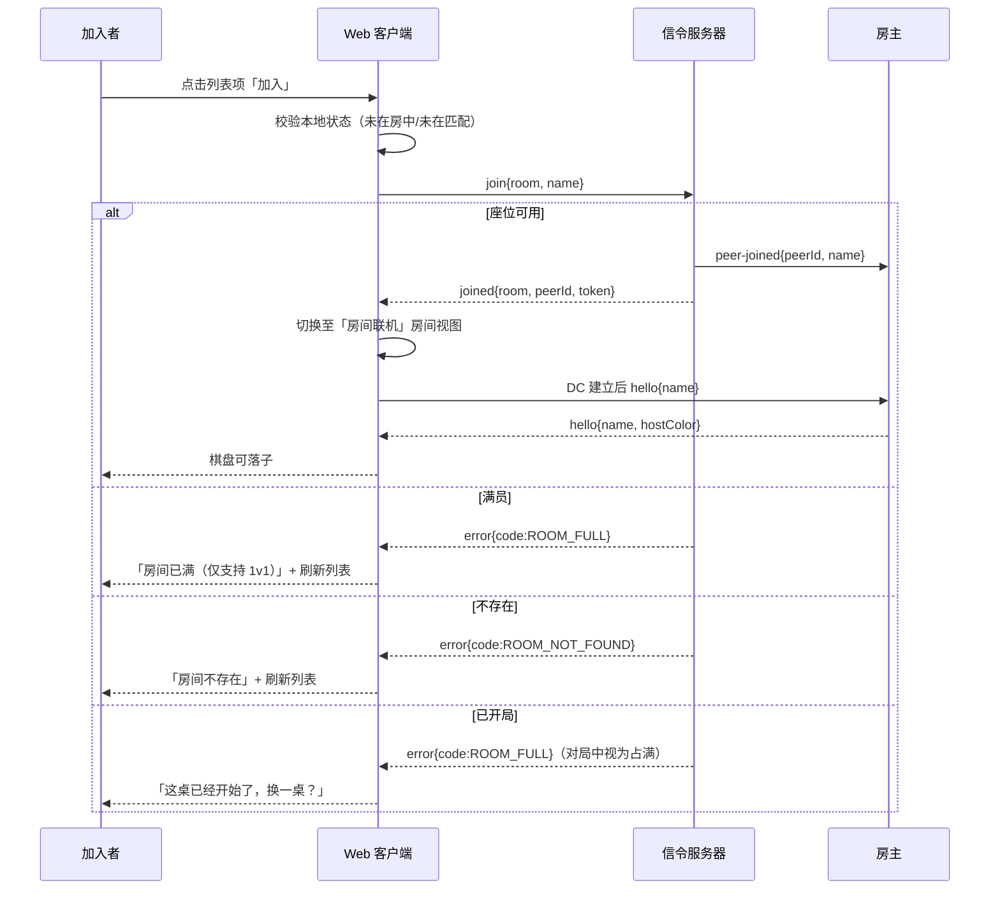
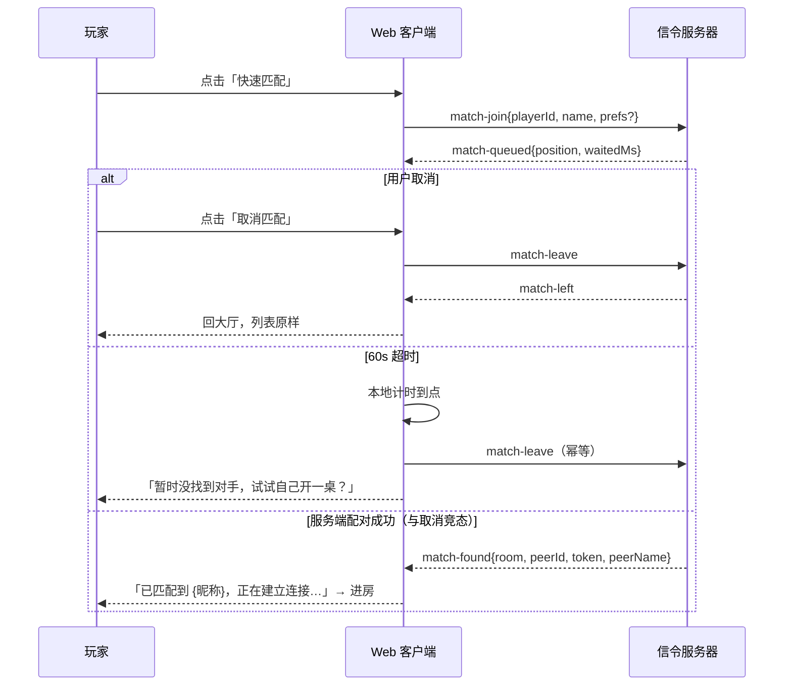

# 服务大厅 PRD（M6 ·「在线棋友 + 邀请组房 + 房间广场 + 快速匹配」）

## 0. 文档头

| 项 | 内容 |
|---|---|
| 文档 | 服务大厅（在线棋友、邀请组房、房间广场与快速匹配）产品需求文档 |
| 版本 | v1.3 |
| 日期 | 2026-10-20 |
| 状态 | Node / Rust MVP 已实现；Rust 合并发布已修复；HTTP 分页、增量通知、多节点统一大厅未实现，线上容量待验证 |
| 作者 | 许清楚（PM） |
| 关联里程碑 | M6（前置：M3 Rust 信令、断线重连 v1.1） |
| 代码基线 | `packages/shared/src/types.ts`（信令协议 v1.1）、`apps/signaling-rust/config.example.toml`、`packages/web/src/App.tsx` |
| 相关文档 | [Rust 信令需求](../m3-rust-signaling/prd.md)、[断线重连需求](../reconnect/prd.md)、[Web 前端说明](../../packages/web/README.md) |
| 写作边界 | 本文只定义「做什么、怎么验收」；协议实现、数据结构、Rust/TS 类型由架构师产出 |

**原始需求复述**：现有联机依赖「自己建房 + 把 4 位房号或连接码发给对方」，用户必须先在站外找到人才能开局。本期在**已部署信令服务器**的前提下，新增独立「大厅」页面：展示在线人数与可加入房间、支持一键快速匹配、支持从列表直接加入他人房间，并用临时昵称标识身份。**不引入账号体系，不引入社交关系，不把对局数据搬上服务器，不破坏单文件零服务器模式。**

**在线棋友与定向邀请**：属于首期 P0，详见 §11；其流程复用既有双人房间，仍不建立好友关系。页面布局见 §3.1，范围差异以 §11 为准。

**实现边界**：Rust 使用“定向即时通知 + 名册变化合并发布”，无变化时不推送。列表目前仍经 WebSocket 查询，HTTP 分页与增量通知属于后续工作。§7 与 §8 区分现有实现和后续目标；DoD 中未验证的指标不能据首版交付标为完成。运行与测试见[大厅说明](README.md)，后续范围见[路线图](../../ROADMAP.md#m6--服务大厅后续迭代)。

---

## 1. 产品目标与非目标

### 1.1 一句话定位

让「现在就想下一盘」的人，在**不离开页面、不借助微信**的情况下，2 次点击内被送到一张真实的棋盘前。

### 1.2 可量化目标（3 条，均可埋点验收）

| # | 目标 | 目标值 | 验收方式（埋点 / 测试） |
|---|---|---|---|
| G1 | **撮合路径足够短** | 从打开页面到「进入可落子对局」的**中位点击数 ≤ 3**（大厅默认路径：设置昵称 1 次 + 快速匹配 1 次 = 2 次点击）；从点击「快速匹配」到收到匹配结果的**中位耗时 ≤ 15s**（在线 ≥ 10 人时） | 埋点 `lobby_view`→`match_start`→`match_success`→`game_ready` 全链路 sessionId 串联，统计点击数中位数与耗时分位数 |
| G2 | **撮合真的能开局** | 大厅→开局成功率 ≥ **85%**（口径：`match_success` 后 10s 内 DataChannel `open` 且首手可落子）；匹配失败率（含超时、对端放弃）≤ **10%** | 埋点 `match_success` / `game_ready` / `match_timeout` / `match_failed` 计数比值，按日聚合 |
| G3 | **主流程零回归** | 单文件产物 `dist/gomoku-standalone.html` **体积增量 = 0 字节**（大厅代码不得进入 standalone 构建）；「房间联机 / 手动信令」两条老路径的**开局成功率不下降**（与 M5 基线持平，波动 ≤ 1 个百分点） | 构建前后产物大小对比；老路径回归用例 + 埋点 `room_create`/`manual_flow_done` 对比基线 |

### 1.3 非目标（本期明确不做，写清以免扩范围）

1. **不做账号体系**：无注册、无登录、无微信授权、无手机号；身份为本地生成、可随时丢弃的临时昵称。
2. **不做社交关系**：无好友、无关注、无私聊/留言、无「最近对手」「再来一局」入口。
3. **不做竞技化**：无 ELO/段位、无排位、无战绩统计、无排行榜、无赛季。
4. **不做观战与多人心智**：**每房仍然只有 2 个座位**；不做旁观者、不做 3 人以上房间。
5. **不做房间规则配置**：不做禁手、计时、棋盘尺寸等规则选项（见 §11 Q3）。
6. **不做服务端持久化对局**：落子/聊天/悔棋/换边**只走 DataChannel**，服务器不存、不读、不转发棋谱。
7. **不改零服务器第一原则**：单文件 HTML 互发连接码的能力必须永远可用，且不因本期增加体积或增加依赖。
8. **不做大厅内的社交内容**：无公告板、无弹幕、无表情包、无头像上传。

---

## 2. 用户角色与核心场景

### 2.1 角色

| 角色 | 定义 | 本期关键诉求 |
|---|---|---|
| 访客（默认） | 首次或偶尔打开页面的人，无账号，昵称随机生成 | 不填任何表单就能开局 |
| 房主 | 主动「创建房间」并等待对手的人 | 知道自己被看见、知道谁进来了 |
| 加入者 | 从列表挑一个房间并进入的人 | 一眼看出哪桌能进、进去不报错 |
| 匹配者 | 点「快速匹配」把选择权交给系统的人 | 等待有反馈、随时能退出、别卡死 |

### 2.2 用户故事

| # | 角色 | 故事 | 验收要点 |
|---|---|---|---|
| US-1 | 只想随便下一盘的访客 | 作为刚打开页面的路人，我想直接点「快速匹配」就被送到一张棋盘前，不用先加好友、不用复制房间号，以便在 10 秒内开始下棋 | 首次进入：昵称已自动生成（无需输入）；点 1 次「快速匹配」→ 匹配中浮层 → 成功即进房并自动开始牵线；全程零复制粘贴 |
| US-2 | 想自己挑对手的人 | 作为有点挑对手的人，我想在大厅看到「谁在等、等了多久、是不是已经在下」，从而主动挑一桌加入，以便避开对局中的房间、少走空门 | 列表项同时展示房号、房主昵称、`等待中/对局中/满员`、已等待时长；「对局中/满员」项按钮为禁用态且点击无副作用；点「加入」后 ≤ 1s 进入房间并看到对手昵称 |
| US-3 | 房主 | 作为已经开好房的人，我想在大厅里被其他玩家看到并等到人进来，进来时我能立刻看到对方昵称，以便确认「来的是真人，不是自己点错」 | 建房成功后大厅立即出现该房间（≤ 2s）；有人加入时房主侧出现「{昵称} 已加入房间」提示；房间状态由「等待中」变为「满员/对局中」 |
| US-4 | 匹配中后悔的人 | 作为点了匹配又不想等的人，我想随时取消并回到大厅原样，以便不被卡在「匹配中」 | 点「取消匹配」≤ 1s 回到大厅列表；不产生房间、不留下服务端队列残留；取消后立刻再点匹配可正常工作 |
| US-5 | 断网/切后台回来的人 | 作为地铁里断了一下网的人，我想刷新后还能回到原来那局（若宽限期内），否则安静地回到大厅，以便不看到一堆报错 | 60s 内重连：回到原房间原座位（复用 resume）；超过宽限期：回大厅并提示「上一局已结束」；两种路径都不得弹全屏错误 |

---

## 3. 信息架构与入口

### 3.1 落点：独立大厅页面（用户最终确认）

大厅位于 `/lobby`，不展示棋盘。在线构建首次访问默认进入大厅；带房号的邀请链接和当前窗口保存的对局可以直接回到棋盘。

- 桌面端：左侧身份、邀请与匹配操作，右侧在线棋友 / 房间广场。
- 手机端：相同信息自动排列成单列，320px 起不出现横向滚动。
- 接受邀请、匹配成功或加入房间后进入棋盘页 `/`，复用既有双人对局。
- 棋盘的「服务大厅」入口返回独立大厅；大厅右上角可以返回棋盘。
- 单文件构建剔除整个大厅模块，保持原有房间 / 手动信令与人机入口。

### 3.2 与两个既有 tab 的关系

| 维度 | 大厅 | 房间联机 | 手动信令 |
|---|---|---|---|
| 是否需要服务器 | **需要**（信令 WS） | 需要 | **不需要** |
| 是否可被大厅替代 | — | 部分（大厅可建房，但仍保留手输房号能力） | 不可（离线兜底） |
| 数据通道 | 仅元数据走 WS，对局走 DC | 同左 | 纯 DC |
| 本期改动 | 新增 | **只加「在大厅展示」开关，不改交互** | **零改动** |

- 大厅内「创建房间」**复用**现有 `create` 流程与房号展示组件，不新写一套建房逻辑。
- 从大厅进入房间后，UI 回到「房间联机」tab 的房间视图（房号、邀请链接、二维码、换边等能力**原样可用**），保证用户随时能退回旧路径。

### 3.3 降级矩阵（必须逐条实现）

| 场景 | 大厅页面表现 | 其他功能 |
|---|---|---|
| 正常（服务器可达 + 支持大厅） | 完整功能 | 正常 |
| 服务器可达但**不支持大厅**（旧服务端，`/config` 无大厅能力标记） | 显示占位：「大厅需要更新后的信令服务器」，隐藏列表与匹配按钮 | 房间联机/手动信令正常 |
| 服务器**不可达**（DNS/超时/WS 握手失败） | 显示错误态 + 「重试」+「用房间号联机」 | 房间联机显示原有连接错误；手动信令**始终可用** |
| 单文件零服务器构建（`dist/gomoku-standalone.html`） | **不渲染大厅 tab**（构建期剔除，非运行期隐藏），产物体积增量 0 | 手动信令完整可用 |
| 新客户端 → 旧服务端（用户直接发 `lobby` 类消息） | 收到 `error{code:'UNKNOWN_TYPE'}` → 静默降级为占位，不弹错、不重试风暴 | 正常 |
| 旧客户端 → 新服务端 | 旧客户端不发大厅消息，服务端**不得**因未知/缺失字段断开连接 | 旧客户端一切行为不变 |
| 大厅 WS 断开但已在房间内 | 不打断对局；顶部只提示「大厅连接已断开」 | 对局继续（DC 独立） |

**铁律**：大厅任何异常（超时、限流、服务端 5xx、字段解析失败）只能影响大厅区块本身，**不得**导致页面白屏、不得关闭已有 DataChannel、不得阻塞落子。

---

## 4. 功能需求池（P0 / P1 / P2）

### 4.1 P0（Must have，缺一不可上线）

| ID | 需求 | 验收标准（可测） |
|---|---|---|
| **L-01** | **大厅入口与三 tab 结构**：联机视图内提供 `大厅/房间联机/手动信令` 三个 tab，可键盘 Tab 聚焦、方向键切换 | 三个 tab 均可达；切 tab 不触发 WS 重连、不清棋盘；`aria-selected` 正确；刷新后回到上次 tab |
| **L-02** | **在线名册**：展示当前在线人数与「等待中桌数」 | 数字与同刻服务端快照一致（允许 ≤ 2s 偏差）；人数变化 ≤ 2s 内反映到 UI；离线后 60s 内从名册移除 |
| **L-03** | **房间列表**：每项展示房号、房主昵称、状态（`等待中/对局中/满员`）、已等待时长、可加入性 | 字段齐全；状态与真实座位一致；「等待中」项「加入」可点，「对局中/满员」项按钮禁用且 `aria-disabled=true`；点击禁用项 0 副作用 |
| **L-04** | **排序与刷新策略**：默认「等待中优先，其次按等待时长从长到短」；推送为主、5s 轮询兜底、支持手动刷新；单页 20 条、上限 100 条（加载更多） | 排序稳定（同输入同顺序）；服务端推送后 ≤ 1s 更新；断推 5s 内轮询自愈；手动刷新 ≤ 500ms 有 loading 反馈；超过 100 条时提示「仅展示前 100 桌」 |
| **L-05** | **空态**：无等待中房间时给可行动引导，而不是空白 | 显示空态插图 + 逐字文案（§6.3）+「创建房间」按钮；点击可直接建房并出现在列表 |
| **L-06** | **快速匹配**：点击进入「匹配中」，成功后自动进房并开始 WebRTC 牵线，无需再点任何按钮 | 点击后 ≤ 200ms 出现匹配浮层；匹配成功 → 自动进房 → 自动开始牵线 → 首手可落子；全程无二次确认弹窗 |
| **L-07** | **取消匹配**：匹配中可随时取消，回到大厅且无残留 | 取消后 ≤ 1s 回到列表；服务端队列中该 playerId 已移除（重连后不会「幽灵匹配」）；取消后再点匹配正常 |
| **L-08** | **匹配超时兜底**：等待超过阈值自动结束并给替代方案 | 默认 60s（可配）；到点后退出队列、浮层关闭、提示文案（§6.5）+ 建议「自己开一桌」；不自动重试、不静默续等 |
| **L-09** | **匹配防重复与状态一致性**：连点、切 tab、切到人机、刷新页面均不得产生两个匹配请求或两个房间 | 连点 10 次「快速匹配」→ 服务端仅收到 1 个入队；匹配中切到「人机对战」再切回 → 状态保持「匹配中」；刷新页面 → 若原匹配仍在队列内则恢复匹配中，否则回大厅 |
| **L-10** | **邀请入座（从列表加入）**：点击列表项「加入」直接进入该房间 | 成功：≤ 1s 进房并看到对手昵称；失败按 L-11 提示；加入成功后该房间对其他人立即变为不可加入（≤ 2s） |
| **L-11** | **加入失败的错误提示（逐字文案 + 错误码）**：满员、不存在、已开局、网络失败、被限流 | `ROOM_FULL`→「房间已满（仅支持 1v1）」；`ROOM_NOT_FOUND`→「房间不存在」；已开局→「这桌已经开始了，换一桌？」；网络→「网络不给力，请重试」；限流→「操作太快了，休息一下」；提示后列表自动刷新一次 |
| **L-12** | **昵称设置与校验**：临时昵称，支持修改与持久化；长度 2–12 字符，允许中英文/数字/下划线，禁止空白开头结尾、连续空格、控制字符与 HTML 标签 | 非法输入即时行内报错且不可提交；合法昵称刷新后保持；同名时服务端自动追加后缀（`小明`→`小明2`）而非拒绝；首访自动生成（如「棋友4821」） |
| **L-13** | **playerId 生成与多标签页**：本地生成持久 playerId；同 playerId 多标签页不得互踢对局 | playerId 存 localStorage，关页重开不变；同浏览器开 2 个 tab 各自可独立对局；第三个 tab 打开时给出「同一浏览器最多 2 桌」提示（服务端 per-IP 连接上限为 10，客户端需更严格） |
| **L-14** | **在线状态与离线判定**：心跳维持在线；超过阈值判离线并从名册/列表中移除 | 心跳间隔 30s（对齐服务端 `ws_ping_interval_secs=30`）；服务端 60s 无心跳判离线（对齐 `ws_idle_timeout_secs=60`）；房主掉线后其房间 60s 内标记「等待中（房主离线）」并禁止加入，宽限期结束即移除 |
| **L-15** | **断线重连归属**：重连成功且 60s 宽限内 → 回原房间原座位；否则 → 回大厅并提示 | 60s 内：`resumed` 成功、座位与棋局恢复、不重复建房；超时：回大厅，提示「上一局已结束」，不残留匹配中状态 |
| **L-16** | **隐私：大厅绝不泄露网络信息** | 大厅响应与推送中**不得**出现 IP、SDP、ICE candidate、peerId 之外的连接标识；抓包校验：大厅消息体内无 `a=candidate`、无 `sdp`、无 IPv4/IPv6 字面量；SDP/ICE 仅在已配对的两端之间经 `signal` 转发 |
| **L-17** | **XSS 与内容安全**：昵称、房间标签等一切用户输入在渲染前转义；禁止 `innerHTML` 直插用户数据 | 昵称输入 `` → 列表与对局内均按纯文本显示，无脚本执行；昵称长度超限被截断而非溢出布局 |
| **L-18** | **频率限制（防刷）**：客户端节流 + 服务端限流双保险 | 客户端：手动刷新 ≥ 2s 一次、加入按钮点击后 1s 内禁用；服务端：单连接列表请求 ≤ 1 次/2s、加入/建房 ≤ 1 次/3s、超限返回可识别错误码；超限时 UI 提示而非无限重试 |
| **L-19** | **零服务器模式不受影响（硬约束）** | standalone 构建中**不包含**大厅代码（构建产物 diff 校验）；断网 + 单文件下完整走通「生成连接码 → 粘贴 → 对局」；单文件产物体积与 M5 基线逐字节对比无增长 |
| **L-20** | **对局数据不过服务器（回归）** | 大厅内完成一整局（含聊天、悔棋、换边），服务端日志与 Redis 中**无**任何落子坐标/聊天文本/棋谱记录；断开局域网出口后对局仍可继续（P2P 已建立） |

### 4.2 P1（Should have，本期尽量做，可延后一个小版本）

| ID | 需求 | 验收标准 |
|---|---|---|
| L-21 | **只看等待中**筛选开关 | 打开后列表仅剩 `等待中`；筛选状态随 tab 记忆；筛选后空态文案区分「没有等待中的房间」与「大厅暂时没人」 |
| L-22 | **隐身模式**：昵称显示为「匿名玩家」但仍在名册计数 | 开启后他人列表看不到真实昵称；自己可正常匹配与加入；不影响房号可见性 |
| L-23 | **执色偏好**：匹配时可声明「想执黑/想执白/无所谓」 | 仅作为撮合排序偏好，不保证满足；匹配成功后若与偏好不符，进房可用既有「换边」申请；不新增服务端座位语义 |
| L-24 | **匹配中显示等待信息**：等待时长、当前在线人数、等待中桌数 | 每 1s 更新时长；数字与大厅一致；超 30s 追加一句「对手有点难找，要不要自己开一桌？」（不自动取消） |
| L-25 | **大厅人数上限提示**：房间数接近上限时提示 | 达到 `max_rooms` 的 90% 时显示「房间较多，可能看不到全部」；达到上限时建房失败提示「大厅已满，稍后再试」 |
| L-26 | **昵称随机生成器**：首访给一个不重复的中文昵称 | 生成后可直接用；点击「换一个」≤ 200ms 出新昵称；不与在线名册重名 |

### 4.3 P2（Nice to have，明确不阻塞上线）

| ID | 需求 | 验收标准 |
|---|---|---|
| L-27 | 大厅骨架屏（替代 loading 文案） | 首屏 ≤ 300ms 出现骨架，数据到达后无布局跳动 |
| L-28 | 房间项展示「房主已等待 X 分」相对时间 | 每 10s 更新；超过 10 分钟标灰提示「等了很久」 |
| L-29 | 匹配成功音效/震动（可关） | 默认开；静音后不再响；不影响 iOS 自动播放策略 |
| L-30 | 大厅快捷键（`m` 匹配、`Esc` 取消） | 输入框聚焦时不触发 |

---

## 5. 关键交互流程

### 5.1 主链路 A：进入大厅 → 快速匹配 → 匹配成功 → 进房 → 对局



异常分支说明：
1. **取消竞态**：点取消的同时服务端已配对成功 → 以「已匹配」为准，进房后顶部提示「已为你找到对手」，不把用户丢回大厅（避免对手空等）。
2. **牵线失败**：10s 内 DC 未 open → 关闭 PC、回大厅、提示「对手网络不太好，换一桌？」；房间保留 60s 供 resume，不立即销毁。
3. **匹配中 WS 断开**：浮层保持「匹配中」并显示「正在重连…」；重连成功后查询队列状态，仍在队列则继续等，不在则回大厅。

### 5.2 主链路 B：进入大厅 → 加入他人房间



异常分支：网络超时（8s 无响应）→ 提示「网络不给力，请重试」并保持列表可操作；连点「加入」被 1s 禁用防抖拦截；加入成功后原列表项立即置为不可加入，避免两人抢同一桌。

### 5.3 主链路 C：匹配取消 / 超时



异常分支：`match-leave` 无响应（网络断）→ 客户端本地立即回大厅，并在重连后补发一次 `match-leave`（幂等）；服务端对同一 playerId 重复 `match-join` 视为幂等（不重复入队）。

---

## 6. UI 设计稿（移动端优先，兼顾桌面）

### 6.1 大厅主界面（移动端 375pt 基准）

```
┌───────────────────────────────────────┐
│ 五子棋          [● 联机对战 │ ○ 人机] │
├───────────────────────────────────────┤
│ [ 大厅 ] [ 房间联机 ] [ 手动信令 ]    │  ← 三 tab
├───────────────────────────────────────┤
│ 昵称  [ 棋友4821        ]  ✎ 修改     │
│ 在线 12 人 · 等待中 5 桌              │
├───────────────────────────────────────┤
│ ┌───────────────────────────────────┐ │
│ │        ⚡  快速匹配                │ │  ← 主 CTA（整宽）
│ │   随机找一位在线玩家，马上开局     │ │
│ └───────────────────────────────────┘ │
│              或自己开一桌 →           │
├───────────────────────────────────────┤
│ 可加入的房间            [刷新] [▾]    │
│ ┌───────────────────────────────────┐ │
│ │ 7K2M   棋友4821        等待中  ●  │ │
│ │ 1/2 人 · 已等 30 秒          [加入]│ │
│ ├───────────────────────────────────┤ │
│ │ 9QX4   阿伟            对局中  ◐  │ │
│ │ 2/2 人 · 已等 3 分钟      [不可加入]│ │
│ ├───────────────────────────────────┤ │
│ │ 3BM8   匿名玩家        等待中  ●  │ │
│ │ 1/2 人 · 已等 1 分钟         [加入]│ │
│ └───────────────────────────────────┘ │
│              [ 加载更多 ]             │
└───────────────────────────────────────┘
```

桌面端（≥ 1024px）：左侧棋盘保持原布局，右侧面板宽度不变；列表由单列改为**两列网格**，快速匹配按钮仍为整宽；在线人数与昵称同行右对齐。

### 6.2 匹配中浮层（覆盖面板区域，非全屏遮罩）

```
┌───────────────────────────────────────┐
│                                       │
│            ◌  ◌  ◌                    │  ← 呼吸动画
│        正在为你寻找对手…              │
│              00:12                    │
│                                       │
│      在线 12 人 · 等待中 5 桌         │
│                                       │
│           [  取消匹配  ]              │
└───────────────────────────────────────┘
```

- 浮层只覆盖大厅面板，**不遮挡棋盘**（用户能看到自己还没开局）。
- 匹配中 tab 切换被允许；切走时浮层收起但状态保留，tab 上显示小圆点表示「匹配中」。

### 6.3 空态与错误态

```
空态（无等待中房间）                      错误态（大厅不可用）
┌───────────────────────────┐          ┌───────────────────────────┐
│         ♟    ♟            │          │   ⚠  大厅暂时不可用        │
│                           │          │                           │
│  大厅里还没有等待中的房间  │          │  信令服务器连接失败        │
│  自己开一桌，等对手来，    │          │                           │
│  通常 1 分钟              │          │  [ 重试 ]  [ 用房间号联机 ]│
│                           │          │                           │
│      [ 创建房间 ]         │          │                           │
└───────────────────────────┘          └───────────────────────────┘
```

### 6.4 房间列表项（组件级规格）

| 区域 | 内容 | 规则 |
|---|---|---|
| 左 | 房号（等宽字体，4 位） | 只读；点击可复制房号并 toast「房号已复制」 |
| 中上 | 房主昵称 | 超长省略号，最多 1 行；纯文本渲染（L-17） |
| 中下 | `1/2 人 · 已等 X` | 相对时间，X < 60s 显示秒，≥ 60s 显示分钟 |
| 右 | 状态徽标 + 操作按钮 | `等待中`=绿点 + 「加入」；`对局中`=灰点 + 「不可加入」（禁用）；`满员`=灰点 + 「不可加入」（禁用） |

### 6.5 关键文案（逐字，供测试断言）

| 场景 | 文案 |
|---|---|
| 昵称标签 | `昵称` |
| 在线统计 | `在线 {n} 人 · 等待中 {m} 桌` |
| 快速匹配按钮 | `快速匹配` |
| 匹配副标题 | `随机找一位在线玩家，马上开局` |
| 匹配中标题 | `正在为你寻找对手…` |
| 取消按钮 | `取消匹配` |
| 匹配成功 | `已匹配到 {昵称}，正在建立连接…` |
| 匹配超时 | `暂时没找到对手，试试自己开一桌？` |
| 等待较久提示（P1） | `对手有点难找，要不要自己开一桌？` |
| 列表标题 | `可加入的房间` |
| 空态标题 | `大厅里还没有等待中的房间` |
| 空态副文案 | `自己开一桌，等对手来，通常 1 分钟` |
| 空态按钮 | `创建房间` |
| 状态徽标 | `等待中` / `对局中` / `满员` |
| 加入按钮 | `加入` |
| 禁用按钮 | `不可加入` |
| 房间已满 | `房间已满（仅支持 1v1）`（与现有服务端逐字一致，不得改写） |
| 房间不存在 | `房间不存在`（同上） |
| 已开局 | `这桌已经开始了，换一桌？` |
| 网络失败 | `网络不给力，请重试` |
| 被限流 | `操作太快了，休息一下` |
| 昵称非法 | `昵称需 2–12 个字符，不能含特殊符号` |
| 大厅不可用标题 | `大厅暂时不可用` |
| 大厅不可用原因（WS） | `信令服务器连接失败` |
| 大厅不可用原因（旧服务端） | `大厅需要更新后的信令服务器` |
| 降级引导按钮 | `用房间号联机` |
| 上一局已结束 | `上一局已结束` |
| 房主侧提示 | `{昵称} 已加入房间` |
| 列表截断提示 | `仅展示前 100 桌` |

---

## 7. 数据与协议需求（只定义「需要什么」，不定义实现）

### 7.1 能力发现（必须）

大厅是**可选能力**，客户端必须先确认服务端支持，再渲染入口。

| 需要的信息 | 用途 | 更新时机 |
|---|---|---|
| 是否支持大厅（布尔能力标记） | 决定是否渲染「大厅」tab | 页面加载、WS 重连成功后 |
| 列表单页/总量上限 | 决定「加载更多」与截断提示 | 同上 |
| 匹配超时秒数 | 客户端计时兜底（与服务端一致） | 同上 |
| 心跳间隔 / 离线判定秒数 | 在线状态与重连策略 | 同上 |
| 限流阈值（可选） | 客户端节流参数，避免撞墙 | 同上 |

**约束**：能力标记必须能通过**既有** `GET /config` 或首条服务端消息获得，且**不得**要求旧客户端理解新字段（旧客户端忽略未知字段）。客户端**禁止**用「版本号大小比较」判断能力。

### 7.2 大厅名册与列表（按需查询、合并更新）

当前 Rust 实现：首次进入和主动 `lobby-list` 查询单独返回 `lobby-state`；浏览器每 5 秒查询。公共状态变化使投影失效，每秒任务最多合并发布一次全量快照，无变化不广播。用户列表每页 20 人，公开房间最多返回 100 条。下表的增量通知与 HTTP 按需分页是后续目标，尚未实现。

| 数据块 | 字段（字段级需求） | 更新时机 | 传输方式 |
|---|---|---|---|
| 在线统计 | 在线玩家数、等待中房间数、统计时间戳 | 可见页面查询，或变化聚合通知 | 按需查询；通知最多每秒一次，5s 查询自愈 |
| 房间列表项 | 房号（4 位）、房主昵称、座位占用（1/2）、状态（`waiting`/`playing`/`full`/`host-offline`）、创建时间（用于算等待时长）、是否可加入、房主是否隐身（P1） | 建房、加入、开局、离开、房主掉线/恢复 | HTTP 按需分页 + 短变更通知或订阅增量（待实现） |
| 列表版本号 | 单调递增序号，用于增量乱序丢弃与查询对齐 | 每次变更 | 随查询响应/通知下发 |

**硬性要求**：
1. 房间列表项**不得**包含：IP、SDP、ICE、DataChannel 标识、房主 peerId、token。
2. 首次进入与主动翻页只获取需要的数据；增量协议落地后必须先建立快照版本，再应用后续增量，缺号时重新查询。
3. 查询协议可以使用 HTTP；不为在线人数、名册与房间分页强制保留 WebSocket。后台页面应停止不必要的列表刷新，回到前台后查询自愈（待实现）。
4. 后续增量消息目标 ≤ 2KB、全量首页目标 ≤ 8KB（gzip 后），须经抓包验收，不能由当前消息条数推定。
5. 禁止每次断线直接向全大厅发送快照；先更新内存并通知相关方，名册与房间变化合并发布。无变化不广播，列表读取不触发全员发布。

### 7.3 匹配队列（必须实时，不可轮询）

| 能力 | 需要的数据 | 时机 |
|---|---|---|
| 入队 | 入队结果（是否已在队、队列位次、已等待毫秒） | 点击「快速匹配」后 ≤ 500ms 返回 |
| 离队 | 离队确认（幂等：不在队也返回成功） | 取消、超时、页面卸载（`sendBeacon`/WS close 兜底） |
| 状态查询 | 是否仍在队、已等待时长 | 重连后、页面从后台恢复时 |
| 匹配成功通知 | 房号、自己的 peerId、座位凭证、对手昵称、自己的角色（房主/加入者） | 配对成功即刻（≤ 2s） |
| 匹配失败通知 | 原因（对端取消/对端牵线失败/服务端拒绝） | 即刻 |

**语义要求（不设计实现，但必须满足）**：
- 同一 playerId 重复入队**幂等**，不产生两个队列条目。
- 配对成功即等价于「服务端为两人建了一间标准 2 人房并各占一座」，后续完全复用现有 `created/joined/signal/peer-joined` 语义，**不新增第三条对局通路**。
- 匹配产生的房间与手动建房**无差别**：同样出现在大厅列表（状态为 `playing/full`）、同样支持 resume、同样 60s 宽限期。
- 队列中不得保存任何对局数据；队列条目 TTL ≤ 匹配超时 + 30s，防止僵尸条目。

### 7.4 房间状态与通知（必须实时）

| 通知 | 触发 | 接收方 |
|---|---|---|
| 房间新增 | 建房成功 | 订阅该列表的客户端（可聚合/分片，或通知后查询） |
| 房间状态变更 | 有人加入、开局、离开、房主掉线/恢复 | 同上 |
| 房间移除 | 房间销毁（双方离开 / 宽限期结束 / TTL 到期） | 同上 |
| 房主侧「谁进来了」 | 有人加入 | **仅该房房主**（复用既有 `peer-joined{name}`，不新增通道） |

### 7.5 实时 vs 轮询的判定（给架构师的边界）

| 定向即时通知 | 可聚合通知或按需查询（≤ 5s） | 可懒加载 |
|---|---|---|
| 邀请与回应、匹配结果、房间成员加入/退出、对手离线/恢复、座位恢复结果 | 在线人数、等待桌数、在线名册、房间列表；当前 Rust 对变化每秒最多合并推送一次 | 非当前页列表、搜索结果、进入房间后的详情 |

命令提交可使用 HTTP 或既有 WebSocket；不因更换传输丢失会话身份校验、幂等性、准入原子性或限流。保持邀请、匹配和房内事件的即时反馈；把“通知发生变化”与“读取整份列表”分开，属于后续协议设计范围。

### 7.6 数据最小化与留存（合规底线）

1. 服务端**只**保存房间元数据（房号、座位、昵称、状态、时间戳）与在线会话，**不**保存对局内容。
2. 昵称与 playerId 仅存内存（Redis 可选，用于跨节点），房间销毁即删；`room_ttl_secs=3600` 仅作兜底。
3. 不记录可用于跨站追踪的标识；playerId 由客户端生成，服务端不得下发给其他客户端。
4. 日志中昵称可记录，但**禁止**记录 SDP/ICE/IP 与完整消息体。

---

## 8. 非功能需求

### 8.1 性能

| 指标 | 目标 | 测量方式 |
|---|---|---|
| 大厅首屏可用（列表出现首条） | 本地 P95 ≤ 300ms；4G 模拟 P95 ≤ 800ms | Lighthouse / 手工 4G 节流 3 次取 P95 |
| 服务端变更 → 客户端渲染 | P95 ≤ 1s | 埋点打点时间差（服务端 `ts` 与客户端渲染时刻） |
| 匹配结果通知延迟 | P95 ≤ 2s（配对成功到客户端收到） | 服务端配对时刻 vs 客户端 `match-found` 时刻 |
| 单次列表全量响应 | ≤ 8KB（gzip） | 抓包 |
| 大厅空闲资源占用 | CPU ≤ 1%，无持续动画；轮询 5s 一次 | DevTools Performance 采样 60s |
| Web 端 JS 增量 | ≤ 30KB gzip（不含 standalone，standalone 增量 = 0） | `vite build` 前后对比 |

### 8.2 容量（首版边界与后续目标）

**当前边界**：每节点最多 2000 个大厅会话；大厅新建/匹配在节点总房间数达到 1000 时拒绝；传统房号联机仍使用通用信令配额。每浏览器最多 2 个大厅会话。100Mbps 出口下已测的低变更场景约 48–50Mbps，持续变更仍有全量发布开销；这是本地测试结果，不是生产容量承诺。

下表保留后续容量目标，均未完成对应规模验收。`max_connections=100000`、`max_rooms=50000` 是通用信令默认配额，不是大厅当前上限，也不是实测承载量。

| 项 | 目标 | 约束 |
|---|---|---|
| 同时在线连接 | 100,000（通用信令设计目标） | 大厅公开状态推送最多每客户端 1 次/秒；仍须控制单条大小、订阅范围及节点出口，单凭限频不能避免带宽放大 |
| 房间总数 | 50,000（对齐 `max_rooms`） | 房间变更风暴（1,000 次/秒）下单节点 CPU 不得饱和；必须支持聚合快照或分片订阅（由架构师选型） |
| 匹配队列 | 同时 10,000 人在队 | 入队/离队 O(1) 量级；匹配扫描不得全表遍历 |
| 匹配时延 | 在线 ≥ 100 人时 P95 ≤ 15s | 埋点直方图 |
| 单 IP 连接 | 默认 `max_connections_per_ip=10`，部署可配置 | 与大厅配额同时生效；同浏览器最多 2 个大厅会话 |

### 8.3 兼容性（三个方向都要测）

| 方向 | 期望行为 | 验收 |
|---|---|---|
| 旧客户端 → 新服务端 | 不因缺少 `name`/新字段报错；不因未知消息类型断开；房间/信令行为与 M3 完全一致 | 用 M3 版本前端连新服务端跑通建房/加入/对局/resume |
| 新客户端 → 旧服务端 | 能力标记缺失 → 隐藏大厅；若误发大厅消息，收到 `UNKNOWN_TYPE` 后**静默降级**，不重试、不弹错 | 用 M3 版本服务端 + 新前端：大厅 tab 显示占位，其余路径正常 |
| 新客户端 → 新服务端 | 全功能 | 主验收路径 |

补充：协议新增消息类型必须满足「旧端可安全忽略」——服务端对未知类型返回 `error{code:UNKNOWN_TYPE}` 且**保持连接**（现行为，不得改为断开）。

### 8.4 可降级性（分级，逐级可退）

1. 大厅整体不可用 → 退到「房间联机」（手输房号）+「手动信令」。
2. 推送不可用 → 退化为 5s 轮询（功能仍在，延迟变差）。
3. 匹配不可用 → 保留列表 + 建房，隐藏匹配按钮并提示。
4. 信令服务器完全不可用 → 仅「手动信令」可用（**必须始终可用**）。
5. 已在对局中 → 大厅任何故障**不得**影响 DC 与棋盘。

### 8.5 可观测性（必须埋点/打点）

| 类型 | 指标 |
|---|---|
| 连接 | `lobby_ws_connected`、`lobby_ws_reconnect_total`、`resume_success_total`、`resume_reject_total{reason}` |
| 大厅 | `lobby_snapshot_latency_ms`（P50/P95）、`lobby_push_fanout`（单次变更影响客户端数）、`lobby_list_render_ms` |
| 匹配 | `match_queue_depth`、`match_wait_seconds`（直方图）、`match_success_total`、`match_timeout_total`、`match_cancel_total`、`match_failed_total{reason}` |
| 错误 | `room_join_error_total{code}`、`lobby_rate_limited_total{action}`、`lobby_degraded_total{reason}` |
| 前端体验 | `lobby_view`、`match_start`、`match_success`、`game_ready`、`lobby_empty_view`（空态曝光） |

要求：前端埋点必须带 `sessionId`（一次页面会话内稳定），G1/G2 依赖它串联；埋点失败**不得**阻塞 UI（异步、失败丢弃）。

### 8.6 可用性与无障碍

- 全流程可键盘操作：tab 切换、列表项聚焦、加入按钮回车触发。
- 状态徽标不只靠颜色区分（点 + 文字），满足色觉障碍。
- 触控目标 ≥ 44×44pt；列表项点击区与「加入」按钮不重叠误触。
- 匹配中浮层不锁焦点（用户仍可切 tab / 取消）。

### 8.7 安全

- 昵称与一切用户输入：长度截断 + 纯文本渲染 + 服务端二次校验（不信任客户端）。
- 大厅请求需带会话上下文（连接即身份），不做可伪造的 query 参数授权。
- 限流维度：单连接 + 单 IP（沿用现有 per-IP 限流），阈值见 L-18。
- 禁止在大厅响应中回显请求原文（避免反射型注入）。

---

## 9. 验收标准清单（DoD）

| # | 验收项 | 通过标准 | 类型 |
|---|---|---|---|
| 1 | 大厅入口 | 联机视图内出现三个 tab；人机视图无大厅；默认 tab 符合 §3.1 | 功能 |
| 2 | 在线统计 | 在线人数/等待桌数与服务端一致（≤ 2s 偏差）；人数变化 ≤ 2s 反映 | 功能 |
| 3 | 列表字段完整 | 房号/昵称/状态/等待时长/可加入性齐全；对局中与满员项按钮禁用且点击无副作用 | 功能 |
| 4 | 排序与刷新 | 等待中优先 + 等待时长降序；推送 ≤ 1s；断推 5s 内自愈；手动刷新有反馈 | 功能 |
| 5 | 分页/上限 | 单页 20 条、可加载更多；超 100 条提示「仅展示前 100 桌」 | 功能 |
| 6 | 空态 | 逐字文案正确；点「创建房间」可建房并出现在列表 | 功能 |
| 7 | 快速匹配主路径 | 1 次点击进入匹配中；成功后自动进房、自动牵线、可落子；无二次确认 | 主路径 |
| 8 | 取消匹配 | ≤ 1s 回大厅；服务端队列无残留；可立即再次匹配 | 异常路径 |
| 9 | 匹配超时 | 到点退出队列、浮层关闭、逐字文案正确；不自动重试 | 异常路径 |
| 10 | 匹配防重 | 连点 10 次仅 1 次入队；切 tab/切人机状态保持；刷新后状态一致 | 异常路径 |
| 11 | 从列表加入 | ≤ 1s 进房并看到对手昵称；成功后该房间对他人不可加入（≤ 2s） | 主路径 |
| 12 | 加入失败 | 满员/不存在/已开局/网络/限流五类提示逐字正确；提示后列表自动刷新 | 异常路径 |
| 13 | 昵称校验 | 1 字符、13 字符、纯空格、含 `<script>` 均被拒并给逐字提示；合法昵称刷新后保持 | 功能 |
| 14 | 昵称重名 | 同名自动加后缀（`小明`→`小明2`），不拒绝用户 | 边界 |
| 15 | 多标签页 | 同浏览器 2 个 tab 可各自对局；第 3 个 tab 给出提示；互不踢线 | 边界 |
| 16 | 在线/离线判定 | 心跳 30s；60s 无心跳判离线并移出名册；房主离线房间 60s 内标记且禁止加入 | 功能 |
| 17 | 断线重连归属 | 60s 内回原房原座位（棋局一致）；超时回大厅并提示「上一局已结束」 | 异常路径 |
| 18 | 隐私 | 大厅消息中无 IP/SDP/ICE/peerId/token；抓包与日志双检 | 安全 |
| 19 | XSS | `` 作为昵称：列表与对局内纯文本显示，无弹窗 | 安全 |
| 20 | 限流 | 2s 内连刷列表被客户端节流；绕过客户端直连时服务端返回限流错误且连接不断 | 安全 |
| 21 | 单文件零回归 | standalone 构建产物**不含**大厅代码、体积增量为 0；断网单文件可完整对局 | 回归 |
| 22 | 对局数据不过服务器 | 完整一局（含聊天/悔棋/换边）后服务端日志与 Redis 无棋谱/聊天内容 | 安全 |
| 23 | 旧客户端兼容 | M3 前端连新服务端：建房/加入/对局/resume 全通过 | 兼容 |
| 24 | 新客户端兼容 | 新前端连 M3 服务端：大厅显示占位，其余路径正常，无报错风暴 | 兼容 |
| 25 | 降级 | 断开 WS：大厅错误态 + 可重试；对局不中断；手动信令可用 | 异常路径 |
| 26 | 性能 | 首屏 P95 ≤ 800ms（4G）、推送 P95 ≤ 1s、匹配通知 P95 ≤ 2s | 性能 |
| 27 | 容量 | 压测：1,000 房间变更/秒下服务端 CPU 不饱和；单客户端大厅消息 ≤ 1 条/秒 | 性能 |
| 28 | 埋点 | G1/G2 所需事件齐全且可用 sessionId 串联；埋点异常不影响 UI | 可观测 |
| 29 | 无障碍 | 全流程键盘可达；状态非纯颜色；触控目标 ≥ 44pt | 可用性 |
| 30 | 文档 | 架构文档、任务记录、部署说明（含新配置项）齐备 | 交付 |

---

## 10. 待确认问题（需用户/架构师拍板）

| # | 问题 | 我的建议默认值 | 若不采纳的影响 |
|---|---|---|---|
| Q1 | **匹配是否支持执色偏好（先手/后手）？** | **不做偏好**：先到者自动成为房主并执黑，进房后可用既有「换边」申请调整（L-23 仅作为 P1 排序偏好，不保证满足） | 需在匹配协议增加偏好字段并在配对时做双向匹配，队列复杂度上升；且会造成等待时间变长 |
| Q2 | **是否允许观战 / 3 人以上房间？** | **不允许**：维持每房 2 人，`ROOM_FULL` 语义不变 | 需改座位模型、协议与 UI（旁观者只读棋谱需服务端或房主转发棋谱），与「对局数据不过服务器」和「每房 2 人」两条边界直接冲突，工作量大一个量级 |
| Q3 | **房间是否允许设置规则/时限（禁手、每步限时、棋盘大小）？** | **不做**：本期只有标准无禁手自由规则，全局一致 | 需在 `create` 增加规则字段并在 `hello` 同步，且规则不一致会导致对局判定分歧；建议放到 M7 单独评估 |
| Q4 | **匹配超时阈值取多少？** | **60s**（与 `grace_secs=60` 一致，心智统一），P1 可在 30s 追加提示文案 | 过长会让用户觉得卡死；过短会导致在线人数少时几乎必超时。若线上同时在线 < 10，建议动态降到 30s |
| Q5 | **是否提供「隐身」模式（匿名但不退出名册）？** | **P1 做，默认关闭**；隐身只隐藏昵称（显示「匿名玩家」），仍计入在线人数、房间仍可见 | 若要求「房间也不可见」，则等于私密房，需要邀请机制，超出本期范围 |
| Q6 | **大厅是否需要展示「最近对局/历史对手」？** | **不做**（属社交关系链，已列非目标） | 需服务端持久化对局关系，违背免注册与数据最小化原则 |
| Q7 | **默认 tab 是否直接停在「大厅」？** | **是**（仅当服务端支持大厅）；否则回退「房间联机」；并记住用户上次选择 | 若坚持默认「房间联机」，G1 的中位点击数会从 2 升到 3（需多点一次 tab），但仍可达标 |
| Q8 | **昵称是否需要敏感词过滤？** | **需要最小实现**：内置一份短词表（脏话/广告/联系方式正则），命中即拒绝并提示「换个昵称试试」；不做人工审核 | 无过滤会导致大厅出现广告昵称；完整内容安全需运营投入，超出本期 |

---

## 附：本期范围一句话总结

**在已部署信令服务器的联机模式下，加一个可查看在线棋友、邀请组房、浏览房间与快速匹配的大厅；所有对局数据仍然只在两台设备之间流动，所有大厅能力失效时，用户都能退回原来的房间号与连接码。**

## 11. 用户补充：在线用户与邀请组房（v1.1）

### 11.1 范围与默认方案

用户明确要求「可以查看在线用户，邀请组建房间」，本节将这两项加入首期 P0。以下超时、限制与私密性是初版建议默认值，用户后续可调整。

大厅新增「在线棋友 / 房间广场」内部切换，默认在线棋友；顶层仍为「大厅 / 房间联机 / 手动信令」。在线棋友展示主动进入在线大厅且可被发现的会话，包括昵称、可区分同名会话的公开短标识、空闲 / 匹配中 / 邀请处理中 / 等待入座 / 连接中 / 对局中状态与可邀请性。

统计按在线会话计数，多标签页各自显示，不宣称去重真人数。当前会话标记「你」且不可自邀；名册不得暴露 peerId、座位 token、IP、SDP 或 ICE。公开短标识仅用于名册展示与定向路由，不作为鉴权凭据，且不得由底层连接标识直接生成。搜索与分页只作用于服务端允许发现的会话。

### 11.2 主流程

1. A 查看在线棋友，对空闲的 B 点击「邀请对局」。
2. A 显示等待接受与取消入口；B 收到带发起人昵称的邀请卡，可「接受邀请」或「暂不接受」。邀请待处理最长 30s，以服务端到期状态为准。
3. B 接受后，服务端重新校验双方仍可入座，再原子创建一间私密双人房并为双方占座；待接受前不创建房间。
4. 双方复用既有房间角色、凭证、WebRTC 牵线和重连流程。发起方成为房主；连接就绪后可落子，接受邀请不等于对局已就绪。
5. 拒绝、取消、超时或任一方离线时，同步结束邀请，双方可回到大厅；不产生空房，不自动重发，不自动接受。

### 11.3 新增 P0 验收要求

| ID | 需求 | 验收标准 |
|---|---|---|
| L-31 | 可浏览在线用户 | 展示可发现会话的昵称、状态与邀请操作；同名 / 多标签页可区分；当前会话不可自邀；在线变化 ≤ 2s 反映至 UI |
| L-32 | 名册搜索与分页 | 支持昵称搜索与只看可邀请；每页 20 项并可加载更多；搜索覆盖可发现名册，不局限已加载首页；空态有恢复入口 |
| L-33 | 发送与接收邀请 | 点击后有请求反馈；服务端确认后对方收到邀请卡；未接受前不建房；不抢焦点、不自动接受；标签 / 模式切换后仍可查看待处理邀请 |
| L-34 | 接受后自动组房 | 仅双方仍可入座且邀请有效时成功；创建恰好一间双人私密房，双方各占一座，随后自动牵线；重复接受不重复建房，第三人不可从公开列表抢座 |
| L-35 | 拒绝、取消与超时 | 双方最终状态一致；30s 过期；均不遗留房间或座位；拒绝显示「对方暂时不方便」，过期显示「邀请已过期」；不自动重发 |
| L-36 | 并发与会话互斥 | 每会话至多一条待处理的发出或收到邀请；交叉邀请复用同一条且不自动接受；忙碌用户不可被强拉出原房；接受 / 取消 / 匹配 / 加入并发时最多入座一间房，入座后不残留队列 |
| L-37 | 状态变化与恢复 | 收到邀请后主动匹配 / 建房 / 加入会使邀请失效；待处理邀请在离线时失效且重连不复活；已接受并入座后走 resume；取消意图遇迟到入座时释放座位并通知另一端 |
| L-38 | 防重复与频控 | 连点只产生一条邀请；发起至少间隔 3s；同一双方会话在拒绝或超时后冷却 60s；客户端防连点、服务端复核；受邀方可拒绝后继续正常使用 |
| L-39 | 能力与回归 | 邀请支持独立能力发现；旧大厅不支持邀请时明确降级；原房间联机、手动信令、匹配与人机不回归；standalone 不引入名册或邀请代码 |

邀请事件只能发送给相关双方，在线名册推送不得包含邀请细节或私密房间号。服务端校验会话身份、邀请归属与有效状态，不信任客户端提交的显示昵称或目标身份。新增消息类型继续经过 shared codec 校验。

### 11.4 与既有条目的关系

- L-02 的人数统计继续保留，L-31 / L-32 增加真正可查看的用户列表。
- L-10 指「从房间列表加入」，L-33 / L-34 指「向指定在线用户发送邀请并组房」，分别验收。
- 不做好友、关注或私聊的边界继续成立，邀请是一条临时对局请求。
- L-22 / Q5 的隐身行为建议调整为「不出现在可发现用户列表、不接收新邀请，仍计入在线会话总数」，公开房间原有可见性不变；这是配合新邀请能力的设计建议，详见 UI 规划 §7。
- 服务端测试覆盖状态转换与竞态；E2E 覆盖在线名册找到指定对手、邀请、接受到可落子，以及拒绝、取消、过期和断线路径。按仓库规范先写失败测试，再实现并完成 build / test / E2E 验证。
