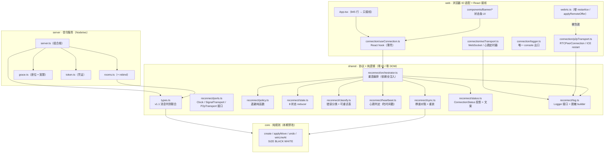
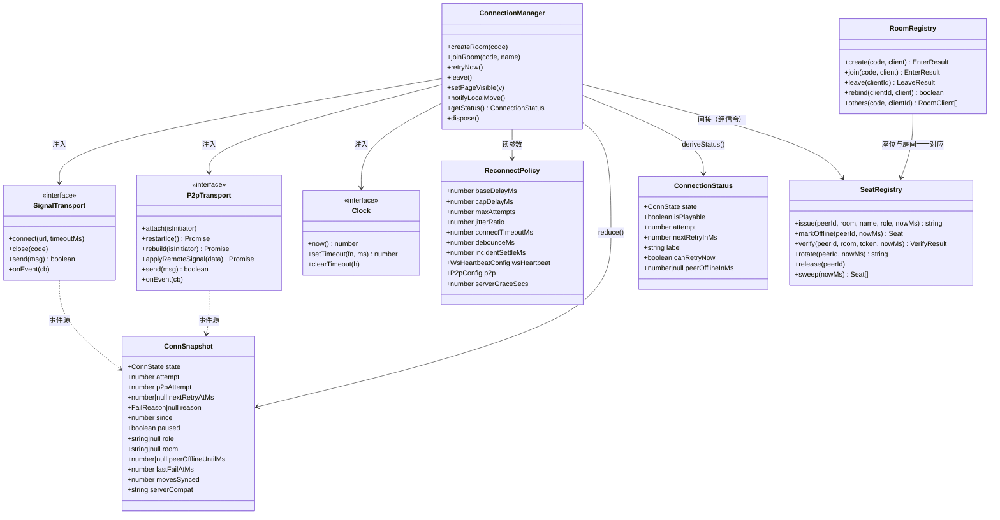
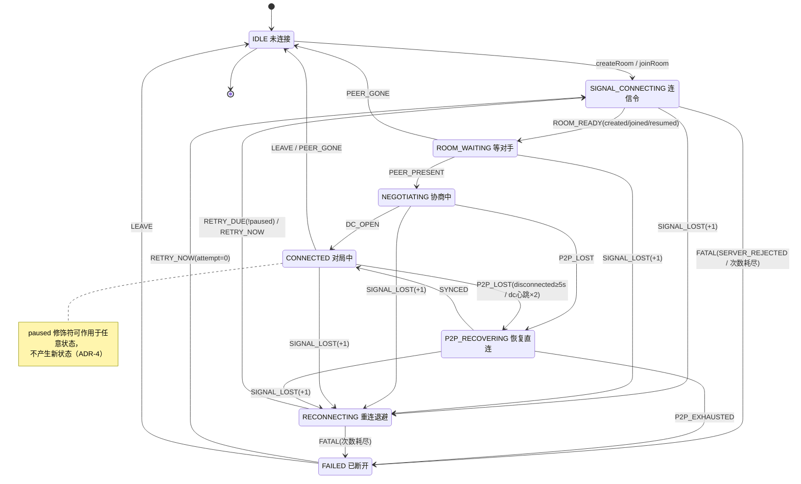
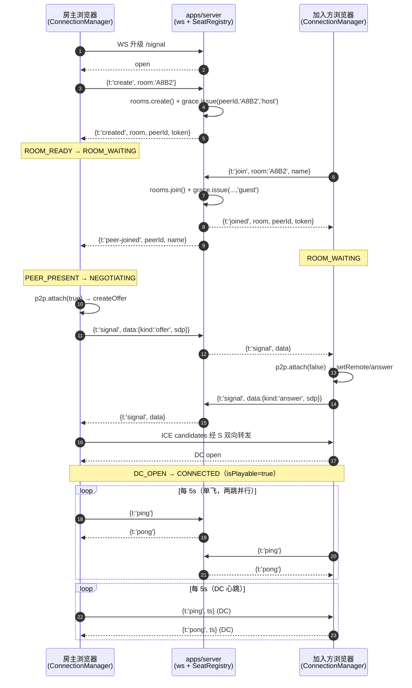
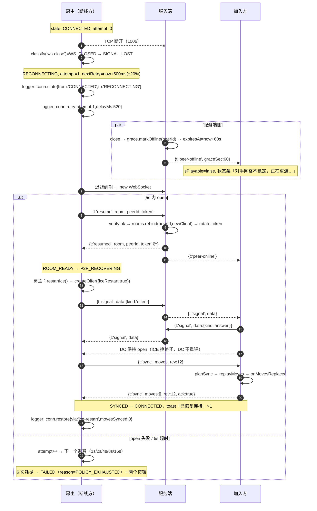
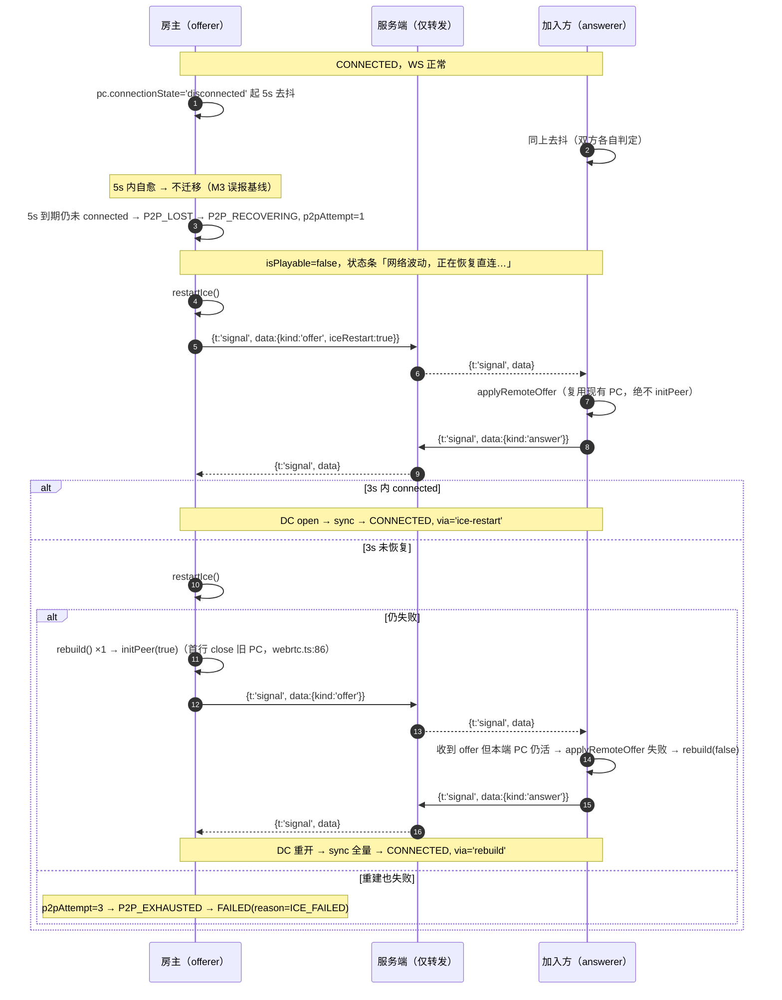
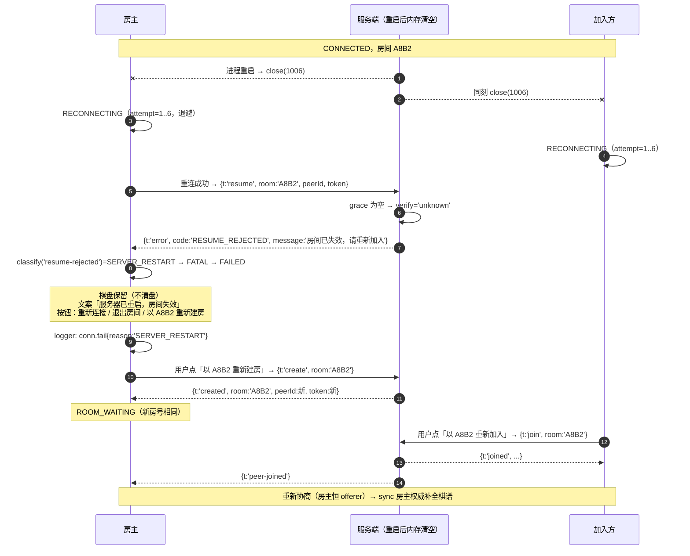

# 自动重连机制 · 架构设计（Reconnect · 稳定连接）

| 项 | 内容 |
|---|---|
| 里程碑 | 稳定连接 · v1.1（协议增量版） |
| 作者 | 高见远（Gao）· 架构师 |
| 状态 | 重连模块设计参考；具体行为以源码和测试为准 |
| 契约来源 | `docs/reconnect/prd.md`（许清楚 · 产品经理，已冻结需求侧约束） |
| 仓库铁律 | `AGENTS.md`（TDD 先行 / SOLID / 依赖单向 `web → shared → core` / core、shared 零 IO、禁 `console.log`、禁 `any` 逃逸） |
| 已拍板前提 | D1 协议纯增量 · D2 重试参数 · D3 房主权威续局 · D4 宽限期锁落子 · D5 原为刷新不续局，已被大厅标签页恢复方案替代 |
| 语言 | 中文 |

> **本次改造不新增任何运行时依赖**（PRD §7）。`package.json` diff 必须为空：定时器、随机、日志、WebSocket、RTCPeerConnection 全部用平台原生能力 + 注入接缝实现。

> **阅读边界（2026-10-22）**：本文保留初版模块拆分和接口草案，旧文件行号及性能估算不作为当前验收结果。当前状态机以 [shared/reconnect](../../packages/shared/src/reconnect/orchestrator.ts)和测试为准；刷新恢复以 [web/lobby](../../packages/web/src/lobby/storage.ts)为准。

---

## 0. 设计总纲（一页速览）

- **一句话**：把「连接」从 4 个散落的 `useState`（`connected`/`roomStatus`/`flow`/`transport`）收敛为**一个纯 reducer 状态机**，把重连能力拆成「纯逻辑（`shared`，零 IO，毫秒级单测）」+「IO 适配器（`web`/`server`）」两层，`App.tsx` 只做接线。
- **检测 4 层**：L1 `onclose/onerror` · L2 WS 应用层 `ping/pong`（5s / 3s × 2 ≈ 16s）· L3 PC 状态 + DC 心跳（`disconnected` ≥5s 才判）· L4 `visibilitychange`（隐藏=修饰符 `paused`，不是状态）。
- **恢复 3 段**：信令恢复（`resume` + 服务端 60s 宽限保留座位）→ P2P 恢复（ICE restart ×2 → 全量重建 ×1）→ 棋谱对账（`sync`，房主权威）。
- **角色固定**：房主恒为 offerer（`initPeer(true)`），加入方只应答 → **结构性消除 glare**，无需 perfect negotiation。
- **座位保持的实现成本≈0**：宽限期内**不调用** `RoomRegistry.leave()`，房间与座位原样保留；只新增 `rebind()` 把旧 `RoomClient` 换成新连接。`rooms.ts:156-176` 的 `leave` 语义完全不动，仅在宽限**超时后**才被调用。
- **协议 v1.1 纯增量**：WS 新增 `ping`/`pong`/`resume`/`resumed`/`peer-offline`/`peer-online`，DC 新增 `sync`。旧客户端连新服务端：只多收到 `peer-offline`（见 §10 兼容矩阵）；新客户端遇旧服务端：探测到 `{t:'error',message:'未知消息类型'}` → 降级「重新 join + 新建 PC」，不崩、不死循环。
- **可测性**：`clock` / `random` / `timer` / `transport` 全部注入；纯逻辑单测不碰 DOM、不碰网络，`pnpm test` 仍 <5s。
- **脱敏靠类型**：`LogEvent` 只声明白名单字段（`from/to/attempt/reason/delayMs/urlHost/...`），SDP / candidate / IP / token **在类型上无处可放**，编译期即脱敏。

---

## 1. 架构总览

### 1.1 分层图



**每层职责一句话**

| 层 | 职责（一句话） |
|---|---|
| `core` | 只回答「这步棋合不合法、谁赢了」——纯函数、零 IO，本期**一行不改**。 |
| `shared` | 回答「协议长什么样、状态该迁到哪、退避该等多久、棋谱以谁为准、日志该记什么」——**全部纯函数**，不碰网络/时钟/DOM。 |
| `web` | 只做两件事：把浏览器 API（WebSocket / RTCPeerConnection / visibility）翻译成 `shared` 定义的事件，把 `ConnectionStatus` 渲染成 UI。 |
| `server` | 只做三件事：托管静态页面、按房间中转信令、**在宽限期内替断线的人保住座位**。 |

### 1.2 落点判定表（哪个文件属于哪层、为什么）

| 文件（相对仓库根） | 层 | 含 IO？ | 判定理由（判据：能不能在 Node 里毫秒级跑完、不 mock 任何全局对象） |
|---|---|---|---|
| `packages/core/src/index.ts` | core | 否 | 已有规则纯函数；本期禁改（PRD 给工程师的硬约束）。 |
| `packages/shared/src/types.ts`（改） | shared | 否 | 只有 `interface`/`type`，零运行时代码；v1.1 增量在此，TS 服务端与 Rust 服务端共用同一份字段定义。 |
| `packages/shared/src/reconnect/policy.ts` | shared | 否 | 只吃 `number` + `random()`，不读 `Date.now()`。 |
| `packages/shared/src/reconnect/state.ts` | shared | 否 | `reduce(snapshot, event)`，时间戳由事件携带（`at`），自身不取时钟。 |
| `packages/shared/src/reconnect/classify.ts` | shared | 否 | 纯字符串/枚举映射表，`Record<FailReason, ...>` 保证穷尽。 |
| `packages/shared/src/reconnect/heartbeat.ts` | shared | 否 | 只做「给两个时间戳，返回 ok/due/miss/dead」，**不创建定时器**（定时器在适配器）。 |
| `packages/shared/src/reconnect/sync.ts` | shared | 否 | 数组前缀比较 + 用 `core.applyMove` 确定性重放。 |
| `packages/shared/src/reconnect/status.ts` | shared | 否 | `ConnSnapshot` → `ConnectionStatus` 投影 + 中文文案（文案属纯映射，放 shared 才能单测）。 |
| `packages/shared/src/reconnect/log.ts` | shared | 否 | 只声明 `Logger` 接口与事件构造器；**sink 在 web**。 |
| `packages/shared/src/reconnect/orchestrator.ts` | shared | 否（能力全注入） | 编排定时器/重试/对账，但 `clock`/`random`/`signal`/`p2p` 全是注入的接口 → 用假实现即可在 Node 跑，不碰 DOM。 |
| `packages/web/src/connection/wsTransport.ts` | web | **是** | `new WebSocket` + `setTimeout` 心跳，只能浏览器跑。 |
| `packages/web/src/connection/p2pTransport.ts` | web | **是** | `RTCPeerConnection` / `RTCDataChannel`。 |
| `packages/web/src/connection/logger.ts` | web | **是** | 唯一允许的 `console.*` 出口（AGENTS §4），实现 `Logger` 接口。 |
| `packages/web/src/connection/useConnection.ts` | web | **是** | React 生命周期（`useEffect` / `useRef`）。 |
| `packages/web/src/components/Banner/ConnectionBanner.tsx` | web | **是** | DOM 渲染。 |
| `packages/web/src/webrtc.ts`（改） | web | **是** | 已有 `RTCPeerConnection` 封装；本期只加 `restartIce()` / `applyRemoteOffer()` 并去掉存量 `console.warn/error`（`webrtc.ts:155`、`webrtc.ts:165`）。 |
| `apps/server/src/grace.ts` | server | 否（`nowMs` 注入） | 纯内存簿记：`Map<peerId, Seat>` + `sweep(nowMs)`；不自己起定时器。 |
| `apps/server/src/token.ts` | server | **是**（`node:crypto`） | 唯一随机源；`rand` 可注入以便确定性单测。 |
| `apps/server/src/rooms.ts`（改） | server | 否 | 已是纯内存索引（`rooms.ts:61-177`），只加 `rebind()`。 |
| `apps/server/src/server.ts`（改） | server | **是** | 组合根：`ws` / `http` / `setInterval`。 |

> **判定规则（写进 code review 清单）**：任何新文件若需要 `vi.mock('node:...')`、`jsdom` 或真实端口才能测，就不许放 `shared`。

### 1.3 依赖方向检查

```
web ──► shared ──► core
server ──► shared ──► core
```

- `shared/reconnect/orchestrator.ts` 只 import：`../types`、`./policy`、`./state`、`./classify`、`./sync`、`./status`、`./log`、`@webrtc-gomoku/core`（仅 `Move` 类型）。
- 适配器接口（`SignalTransport` / `P2pTransport` / `Clock`）**声明在 `shared/reconnect/ports.ts`**，实现只在 `web` —— 依赖倒置，`shared` 不知道 `WebSocket` 的存在。
- 禁止：`shared` import `web`；`web/connection/*` import `App.tsx`；`server` import `web`。

---

## 2. 模块清单

> 导出签名给到**接口级**（工程师按此写测试，先红后绿）。伪代码仅用于说明契约，不是实现。

### 2.1 `shared/reconnect/ports.ts`（新增，纯类型）

```ts
/** 注入的时钟：禁止在 shared 内直接 Date.now / setTimeout（AGENTS §2 DIP） */
export interface Clock {
  now(): number;
  setTimeout(fn: () => void, ms: number): number;
  clearTimeout(handle: number): void;
}

/** 信令通道抽象：web 用 WebSocket 实现，单测用假实现 */
export interface SignalTransport {
  connect(url: string, timeoutMs: number): void;
  close(code?: number): void;
  send(msg: ClientSignalingMsg): boolean;
  onEvent(cb: (e: SignalEvent) => void): void;   // 单一事件回调，不做多播
  readonly readyState: 'idle' | 'connecting' | 'open' | 'closed';
}

export type SignalEvent =
  | { type: 'open' }
  | { type: 'closed'; code: number; intentional: boolean }
  | { type: 'error'; detail: 'connect-failed' | 'socket-error' }
  | { type: 'connect-timeout' }
  | { type: 'msg'; msg: ServerSignalingMsg }
  | { type: 'probe-unsupported'; probe: 'ping' | 'resume' };  // 旧服务端探测命中

/** P2P 通道抽象：web 用 WebRTCClient 实现 */
export interface P2pTransport {
  attach(isInitiator: boolean): void;
  restartIce(): Promise<void>;
  rebuild(isInitiator: boolean): Promise<void>;
  applyRemoteSignal(data: unknown): Promise<void>;
  send(msg: GameMessage): boolean;
  onEvent(cb: (e: P2pEvent) => void): void;
  close(): void;
}

export type P2pEvent =
  | { type: 'dc-open' }
  | { type: 'dc-closed' }
  | { type: 'pc-state'; state: RTCPeerConnectionState }
  | { type: 'pc-disconnected-settled' }   // disconnected 持续 ≥5s 后由适配器发出
  | { type: 'pc-failed' }
  | { type: 'msg'; msg: GameMessage }
  | { type: 'signal-out'; data: unknown } // 适配器要经信令转发的 offer/answer/ice
  | { type: 'ice-restart-failed' };
```

### 2.2 `shared/reconnect/policy.ts`

```ts
export interface WsHeartbeatConfig { intervalMs: number; timeoutMs: number; misses: number }
export interface P2pConfig {
  disconnectedGraceMs: number;
  dcHeartbeat: WsHeartbeatConfig;
  iceRestartAttempts: number;
  iceRestartDelaysMs: readonly number[];
  rebuildAttempts: number;
  peerOnlineWaitMs: number;
}

export interface ReconnectPolicy {
  baseDelayMs: number;      // 500
  capDelayMs: number;       // 16000
  maxAttempts: number;      // 6
  jitterRatio: number;      // 0.2
  connectTimeoutMs: number; // 5000
  debounceMs: number;       // 1000   同一 incident 内 1s 多次 close 只计 1 次
  incidentSettleMs: number; // 10000  回到 CONNECTED 稳定 10s 才关闭 incident
  wsHeartbeat: WsHeartbeatConfig;   // 5000 / 3000 / 2
  p2p: P2pConfig;
  serverGraceSecs: number;  // 60（仅 UI 兜底倒计时；权威值以 peer-offline.graceSec 为准）
  syncOnRestore: boolean;   // true
}

export const DEFAULT_POLICY: ReconnectPolicy;

/** delay(attempt) = min(base * 2^(attempt-1), cap) * (1 + jitter)，jitter ∈ [-ratio, +ratio] */
export function nextDelayMs(attempt: number, p: ReconnectPolicy, random: () => number): number;

/** 理论总窗口 = Σ nextDelayMs(1..n, random=0.5) + n * connectTimeoutMs */
export function totalWindowMs(p: ReconnectPolicy): number;
```

- `attempt` 从 **1** 开始；`attempt <= 0` 按 1 处理（防御性钳制）。
- `random()` 语义：返回 `[0, 1)`；`0` → `0.8x`，`0.999…` → `≈1.2x`；结果 `Math.round`。
- 序列（jitter=0）：`500 / 1000 / 2000 / 4000 / 8000 / 16000`，Σ=31.5s，+6×5s=**61.5s**；PRD 的「≈45s」按「最后一次不必再等连接超时」口径 → `totalWindowMs` 只对前 5 次计 connectTimeout：`31.5 + 5×5 = 56.5s`。**以 `totalWindowMs()` 的实测值为准并单测锁定**（见 §9 用例 `totalWindowMs 与 PRD 窗口口径一致`）。

> ⚠️ 这是本设计发现的**口径差异**（PRD R3 写「总退避≈31.5s + 每次超时 5s = ≈45s」，实际 6×5=30s）。已按 D2「总窗口≈45s」不变、把口径写清：**用户可感知的放弃时延 = 最后一次退避到期 + 一次连接超时 ≈ 47.5s（不含 jitter）**，`totalWindowMs()` 返回该值，PRD 的 45s 是约数。不新增决策，仅记录。

### 2.3 `shared/reconnect/state.ts`（状态机 reducer）

```ts
export const CONN_STATES = [
  'IDLE', 'SIGNAL_CONNECTING', 'ROOM_WAITING', 'NEGOTIATING',
  'CONNECTED', 'P2P_RECOVERING', 'RECONNECTING', 'FAILED',
] as const;
export type ConnState = (typeof CONN_STATES)[number];

export interface ConnSnapshot {
  readonly state: ConnState;
  readonly attempt: number;              // 已消耗的 WS 重连次数 0..maxAttempts
  readonly p2pAttempt: number;           // 0..(iceRestartAttempts + rebuildAttempts)
  readonly nextRetryAtMs: number | null; // RECONNECTING 才有值 → UI 倒计时
  readonly reason: FailReason | null;
  readonly since: number;                // 进入当前状态的时刻
  readonly paused: boolean;              // 页面隐藏「修饰符」，不是状态
  readonly role: 'host' | 'guest' | null;
  readonly room: string | null;
  readonly peerOfflineUntilMs: number | null; // D4：对手宽限剩余
  readonly lastFailAtMs: number;         // 用于 debounce
  readonly movesSynced: number;          // 最近一次对账补手数（供 conn.restore 日志）
  readonly serverCompat: 'v1' | 'v1.1';
}

export function initialSnapshot(nowMs: number): ConnSnapshot;

export type ConnEvent =
  | { type: 'START'; at: number; role: 'host' | 'guest'; room: string | null }
  | { type: 'SIGNAL_LOST'; at: number; reason: FailReason }
  | { type: 'SIGNAL_OPEN'; at: number }
  | { type: 'ROOM_READY'; at: number; room: string }
  | { type: 'PEER_PRESENT'; at: number }
  | { type: 'PEER_OFFLINE'; at: number; graceSecs: number }
  | { type: 'DC_OPEN'; at: number }
  | { type: 'P2P_LOST'; at: number; reason: FailReason }
  | { type: 'RETRY_DUE'; at: number }
  | { type: 'RETRY_NOW'; at: number }
  | { type: 'P2P_EXHAUSTED'; at: number }
  | { type: 'FATAL'; at: number; reason: FailReason }
  | { type: 'PAUSE'; at: number }
  | { type: 'RESUME'; at: number }
  | { type: 'INCIDENT_CLOSED'; at: number }
  | { type: 'SYNCED'; at: number; movesSynced: number }
  | { type: 'SERVER_COMPAT'; at: number; compat: 'v1' | 'v1.1' }
  | { type: 'PEER_GONE'; at: number }
  | { type: 'LEAVE'; at: number };

/** 纯函数；非法迁移原样返回同一个引用（可用 toBe 断言「未变」） */
export function reduce(s: ConnSnapshot, e: ConnEvent, p: ReconnectPolicy): ConnSnapshot;
```

**为什么这样设计（关键结构决策）**

| 决策 | 理由 |
|---|---|
| 迁移用**表驱动** `Record<ConnState, Partial<Record<ConnEvent['type'], Handler>>>` | 8×18 的迁移空间用 `switch` 写必然漏分支；表驱动让「某状态收到某事件」变成查表命中/未命中，未命中即拒绝。 |
| 非法迁移**返回原引用**（不抛异常、不打日志） | PRD §6.2 要求「拒绝并返回原状态」；返回同一引用让单测能 `expect(next).toBe(prev)` 精确断言，也让编排器能据此判断「是否真的迁移了」从而决定要不要打 `conn.state` 日志（避免日志刷屏）。 |
| `attempt` 在 `SIGNAL_LOST` 时 +1，但 `at - lastFailAtMs < debounceMs` 时**整体拒绝迁移** | R2 防抖「1s 内多次 close 只计 1 次 attempt、只迁移 1 次」用一行守卫实现，不需要额外的 incident 对象。 |
| `paused` 是布尔而非 `PAUSED` 状态 | 见 ADR-4。 |
| `serverCompat` 在快照里 | 旧服务端降级是一次性决策，后续所有 resume 尝试都要跳过 → 必须记住，不能靠局部变量。 |
| 不把 `moves` 放进快照 | 快照要能 1ms 内深比较；棋谱可达 225 项且每手变一次，放进来会让每次落子都触发状态机 diff。棋谱通过 `getLocalMoves()` 拉取（见 §7）。 |

### 2.4 `shared/reconnect/classify.ts`

```ts
export const FAIL_REASONS = [
  'NETWORK_OFFLINE', 'WS_CLOSED', 'WS_TIMEOUT', 'SERVER_REJECTED',
  'SERVER_RESTART', 'ICE_FAILED', 'DC_NOT_OPEN', 'POLICY_EXHAUSTED', 'USER_CANCELLED',
] as const;
export type FailReason = (typeof FAIL_REASONS)[number];

export interface RetryRule {
  countsAttempt: boolean;   // 是否消耗 WS 重试次数
  autoRetry: boolean;       // 是否允许自动重试
  label: string;            // FAILED 态原因文案（PRD §6.4 逐字）
}
export const RETRY_RULES: Readonly<Record<FailReason, RetryRule>>;

export type FailSource =
  | 'ws-close' | 'ws-error' | 'ws-heartbeat' | 'connect-timeout'
  | 'pc-state' | 'dc-heartbeat' | 'dc-send' | 'ice-restart'
  | 'server-error' | 'resume-rejected' | 'attempts-exhausted' | 'user-leave';

export interface ClassifyInput {
  source: FailSource;
  online?: boolean;          // navigator.onLine
  closeCode?: number;        // 1000/1001/1006
  serverMessage?: string;    // {t:'error'}.message
  serverCode?: string;       // v1.1 的 {t:'error'}.code（旧服务端缺失）
  attempts?: number;
  maxAttempts?: number;
}

export function classifyFailure(i: ClassifyInput): FailReason;

/** 旧服务端探测：文案逐字匹配 v1 的「未知消息类型」 */
export function isUnsupportedMessageError(message: string): boolean;
/** 房号非法 / 房间不存在 / 已满 —— 重试无意义（PRD R6） */
export function isRoomInvalidError(message: string): boolean;
```

`RETRY_RULES` 取值（**唯一真源**，UI / 编排器 / 日志全部读它，禁止各处硬编码）：

| FailReason | countsAttempt | autoRetry | label |
|---|---|---|---|
| `NETWORK_OFFLINE` | ✓ | ✓ | 网络不可用 |
| `WS_CLOSED` | ✓ | ✓ | 连接被关闭 |
| `WS_TIMEOUT` | ✓ | ✓ | 服务器无响应 |
| `SERVER_REJECTED` | ✗ | ✗ | 服务端原文（逐字复用 `rooms.ts` 文案） |
| `SERVER_RESTART` | ✓ | ✓ | 服务器已重启，房间失效 |
| `ICE_FAILED` | ✗（走 `p2pAttempt`） | ✓（2 次后终态） | 直连建立失败（可能处于对称 NAT） |
| `DC_NOT_OPEN` | ✗ | ✗（仅触发一次 P2P 检测） | 直连通道未就绪，本手未送达 |
| `POLICY_EXHAUSTED` | — | ✗ | 多次重试失败 |
| `USER_CANCELLED` | ✗ | ✗ | —（不展示） |

**未知错误码兜底规则（重要）**：服务端返回**未识别**的 `code`/`message` → 一律归 `SERVER_REJECTED`（不计 attempt、不自动重试、终态、原文展示）。这样「协议不认识的东西」永远不会变成无限重试。

### 2.5 `shared/reconnect/heartbeat.ts`

```ts
export interface HeartbeatState {
  readonly pendingSinceMs: number | null;  // 在途探测发出时刻（单飞：非 null 时不许再发）
  readonly misses: number;
  readonly lastPongAtMs: number | null;
}
export type HeartbeatVerdict = 'idle' | 'due' | 'waiting' | 'miss' | 'dead';

export function createHeartbeat(nowMs: number): HeartbeatState;
export function markSent(s: HeartbeatState, nowMs: number): HeartbeatState;
export function markPong(s: HeartbeatState, nowMs: number): HeartbeatState;
/** 纯判定：不发定时器、不取时钟 */
export function evaluate(s: HeartbeatState, nowMs: number, cfg: WsHeartbeatConfig):
  { verdict: HeartbeatVerdict; state: HeartbeatState };
```

- **单飞**：`pendingSinceMs !== null` 时不发第二次（PRD §7「同一时刻最多 1 个在途探测」）。
- **`dead` 推导**：`now - pendingSince >= timeoutMs` → `misses+1`、`pending=null`；`misses >= cfg.misses(2)` → `dead`。
- 最坏判定时延 = `interval(5s) + 2×timeout(3s) = 11s`，加一次 tick 抖动 ≈ **≤16s**，对齐 PRD M4。**这个推导写进单测注释**，避免有人改参数后 M4 悄悄失效。
- WS 与 DC 共用本模块（同一份语义，两个独立实例）。

### 2.6 `shared/reconnect/sync.ts`

```ts
export interface SyncPlan {
  /** 本端是否为权威方（房主） */
  authoritative: boolean;
  /** 采用后的完整棋谱（房主=自己的；加入方=收到的） */
  adopt: readonly Move[];
  /** 加入方相比本地新增的手数 */
  appended: number;
  /** 是否发现分叉（本地与权威不一致） */
  mismatch: boolean;
}
export type ReplayResult =
  | { ok: true; game: GameState }
  | { ok: false; at: number };            // 第 at 手非法（脏数据/作弊）

/** 用 core.applyMove 确定性重放，逐手校验（不信任对端数据） */
export function replayMoves(moves: readonly Move[]): ReplayResult;

/** 房主：authoritative=true，adopt=local；加入方：与 incoming 前缀比较后决定 adopt */
export function planSync(params: {
  role: 'host' | 'guest';
  local: readonly Move[];
  incoming?: readonly Move[];
}): SyncPlan;
```

- 冲突解决：**房主权威**（D3）。加入方 `adopt = incoming`，即使本地更多手也**整体替换**（本地多出来的手视为未送达，需用户重下——因为房主没收到，胜负判定以房主为准）。
- `mismatch = true` 时补一条系统消息「已与对手同步棋谱」（PRD R9）。
- `replayMoves` 失败 → **不替换本地**、记 `conn.fail{reason:'DC_NOT_OPEN'}`? 否：记 `conn.fail{reason:'ICE_FAILED'}` 不合适。定义：重放失败记 `conn.fail{reason:'SERVER_REJECTED'}`? 也不合适。
  → **新增日志事件而非新 FailReason**：`conn.fail{reason:'DC_NOT_OPEN'}` 不用于此。这里用 `conn.state` + `warn` 级 `conn.fail{reason:'ICE_FAILED'}` 会误导。
  **最终决定**：`planSync` 在内部先 `replayMoves(incoming)`，若失败则返回 `mismatch: true` 且 `adopt = local`（拒绝采纳脏数据），编排器记 `conn.fail{reason:'POLICY_EXHAUSTED'}`? 不行。
  → 见 §8 日志矩阵：新增事件 `conn.sync-reject{ rev, at }`（**warn** 级，无 FailReason），因为它是「数据校验失败」而非「连接失败」，混入 FailReason 会污染 M5 的「放弃可解释」统计。这是对 PRD R6 事件集的**纯增量**（PRD 只规定了 4 个事件名，未禁止新增）。

### 2.7 `shared/reconnect/status.ts`

```ts
export interface ConnectionStatus {
  state: ConnState;
  isPlayable: boolean;               // 唯一业务判据：state === 'CONNECTED'
  attempt: number;
  maxAttempts: number;
  nextRetryInMs: number | null;      // UI 倒计时（RECONNECTING）
  reason: FailReason | null;
  label: string;                     // 状态条主文案（PRD §6.4 逐字）
  canRetryNow: boolean;              // FAILED 恒 true；RECONNECTING 且非 paused
  canLeave: boolean;
  role: 'host' | 'guest' | null;
  room: string | null;
  peerOfflineInMs: number | null;    // D4：对手宽限倒计时
  compat: 'v1' | 'v1.1';
}

export function deriveStatus(s: ConnSnapshot, p: ReconnectPolicy, nowMs: number): ConnectionStatus;
```

**`isPlayable` 的穷尽性保证**：`isPlayable` 由 `state === 'CONNECTED'` 单点计算，并有一条**穷尽单测**遍历 `CONN_STATES`，断言「只有 CONNECTED 为 true」。任何新增状态若忘了归类，该测试的 `Record<ConnState, boolean>` 期望表会编译失败。

### 2.8 `shared/reconnect/log.ts`

```ts
export type LogEvent =
  | { ev: 'conn.state'; from: ConnState; to: ConnState; attempt: number; reason: FailReason | null; sinceMs: number }
  | { ev: 'conn.retry'; attempt: number; delayMs: number; reason: FailReason; urlHost: string }
  | { ev: 'conn.restore'; attempt: number; totalMs: number; via: 'ice-restart' | 'rebuild' | 'ws-only'; movesSynced: number }
  | { ev: 'conn.fail'; reason: FailReason; attempt: number; totalMs: number; online: boolean; visibility: 'visible' | 'hidden' }
  | { ev: 'conn.compat'; server: 'v1' | 'v1.1' }
  | { ev: 'conn.sync-reject'; rev: number; at: number };

export interface Logger { log(e: LogEvent): void }

/** 'A8B2' → 'A**2'；null/异常长度 → '****' */
export function maskRoom(room: string | null): string;
/** 'wss://host:3000/signal' → 'host'（只留 host，禁 path/query） */
export function hostOf(url: string): string;
```

**脱敏靠类型**：`LogEvent` 的字段集合即白名单，`sdp`/`candidate`/`ip`/`token` **没有任何字段可以承载**。`maskRoom`/`hostOf` 是仅有的两个把「原始值」转成「可打印值」的函数，单测覆盖。

### 2.9 `shared/reconnect/orchestrator.ts`（重连编排器，依赖全注入）

```ts
export interface ConnectionManagerDeps {
  signal: SignalTransport;
  p2p: P2pTransport;
  clock: Clock;
  random: () => number;
  policy: ReconnectPolicy;
  logger: Logger;
  /** 信令 URL 由 web 提供（shared 不知道 location） */
  signalUrl: string;
  /** 供 sync 取棋谱快照 */
  getLocalMoves: () => readonly Move[];
  /** 加入方对账后要求 App 重放棋盘 */
  onMovesReplaced: (moves: readonly Move[]) => void;
  onStatus: (s: ConnectionStatus) => void;
  onEvent: (e: ConnSideEffect) => void;
  isOnline: () => boolean;
}

export type ConnSideEffect =
  | { type: 'restored'; via: 'ice-restart' | 'rebuild' | 'ws-only'; movesSynced: number }
  | { type: 'failed'; reason: FailReason }
  | { type: 'peer-offline'; graceSecs: number }
  | { type: 'peer-online' }
  | { type: 'peer-gone' }
  | { type: 'room-invalid'; room: string }
  | { type: 'sync-applied'; appended: number; mismatch: boolean }
  | { type: 'degraded-to-v1' };

export interface ConnectionManager {
  createRoom(code: string): void;
  joinRoom(code: string, name: string): void;
  retryNow(): void;
  leave(): void;
  setPageVisible(visible: boolean): void;
  notifyLocalMove(): void;       // 落子后调用：检测 send 失败 → DC_NOT_OPEN
  getStatus(): ConnectionStatus;
  dispose(): void;
}

export function createConnectionManager(deps: ConnectionManagerDeps): ConnectionManager;
```

> 入口为 `createRoom` / `joinRoom`，分别表达建房和使用用户输入的房号加入；不提供 `start(role, room)`。

### 2.10 web 层模块

```ts
// packages/web/src/connection/wsTransport.ts
export function createWsTransport(deps: { clock: Clock; policy: ReconnectPolicy }): SignalTransport;
// 内部职责：new WebSocket → 单链心跳 setTimeout → evaluate() → emit('closed') / emit('probe-unsupported')

// packages/web/src/connection/p2pTransport.ts
export function createP2pTransport(deps: {
  clock: Clock; policy: ReconnectPolicy; client: WebRTCClient; signalOut: (data: unknown) => void;
}): P2pTransport;
// 内部职责：包装 WebRTCClient；pc.connectionState==='disconnected' 起 5s 去抖定时器；DC 心跳；ICE restart

// packages/web/src/connection/logger.ts
export function createConsoleLogger(sink?: (e: LogEvent) => void): Logger;

// packages/web/src/connection/useConnection.ts
export interface UseConnectionOptions { myName: string; getMoves: () => readonly Move[]; onMovesReplaced: (m: readonly Move[]) => void; onEvent: (e: ConnSideEffect) => void; }
export interface UseConnectionResult {
  status: ConnectionStatus;
  createRoom: (code: string) => void;
  joinRoom: (code: string) => void;
  retryNow: () => void;
  leaveRoom: () => void;
  notifyLocalMove: () => void;
}
export function useConnection(o: UseConnectionOptions): UseConnectionResult;
```

### 2.11 server 层模块

```ts
// apps/server/src/token.ts
export function createToken(rand?: (n: number) => Uint8Array, bytes?: number): string; // base64url, ≥24B
export function tokenEquals(a: string, b: string): boolean;                            // 常量时间

// apps/server/src/grace.ts
export interface Seat {
  peerId: string; room: string; name: string; role: 'host' | 'guest';
  token: string; offlineSinceMs: number | null; expiresAtMs: number | null;
}
export type VerifyResult = 'ok' | 'invalid' | 'expired' | 'unknown';
export class SeatRegistry {
  constructor(opts: { graceMs: number; newToken?: () => string });
  issue(peerId: string, room: string, name: string, role: 'host' | 'guest', nowMs: number): string;
  markOffline(peerId: string, nowMs: number): Seat | null;   // → 进入宽限，返回座位（供广播）
  verify(peerId: string, room: string, token: string, nowMs: number): VerifyResult;
  rotate(peerId: string, nowMs: number): string | null;      // resume 成功 → 轮换 token
  release(peerId: string): void;                             // 主动 leave / 宽限超时
  sweep(nowMs: number): Seat[];                              // 返回已过期项（调用方负责 leave + peer-left）
  get size(): number;
}

// apps/server/src/rooms.ts（增量）
rebind(clientId: string, client: RoomClient): boolean;        // 座位存在则替换 send 目标
has(clientId: string): boolean;
```

### 2.12 类图



---

## 3. 连接状态机

### 3.1 8 状态与业务判据

| 状态 | 含义 | `isPlayable` | 终态 | 定时器 |
|---|---|---|---|---|
| `IDLE` | 未连接 / 已主动离开 | ✗ | 否 | 全停 |
| `SIGNAL_CONNECTING` | 建 socket（含重试） | ✗ | 否 | connectTimeout 5s |
| `ROOM_WAITING` | 已在房，等对手 | ✗ | 否 | 仅 WS 心跳 |
| `NEGOTIATING` | 交换 SDP/ICE | ✗ | 否 | 仅 WS 心跳 |
| `CONNECTED` | DC 已开 | ✓ | 否 | WS+DC 心跳、stats 轮询 |
| `P2P_RECOVERING` | 信令在、P2P 断 | ✗ | 否 | 重启/重建定时器 |
| `RECONNECTING` | 信令断，退避中 | ✗ | 否 | 退避定时器 |
| `FAILED` | 自动重连放弃 | ✗ | **是** | 全停（省电，PRD §7） |

### 3.2 合法迁移表（reducer 的唯一真源）

| From | 事件 | To | 守卫 / 附加动作 |
|---|---|---|---|
| `IDLE` | `START` | `SIGNAL_CONNECTING` | attempt=0、reason=null |
| `SIGNAL_CONNECTING` | `SIGNAL_OPEN` | `SIGNAL_CONNECTING` | 无迁移（只发 resume/join） |
| `SIGNAL_CONNECTING` | `ROOM_READY` | `ROOM_WAITING` | 写 room；host 若已见 peer → `PEER_PRESENT` 可直达 NEGOTIATING |
| `SIGNAL_CONNECTING` | `SIGNAL_LOST` | `RECONNECTING` | `countsAttempt` → attempt+1；`at-lastFailAtMs<debounce` → 拒绝 |
| `SIGNAL_CONNECTING` | `FATAL`(`SERVER_REJECTED`) | `FAILED` | **不计 attempt** |
| `SIGNAL_CONNECTING` | `FATAL`(`POLICY_EXHAUSTED`) | `FAILED` | attempt≥max |
| `ROOM_WAITING` | `PEER_PRESENT` | `NEGOTIATING` | — |
| `ROOM_WAITING` | `SIGNAL_LOST` | `RECONNECTING` | 同上 +1 |
| `ROOM_WAITING` | `PEER_GONE` | `IDLE` | 对手宽限超时 |
| `NEGOTIATING` | `DC_OPEN` | `CONNECTED` | `since` 重置；`INCIDENT_CLOSED` 定时器由编排器起 |
| `NEGOTIATING` | `P2P_LOST` | `P2P_RECOVERING` | p2pAttempt=1 |
| `NEGOTIATING` | `SIGNAL_LOST` | `RECONNECTING` | +1 |
| `CONNECTED` | `P2P_LOST` | `P2P_RECOVERING` | p2pAttempt=1；**不清 movesSynced** |
| `CONNECTED` | `SIGNAL_LOST` | `RECONNECTING` | +1 |
| `CONNECTED` | `PEER_OFFLINE` | `CONNECTED` | 只写 `peerOfflineUntilMs`（D4 锁落子由 `isPlayable` 之外的 `peerOfflineInMs>0` 表达 → 见 §7.3） |
| `CONNECTED` | `INCIDENT_CLOSED` | `CONNECTED` | attempt=0、reason=null |
| `P2P_RECOVERING` | `DC_OPEN` | `P2P_RECOVERING` | 等 `SYNCED` 才进 CONNECTED（房主）/ 加入方收到 sync 后自行 `SYNCED` |
| `P2P_RECOVERING` | `SYNCED` | `CONNECTED` | 写 movesSynced |
| `P2P_RECOVERING` | `P2P_LOST` | `P2P_RECOVERING` | p2pAttempt+1 |
| `P2P_RECOVERING` | `SIGNAL_LOST` | `RECONNECTING` | +1（WS 优先，p2pAttempt 保留） |
| `P2P_RECOVERING` | `P2P_EXHAUSTED` | `FAILED` | reason=`ICE_FAILED` |
| `RECONNECTING` | `RETRY_DUE` | `SIGNAL_CONNECTING` | `paused` → 拒绝；否则清 nextRetryAtMs |
| `RECONNECTING` | `RETRY_NOW` | `SIGNAL_CONNECTING` | 清定时器（编排器负责），attempt 不重置 |
| `RECONNECTING` | `SIGNAL_LOST` | `RECONNECTING` | debounce 内拒绝；超出则 attempt+1 |
| `RECONNECTING` | `FATAL`(`POLICY_EXHAUSTED`) | `FAILED` | attempt≥max |
| `FAILED` | `RETRY_NOW` | `SIGNAL_CONNECTING` | **attempt=0**（PRD R12） |
| `FAILED` | `LEAVE` | `IDLE` | — |
| 任意 | `LEAVE` | `IDLE` | 清全部计数与 reason |
| 任意 | `PEER_GONE` | `IDLE` | 仅当对手宽限超时（`peer-left`） |
| `IDLE`/`FAILED` | `PAUSE`/`RESUME` | 不变 | 只翻 `paused` |

### 3.3 非法迁移拒绝策略

**明令禁止**（PRD §6.2）并全部有单测：`FAILED → CONNECTED`、`IDLE → CONNECTED`、`CONNECTED → ROOM_WAITING`、`RECONNECTING → NEGOTIATING`。

实现约定：
1. 迁移表未命中 → 返回**同一个** `ConnSnapshot` 引用（`toBe` 可断言）。
2. **不抛异常、不吞异常**：编排器收到「未变化」时只做 `logger.log({ev:'conn.state'})` 的抑制，不重试该事件。
3. **穷尽性**：`ConnEvent['type']` 的 switch 必须带 `default: assertNever(e)`（`assertNever(x: never): never`），新增事件类型时编译期报错，防止「加了事件忘了加分支」。
4. `RETRY_DUE` 在 `paused` 下被拒绝 → 编排器必须**重新排**一次定时器（否则永久卡住），这条写进 §9 用例。

### 3.4 状态迁移图（含 paused 修饰符）



---

## 4. 协议增量设计（v1.1）

### 4.1 消息总表

| # | 方向 | `t` | 载荷 | 幂等性 | 触发时机 |
|---|---|---|---|---|---|
| 1 | C→S | `ping` | `{t:'ping', ts?:number}` | 幂等（只回 pong，不改状态） | 客户端每 5s（单飞） |
| 2 | S→C | `pong` | `{t:'pong', ts?:number}` | 幂等 | 收到 ping 立即回 |
| 3 | C→S | `resume` | `{t:'resume', room, peerId, token}` | **非幂等**（成功后 token 轮换） | 重连 onopen 后第一件事 |
| 4 | S→C | `resumed` | `{t:'resumed', room, peerId, token}` | 幂等（同连接重复请求回同一新 token） | resume 校验通过 |
| 5 | S→C | `peer-offline` | `{t:'peer-offline', graceSec}` | 幂等（一个宽限周期只发一次） | 对手 socket 断开且座位可恢复 |
| 6 | S→C | `peer-online` | `{t:'peer-online'}` | 幂等 | 对手 resume 成功 |
| 7 | C↔C | `sync` | `{t:'sync', moves, rev, ack?}` | 幂等（同 rev 重放同结果） | DC 重开后房主发起；加入方回 ack |

**`{t:'error'}` 增补可选 `code`**（纯增量，旧客户端忽略未知字段）：

```ts
export interface ServerErrorMsg {
  t: 'error';
  message: string;
  code?: ServerErrorCode;   // v1.1 新增；旧服务端不提供 → 客户端回退到文案匹配
}
export type ServerErrorCode =
  | 'ROOM_FORMAT' | 'ROOM_EXISTS' | 'ROOM_NOT_FOUND' | 'ROOM_FULL'
  | 'UNKNOWN_TYPE' | 'RESUME_REJECTED' | 'RESUME_TOKEN_INVALID';
```

**`created`/`joined` 增补可选 `token`**（纯增量）：

```ts
export interface ServerCreatedMsg { t:'created'; room:string; peerId:string; token?:string }
export interface ServerJoinedMsg  { t:'joined';  room:string; peerId:string; token?:string }
```

### 4.2 错误码与文案（逐字沿用 v1）

| code | 触发 | message（逐字，禁止改动） | 客户端 FailReason |
|---|---|---|---|
| `ROOM_FORMAT` | `create`/`join` 房号非法 | 房间号需为 4 位字母或数字 | `SERVER_REJECTED` |
| `ROOM_EXISTS` | `create` 冲突 | 房间 {CODE} 已存在，请更换 | `SERVER_REJECTED` |
| `ROOM_NOT_FOUND` | `join` 不存在 | 房间 {CODE} 不存在 | `SERVER_REJECTED`（`resume` 路径 → `SERVER_RESTART`） |
| `ROOM_FULL` | `join` 满员 | 房间已满（仅支持 1v1） | `SERVER_REJECTED` |
| `UNKNOWN_TYPE` | 未知 `t` | 未知消息类型 | **不产生 FailReason**，走兼容探测（§10） |
| `RESUME_REJECTED` | 宽限过期 / 座位已释放 | 房间已失效，请重新加入 | `SERVER_RESTART` |
| `RESUME_TOKEN_INVALID` | token 不匹配（防抢座） | 座位凭证无效 | `SERVER_RESTART` |

> `UNKNOWN_TYPE` 的文案与 v1 完全一致（`server.ts:146-147`），因此**旧客户端无需改动**；新客户端把它当作「服务端是 v1」的探测信号。

### 4.3 `resume` 的 token 生命周期

```
[生成] created/joined 下发 → token = base64url(crypto.randomBytes(24))  (32 字符)
       服务端存 SeatRegistry.seats[peerId].token
       ↓
[在线期] token 不轮换；大厅会话可写入当前标签页 sessionStorage，不进日志或 URL
       ↓
[socket 断开] markOffline → expiresAtMs = now + graceMs(60s)
       ↓
[resume 校验] 顺序：seat 存在? → room 匹配? → tokenEquals(存, 收)? → now < expiresAt?
       任一失败 → {t:'error', code:'RESUME_*', message:…}，不轮换、不放行
       ↓
[resume 成功] ① rebind 座位到新 ws ② rotate() 生成新 token ③ 下发 resumed{token:新}
       旧 token 立即失效（单次使用）→ 防重放
       ↓
[宽限超时] sweep → release() → rooms.leave() → 对手收 peer-left（v1 语义）
       ↓
[主动 leave] release() 立即删除（不留座位、不发 peer-offline）
```

**为什么单次使用 + 轮换**：大厅会话为支持刷新恢复，将 token 与座位、棋谱保存到当前标签页的 `sessionStorage`，恢复成功后更新凭证；主动离开或会话重置时清理。服务端轮换阻止旧凭证重复使用，但不能防止同源恶意脚本读取存储。存储不可用时降级为内存态。实现见 [storage.ts](../../packages/web/src/lobby/storage.ts)与 [runtime.ts](../../packages/web/src/lobby/runtime.ts)。
**为什么不放 URL**：URL 会进浏览器历史、`Referer`、反代 access log、以及用户「复制邀请链接」时被分享出去（`App.tsx:899-902` 的邀请链接就是 `?room=`）——token 一旦进 URL 等于把座位公开。

### 4.4 服务端宽限期数据结构

```ts
interface Seat {
  peerId: string;          // 主键（= 旧 ws.__id，server.ts:84）
  room: string;            // 4 位码，冗余存储避免反查
  name: string;            // 已截断 20（server.ts:122 既有规则）
  role: 'host' | 'guest';  // 由 create/join 路径决定
  token: string;           // 当前有效凭证
  offlineSinceMs: number | null;  // null = 在线
  expiresAtMs: number | null;     // null = 在线；否则 offlineSince + 60000
}
```

| 维度 | 设计 |
|---|---|
| 键 | `peerId`（`Map<peerId, Seat>`）——`rooms.ts` 的 `membership` 在 leave 时才删，所以宽限期必须独立索引 |
| TTL | 绝对过期时刻 `expiresAtMs`（不是剩余时长），避免 sweep 抖动累积误差 |
| 与 room 的关系 | 一个 room ≤2 个 Seat（`rooms.ts:48 MAX_CLIENTS=2`）；**房间在宽限期内不销毁**，因为 `rooms.leave()` 根本没被调用 |
| 回收 | `sweep(nowMs)` 由 `server.ts` 每 5s 调用一次；过期项 → `rooms.leave(peerId)` → 现有逻辑自动广播 `peer-left` |
| 内存上界 | = 在线连接数 + 60s 内的断线数；TS 版单机 P0 足够，线性扫可接受 |
| 为什么不复用 `rooms.ts` | `rooms.ts` 是「谁在哪个房间」；`grace.ts` 是「谁在什么时候可以回来、凭什么回来」。职责不同（SRP），且 `rooms.ts` 已有 13 条测试，不应被凭证逻辑污染 |

### 4.5 `peer-offline` / `peer-online` 广播时机

| 事件 | 服务端动作顺序（顺序不可换） | 广播 |
|---|---|---|
| `ws.on('close')` / `on('error')` | ① `seat = grace.markOffline(peerId)` ② 若 seat 为 null（不在任何房间）→ 什么都不做 ③ **不调用** `rooms.leave()` | 若 seat 非 null → 向 `registry.others(room, peerId)` 发 `{t:'peer-offline', graceSec:60}` |
| `{t:'resume'}` 校验通过 | ① `rooms.rebind(peerId, asClient(ws))` ② `newToken = grace.rotate(peerId)` ③ 回 `resumed{room, peerId, token:newToken}` | 向 `others` 发 `{t:'peer-online'}`（**在 resumed 之后**，保证房主先拿到座位再看到 peer 在线） |
| `sweep` 过期 | `rooms.leave(peerId)` → `rooms.ts:171-174` 现有逻辑广播 `peer-left` | `peer-left`（v1 语义，逐字不变） |
| `{t:'leave'}` 主动退 | `grace.release(peerId)` → `rooms.leave(peerId)` | `peer-left` |

**幂等**：`close` 与 `error` 可能连续触发（`server.ts:153-154` 现在两个都绑 `bye`）→ `markOffline` 对已在宽限的座位返回原 seat 且**不重复广播**（用 `offlineSinceMs !== null` 判断）。

### 4.6 `sync` 的载荷与冲突解决

```jsonc
// 房主 → 加入方（DC，重开后立即）
{ "t": "sync", "moves": [{"x":7,"y":7,"c":1}, ...], "rev": 12 }
// 加入方 → 房主（应用完成后回执，复用同一 t，不新增消息类型）
{ "t": "sync", "moves": [], "rev": 12, "ack": true }
```

| 规则 | 说明 |
|---|---|
| 权威方 | 房主（`role==='host'`，即 `initPeer(true)` 侧）。D3 已拍板。 |
| 加入方处理 | `planSync({role:'guest', local, incoming})` → `replayMoves(incoming)` 校验 → 成功则 `onMovesReplaced(adopt)`；失败则**拒绝采纳**（保留本地）并记 `conn.sync-reject` |
| 房主何时算恢复完成 | 收到 `ack && rev === lastSentRev` → `SYNCED` → `CONNECTED` → toast「已恢复连接」 |
| 加入方何时算恢复完成 | 应用成功即 `SYNCED`（本地已一致） |
| 分叉可观测 | `mismatch===true` → 补系统消息「已与对手同步棋谱」（PRD R9） |
| 幂等 | 同 `rev` 重复到达 → `planSync` 结果相同；`rev` 小于已应用 → 忽略 |
| 大小上界 | 225 手 × ~20B ≈ 4.5KB，远小于 DC 单条上限，**不分片** |
| 何时不发 | `p2pAttempt` 只做过 ICE restart 且本地与对端手数相同 → 仍发（一致性优先，成本 4.5KB 可忽略） |

---

## 5. 关键时序图

### ① 正常建房 / 入房（含应用层心跳）



### ② WS 断开 → 退避 → resume → P2P 恢复（场景 C）



### ③ 仅 P2P 断（场景 B：ICE restart ×2 → 重建 ×1）



### ④ 服务端重启（场景 E：房间丢失 → 终态 → 同房号重建）



---

## 6. 关键设计决策（ADR）

**ADR-1 · 房主恒为 offerer，不做 perfect negotiation**
`peer-joined`/`peer-online` 时只有房主 `initPeer(true)` / `restartIce()`，加入方永远只 `applyRemoteSignal`。理由：五子棋只有两人且角色天然固定（黑/白在 `created`/`joined` 时就确定），引入 perfect negotiation 需要 rollback、polite/impolite 判定与 `signalingState` 竞态处理，收益为零。glare 在结构上不可能发生。

**ADR-2 · ICE restart 优先于全量重建**
`restartIce()` 复用现有 `RTCPeerConnection`：保留 DTLS 上下文与 SDP 会话、只需重新 gather + 一次 offer/answer 往返，`RTCDataChannel` **不需要重建**（因此也不需要重发 `hello`、不会丢聊天上下文）。全量重建必须重新 gather + DTLS 握手 + DC open，实测成本 1–3s，且必然触发全量 `sync`。所以顺序固定：restart ×2（0s / 3s）→ rebuild ×1。

**ADR-3 · 退避用单链 `setTimeout`，禁止 `setInterval`**
`setInterval` 在回调耗时 > 周期时会叠加触发（重连风暴下就是雪崩），且无法表达「上一次尝试结束才开始计时」。单链 `setTimeout` 天然串行、只需一个 handle 就能 `clearTimeout` 取消；页面隐藏时把 `nextRetryAtMs` 保留在快照里，可见时用 `max(0, nextRetryAtMs - now)` 恢复，不产生「假 attempt」（PRD R10）。

**ADR-4 · 页面隐藏是修饰符 `paused`，不是状态**
隐藏可发生在任意状态（含 `FAILED`、`CONNECTED`）；若建模为状态，8 状态要变 16 且迁移表翻倍，还会与「对手宽限」「退避中」组合爆炸。作为修饰符只需两处：`RETRY_DUE` 的 `!paused` 守卫、`RESUME` 时立即重试。iOS 冻结定时器不会造成假 attempt，因为 attempt 只在 `SIGNAL_LOST`（真实失败）时 +1。

**ADR-5 · 宽限期锁定落子（`isPlayable=false`）**
若允许落子，恢复后 `sync` 必须回滚本地手（用户看到自己下的子消失）或强制对端接受（破坏房主权威）。两种结果都比「冻结 60s」差。锁定的代价是「对手最多等 60s」，且 UI 有倒计时可解释；换来 PRD M2 的「棋谱分叉 0 例」。P0 明确不做离线队列（R18 已后置）。

**ADR-6 · token 不进 URL、日志；大厅标签页保存恢复凭证，成功恢复后轮换**
URL 会进历史、`Referer`、反代日志和分享链接，因此不携带 token。原 D5「只走内存、刷新不续局」已被大厅迭代替代：`sessionStorage` 支持同标签页刷新后的恢复尝试，服务端仍校验座位、宽限期和 token，失效凭证不能恢复座位。

**ADR-7 · 座位保持用「不调用 leave」实现，不重构房间结构**
`rooms.ts` 的 `rooms: Map<code, Map<clientId, RoomClient>>` 天然就是「座位表」：断线时不删条目，座位就在；`send()` 到已关闭的 ws 会被 `server.ts:40-44` 的 `readyState` 检查静默丢弃，安全。恢复时只需 `rebind()` 换 `send` 目标。这样 `rooms.ts` 的 13 条既有测试**一条都不用改**，新增 3 条测 `rebind`。

**ADR-8 · 纯逻辑进 `shared`，适配器进 `web`/`server`**
判据不是「文件放在哪个包好看」，而是「能不能在 Node 里毫秒级跑完、不 mock 全局」。`orchestrator` 虽含定时器，但 `clock`/`transport`/`random` 全注入，因此仍可放 `shared` 并零 DOM 单测（对应 AGENTS §2 DIP 检查项）。结果是 `App.tsx` 只剩接线，且未来小程序端可复用同一份编排逻辑。

**ADR-9 · `connected` prop 名保留，值改为 `isPlayable`**
`Board`/`Chat`/`GameStatus` 的 `connected` prop 语义本来就是「能不能下棋」（`Board.tsx` 用它控制遮罩与落子、`Chat.tsx` 控制输入框）。把值换成 `status.isPlayable` 即可，**4 个组件零改动**（PRD R7 要求 Board/Chat/GameStatus 零 import 重连模块）。新增状态条是**新组件**，不改旧组件。

---

## 7. 对上层业务透明的接入接口

### 7.1 最终 API（比 PRD R7 草案更精确）

```ts
// packages/web/src/connection/useConnection.ts —— 业务层唯一入口
export function useConnection(o: {
  myName: string;
  getMoves: () => readonly Move[];
  onMovesReplaced: (moves: readonly Move[]) => void;
  onEvent: (e: ConnSideEffect) => void;
}): {
  status: ConnectionStatus;       // 唯一状态源（8 状态 + isPlayable + label + 倒计时）
  createRoom: (code: string) => void;
  joinRoom: (code: string) => void;
  retryNow: () => void;
  leaveRoom: () => void;
  notifyLocalMove: () => void;    // 落子后必调（检测 DC_NOT_OPEN）
};
```

与 PRD 草案的差异（都是精确化，不是语义变更）：

| PRD 草案 | 本设计 | 原因 |
|---|---|---|
| `start(role, room?)` | `createRoom(code)` / `joinRoom(code)` | 现状是两个独立入口（`App.tsx:632`、`App.tsx:644`），`start` 无法表达「房号由用户输入 / 随机生成」 |
| `onRestored({via, movesSynced})` | `onEvent({type:'restored', via, movesSynced})` | 恢复/失败/对手掉线/房间失效都要回调，统一成一个判别联合更省参数 |
| 无 `notifyLocalMove()` | 新增 | PRD R9 要求「`sendMessage()` 返回 false 不得静默」，必须有一个落子后的通知点 |
| 无 `setPageVisible` | 内部由 hook 绑 `visibilitychange` | 业务层不该知道页面可见性 |

### 7.2 `App.tsx` 改造前后的 diff 形态（只接线）

```diff
- const [connected, setConnected] = useState(false);          // App.tsx:57
- const [roomStatus, setRoomStatus] = useState('');           // App.tsx:71
- const [flow, setFlow] = useState<FlowState>('idle');        // App.tsx:72
- const wsRef = useRef<WebSocket | null>(null);               // App.tsx:112
- const wsQueueRef = useRef<any[]>([]);                       // App.tsx:364
- const ensureWsSignaling = useCallback(() => { … }, […]);    // App.tsx:495-621（整段删除）
- const handleCreateRoom = () => { … };                       // App.tsx:632-642（改为 1 行）
- const handleJoinRoom = () => { … };                         // App.tsx:644-658（改为 1 行）

+ const conn = useConnection({
+   myName,
+   getMoves: () => gameRef.current.moves,
+   onMovesReplaced: (moves) => { const r = replayMoves(moves); if (r.ok) setGame(r.game); },
+   onEvent: handleConnEvent,   // toast / 系统消息 / 房间失效按钮，纯 UI 反应
+ });
+ const connected = conn.status.isPlayable;   // 保留变量名 → 下游 4 个组件零改动
```

- `useEffect` 里的 `new WebRTCClient(...)`（`App.tsx:228-268`）保留，但把 `client` 交给 `createP2pTransport` 包装；`onConnected`/`onDisconnected` 改为转发给 manager（不再 `setConnected`）。
- `__gomoku` 测试钩子（`App.tsx:761-813`）追加只读字段：`connState`、`isPlayable`、`attempt`、`nextRetryInMs`、`reason`（E2E 断言用，纯读取，不影响逻辑）。

### 7.3 `isPlayable` 作为唯一业务判据的防回归机制

| 机制 | 内容 |
|---|---|
| **单点计算** | `isPlayable` 只在 `deriveStatus()` 里由 `state === 'CONNECTED'` 产生，全仓禁止第二处赋值。 |
| **穷尽单测** | `status.test.ts` 用 `Record<ConnState, boolean>` 期望表遍历 8 状态；新增状态未归类 → **编译失败**。 |
| **落子守卫** | `handleLocalMove` 的守卫从 `if (!connected)`（`App.tsx:273`）改为 `if (!status.isPlayable)`；`connected` 本身已是它的别名，两处语义统一。 |
| **结构断言测试** | `packages/web/test/app-wiring.test.ts` 读 `App.tsx` 源码文本，断言**不含** `new WebSocket(`、`ensureWsSignaling`、`wsQueueRef`、`setConnected(` —— 把 PRD R7 的「全部移出组件」变成可自动化的判据（比人工 review 可靠）。 |
| **对手宽限锁定** | D4 的锁落子由 `isPlayable` 之外再叠加 `peerOfflineInMs > 0`：`Board` 只收到 `connected={status.isPlayable && status.peerOfflineInMs === null}`。**这条不进 `isPlayable`**，因为 `isPlayable` 语义是「我这条链路能不能用」，对手掉线是「对手能不能收」——两者都在 UI 层合成，保证 `isPlayable` 的定义稳定。 |

---

## 8. 异常与日志矩阵

### 8.1 错误分类矩阵

| FailReason | 典型来源（代码位置） | 计入 attempt | 可自动重试 | 终态 | UI 文案（FAILED） |
|---|---|---|---|---|---|
| `NETWORK_OFFLINE` | `navigator.onLine===false`；连续 connect 失败 | ✓ | ✓ | 次数耗尽后 | 网络不可用 |
| `WS_CLOSED` | `onclose` code≠1000（`wsTransport`） | ✓ | ✓ | 次数耗尽后 | 连接被关闭 |
| `WS_TIMEOUT` | WS 心跳 2 次未回（`heartbeat.evaluate→dead`） | ✓ | ✓ | 次数耗尽后 | 服务器无响应 |
| `SERVER_REJECTED` | `{t:'error'}` 房号非法/不存在/已满 | **✗** | **✗** | 立即 | 服务端原文（逐字） |
| `SERVER_RESTART` | 连上后立刻被踢 / `resume` 被拒 / 房间丢失 | ✓ | ✓（降级为同房号重建/重入） | 降级失败后 | 服务器已重启，房间失效 |
| `ICE_FAILED` | ICE restart ×2 + 重建 ×1 全败 | ✗（走 `p2pAttempt`） | ✓（2 次后转终态） | p2p 耗尽后 | 直连建立失败（可能处于对称 NAT） |
| `DC_NOT_OPEN` | `sendMessage()` 返回 `false`（`webrtc.ts:175-181`） | ✗ | ✗（触发一次 P2P 检测） | 否 | 直连通道未就绪，本手未送达 |
| `POLICY_EXHAUSTED` | `attempt >= maxAttempts` | — | ✗ | 是 | 多次重试失败 |
| `USER_CANCELLED` | 用户 leave / 换房 / 组件卸载（`App.tsx:263-267`） | ✗ | ✗ | 是（IDLE） | —（不展示） |

**不计入 attempt 的三类**（`SERVER_REJECTED` / `ICE_FAILED` / `DC_NOT_OPEN`）是「重试也不会变好」或「不属于连接尝试」的失败——这是 M5「放弃可解释」与 M7「服务端不被拖垮」的共同前提。

### 8.2 日志事件矩阵（字段白名单）

| 事件 | 级别 | 字段（仅这些，禁止扩展） | 触发点 | 频次约束 |
|---|---|---|---|---|
| `conn.state` | info | `from,to,attempt,reason,sinceMs` | 每次**真实**迁移（reducer 返回新引用） | 每 incident ≤1 条 info 聚合 |
| `conn.retry` | info | `attempt,delayMs,reason,urlHost` | 每次排退避定时器 | 每次 attempt 1 条 |
| `conn.restore` | info | `attempt,totalMs,via,movesSynced` | `SYNCED → CONNECTED` | 每 incident ≤1 条 |
| `conn.fail` | warn | `reason,attempt,totalMs,online,visibility` | 进入 `FAILED` | 每 incident ≤1 条 |
| `conn.compat` | info | `server` | 探测到旧服务端（`probe-unsupported`） | 每次会话 ≤1 条 |
| `conn.sync-reject` | warn | `rev,at` | `replayMoves` 失败（脏数据） | 每次 sync ≤1 条 |

**脱敏红线（PRD R6 逐条落地）**

| 禁止内容 | 落地手段 |
|---|---|
| SDP / ICE candidate | `LogEvent` 类型无对应字段（编译期不可能写出） |
| IP / TURN 凭证 | 同上；`urlHost` 只取 host，`hostOf()` 是唯一转换函数 |
| resume token | 同上；token 只存在 `SeatRegistry` 与编排器闭包 |
| 房间号明文 | `maskRoom('A8B2') === 'A**2'`，所有含 room 的日志必须过它（唯一转换函数） |
| `console.log` | 客户端唯一出口是 `web/src/connection/logger.ts`；`shared` 里连 `console` 类型都不可见（`lib` 有 DOM，但 code review + `app-wiring.test.ts` 双重约束） |
| 存量违规 | `webrtc.ts:155` `console.warn`、`webrtc.ts:165` `console.error` 属存量，T03 一并收敛到 `logger`（不加新职责） |

**服务端日志**：沿用 `server.ts:32-34` 已集中化的 `log()`（这是服务端唯一出口，不新增文件），新增事件名 `srv.resume.ok` / `srv.resume.reject` / `srv.grace.start` / `srv.grace.expire`，字段 `room(masked) / peerId / graceMs`。**禁止**打印 token 与 ws 远端地址。

---

## 9. 可测试性设计

### 9.1 注入矩阵

| 能力 | 注入点 | 单测替身 |
|---|---|---|
| 时间 | `Clock.now/setTimeout/clearTimeout` | `vi.useFakeTimers()` 或手写 `FakeClock`（推荐后者：可直接 `advance(ms)` 驱动，不用全局假时钟） |
| 随机 | `random: () => number` | `() => 0` / `() => 0.5` / `() => 0.9999`（测 jitter 边界） |
| 信令 | `SignalTransport` | `FakeSignal`：可 `emit({type:'open'})`、`emit({type:'closed',code:1006})`、`emit({type:'msg',…})`，并记录 `sent[]` |
| P2P | `P2pTransport` | `FakeP2p`：可 `emit({type:'dc-open'})`、`forceDisconnected()`，`send()` 返回值可编程（测 `DC_NOT_OPEN`） |
| 日志 | `Logger` | 收集数组 `logs: LogEvent[]`，直接断言事件序列与字段 |
| 浏览器 | 无（`shared` 全部不 import DOM） | — |
| 服务端随机 | `token.createToken(rand)` / `SeatRegistry({newToken})` | `rand = (n) => new Uint8Array(n).fill(7)` |

### 9.2 测试落点（`src/<module>.ts` ↔ `test/<module>.test.ts` 对称）

| 测试文件 | 覆盖模块 | 至少 1 条关键用例名 |
|---|---|---|
| `packages/shared/test/reconnect/policy.test.ts` | `policy.ts` | `nextDelayMs(1..6) 在 random=0.5 时等于 500/1000/2000/4000/8000/16000` |
| 同上 | 同上 | `jitter 边界：random=0 得 0.8x，random→1 得 1.2x，且第 6 次不超过 cap` |
| 同上 | 同上 | `totalWindowMs 与 PRD 窗口口径一致（≤60s 且 ≥45s）` |
| `packages/shared/test/reconnect/state.test.ts` | `state.ts` | `CONNECTED 收到 SIGNAL_LOST 迁移到 RECONNECTING 且 attempt=1` |
| 同上 | 同上 | `1s 内连续两次 SIGNAL_LOST 只消耗 1 次 attempt（R2 防抖）` |
| 同上 | 同上 | `非法迁移 FAILED→DC_OPEN 返回同一引用（toBe）` |
| 同上 | 同上 | `paused 时 RETRY_DUE 被拒绝，RESUME 后 RETRY_NOW 可放行` |
| `packages/shared/test/reconnect/classify.test.ts` | `classify.ts` | `resume 被拒归类为 SERVER_RESTART 且计入 attempt` |
| 同上 | 同上 | `房间已满文案归类为 SERVER_REJECTED 且不计 attempt、不可自动重试` |
| 同上 | 同上 | `未知错误码兜底为 SERVER_REJECTED（防无限重试）` |
| `packages/shared/test/reconnect/heartbeat.test.ts` | `heartbeat.ts` | `间隔 5s + 两次 3s 超时后判定 dead（最坏 16s 内，对齐 M4）` |
| 同上 | 同上 | `在途探测未回时不发第二次（单飞）` |
| `packages/shared/test/reconnect/sync.test.ts` | `sync.ts` | `加入方本地是权威前缀时只追加差异，appended=2` |
| 同上 | 同上 | `加入方本地多出 1 手时整体替换为权威棋谱且 mismatch=true` |
| 同上 | 同上 | `replayMoves 遇到非法落子返回 {ok:false, at:3}` |
| `packages/shared/test/reconnect/status.test.ts` | `status.ts` | `8 个状态中只有 CONNECTED 的 isPlayable 为 true（穷尽）` |
| 同上 | 同上 | `RECONNECTING 时 label 含「第 2/6 次」与「剩余 8s」` |
| `packages/shared/test/reconnect/log.test.ts` | `log.ts` | `maskRoom('A8B2')==='A**2'，hostOf 只保留 host` |
| `packages/shared/test/reconnect/orchestrator.test.ts` | `orchestrator.ts` | `WS 断开后按 500ms 退避发起重连，第 1 次 attempt=1` |
| 同上 | 同上 | `6 次失败后进入 FAILED 且日志恰为 1 条 conn.fail` |
| 同上 | 同上 | `resume 返回 UNKNOWN_TYPE 时降级为 join 且不再尝试 resume` |
| 同上 | 同上 | `隐藏 40s 期间不消耗 attempt，可见后立即重试` |
| 同上 | 同上 | `落子 send 返回 false 时记 DC_NOT_OPEN 并触发一次 P2P 检测` |
| `apps/server/test/grace.test.ts` | `grace.ts` | `markOffline 后 verify 通过，60s 后 sweep 返回过期项` |
| 同上 | 同上 | `token 轮换后旧 token 校验失败（防重放）` |
| 同上 | 同上 | `重复 markOffline 只产生一次宽限（幂等，不重复广播）` |
| `apps/server/test/token.test.ts` | `token.ts` | `createToken 注入固定 rand 时输出确定且长度 ≥32` |
| `apps/server/test/rooms.test.ts`（扩展） | `rooms.ts` | `rebind 后新 client 收到转发消息，旧 client 不再收到` |
| `packages/web/test/connection/wsTransport.test.ts` | `wsTransport.ts` | `open 后每 5s 发一次 ping，收到 pong 后 misses 归零` |
| 同上 | 同上 | `收到「未知消息类型」且 probe=ping 时 emit probe-unsupported 并停心跳` |
| `packages/web/test/connection/p2pTransport.test.ts` | `p2pTransport.ts` | `connectionState=disconnected 后 4.9s 不报、5.0s 报 pc-disconnected-settled` |
| 同上 | 同上 | `restartIce 只 createOffer({iceRestart:true}) 且不调用 initPeer（PC 实例不变）` |
| `packages/web/test/app-wiring.test.ts` | `App.tsx`（文本断言） | `App.tsx 不含 new WebSocket( / ensureWsSignaling / wsQueueRef` |

> **总时长约束**：以上全部为纯内存 + 假时钟，`pnpm test` 增量应 <300ms（PRD M6 要求总时长 <5s，当前余量充足）。

---

## 10. 兼容与降级

### 10.1 新客户端 ↔ 旧服务端（v1.3，不认 `ping`/`resume`）

| 阶段 | 旧服务端行为 | 新客户端动作 | 结果 |
|---|---|---|---|
| 连接 | 正常 upgrade | 正常 | — |
| 首次 `ping` | `{t:'error',message:'未知消息类型'}` | `isUnsupportedMessageError` 命中 → `signalCompat='v1'` → **停止应用层心跳**（L2 关闭，只保留 L1/L3） | 无报错、无重试消耗；记 1 条 `conn.compat` |
| 断线后重连 | 同上 | `serverCompat==='v1'` → **不发 `resume`**，直接 `{t:'join', room}` + `p2p.rebuild()` | 走「重新 join + 新建 PC」降级路径 |
| `join` 撞「房间已满」 | 因为旧服务端已把断线者 `leave` 掉，座位空着 → 一般能 join 成功 | — | 恢复成功（棋谱靠 `sync` 补齐，DC 是新建的） |
| `join` 撞「房间不存在」 | 旧服务端房间已销毁 | `SERVER_REJECTED` → 终态 + 「以 A8B2 重新建房/加入」 | 用户可自救（PRD 场景 E 行为） |
| 半开连接 | 旧服务端 60s 后 `terminate` | 无 L2 → 只能等 L1/L3 | **M4（≤16s）在旧服务端下不成立**，需在发布说明标注 |

> 结论：新客户端 + 旧服务端 = **可用但半开检测退化**，不崩、不死循环。这是 D1「降级不崩」的落地口径。

### 10.2 旧客户端（v1.3 前端） ↔ 新服务端

| 消息 | 新服务端行为 | 旧客户端反应（`App.tsx:513-618` 的 `if/else` 链） | 是否破坏 v1 |
|---|---|---|---|
| `created`/`joined` 多带 `token` | 下发 | 忽略未知字段 | 否 |
| `peer-offline` | 断线时发 | 无匹配分支 → **静默忽略** → UI 仍显示「对局中」 | ⚠️ 见下 |
| `peer-online` | resume 时发 | 无匹配分支 → 忽略 | 否 |
| `peer-left` | **仅在宽限超时后**发 | 走 `App.tsx:561-566` 清盘 | ⚠️ 时序变化 |
| `ping` 无回（旧客户端不发 ping） | 服务端不主动要求 | — | 否 |
| `{t:'error'}` 带 `code` | 下发 | 只读 `message`（`App.tsx:616`） | 否 |

**⚠️ 唯一的语义变化**：旧客户端不再在断线 0s 收到 `peer-left`，而是 60s 后收到（或一直不收到，若对手 resume 成功）。净效果是**更好**（不再 3 秒抖动就清盘），但**严格来说改变了「旧客户端行为不变」的字面承诺**。旧客户端应按这一时序验证兼容性。

### 10.3 新客户端 ↔ 旧客户端（同一局对弈）

| 现象 | 原因 | 处理 |
|---|---|---|
| DC 心跳（`{t:'ping'}`）无回 | 旧客户端 `handleGameMessage` 无 `ping` 分支 → 不回 `pong` | `p2pTransport` 在「从未收到过任何 DC pong」且 `pc.connectionState==='connected'` 且 `dc.readyState==='open'` 时，判定对端为 v1 → **关闭 DC 心跳**，只依赖 `pc.connectionState`（不误判 P2P 断） |
| 旧客户端收到 `sync` | 无 `sync` 分支 → 忽略 | 无副作用；但旧客户端不会 ack → 新房主会等 ack 超时（`sync` 3s 超时视为 `via:'ice-restart'` 完成，避免卡死） |
| 旧客户端收到 DC `ping` | 忽略 | 不影响（不崩） |

---

## 11. 需求 → 设计映射（可追溯）

| PRD | 落点 |
|---|---|
| R1 掉线检测 L1 | `web/connection/wsTransport.ts`（`onclose`/`onerror`） |
| R1 L2 心跳 | `shared/reconnect/heartbeat.ts` + `wsTransport.ts`（定时器） |
| R1 L3 P2P | `web/connection/p2pTransport.ts`（5s 去抖 + DC 心跳） |
| R1 L4 生命周期 | `useConnection.ts`（`visibilitychange`）+ `state.paused` |
| R2 触发/不触发/防抖 | `state.ts` 的 `debounceMs` 守卫 + `classify.ts` 的 `RETRY_RULES` |
| R3 退避 | `policy.ts`（`nextDelayMs` / `totalWindowMs`） |
| R4 上限 | `policy.maxAttempts` + `p2p.iceRestartAttempts/rebuildAttempts` + `FAILED` 终态 |
| R5 状态机 | `state.ts`（8 状态 / 迁移表 / 拒绝策略） |
| R6 分类与日志 | `classify.ts` + `log.ts` + `web/connection/logger.ts` |
| R7 透明接口 | `shared/reconnect/orchestrator.ts` + `useConnection.ts` + `App.tsx` 接线 |
| R8 座位保持 | `apps/server/src/grace.ts` + `rooms.rebind` + `server.ts`（`ping`/`resume`/`peer-offline`） |
| R9 棋谱一致 | `shared/reconnect/sync.ts` + `orchestrator` 的 `sync` 收发 + `notifyLocalMove` |
| R10 移动端 | `state.paused` + `useConnection` 的可见性绑定 |
| R11 双端同时掉线 | ADR-1（房主恒 offerer）+ 时序图 ②/③ 的 `peer-online` 等待 |
| R12 手动重连 | `RETRY_NOW` 事件 + `ConnectionStatus.canRetryNow` + `ConnectionBanner` 按钮 |
| M4 ≤16s 半开 | `heartbeat` 参数推导（5s + 3s×2） |
| M6 零依赖 | §0 声明 + 全部用原生 API |

---
