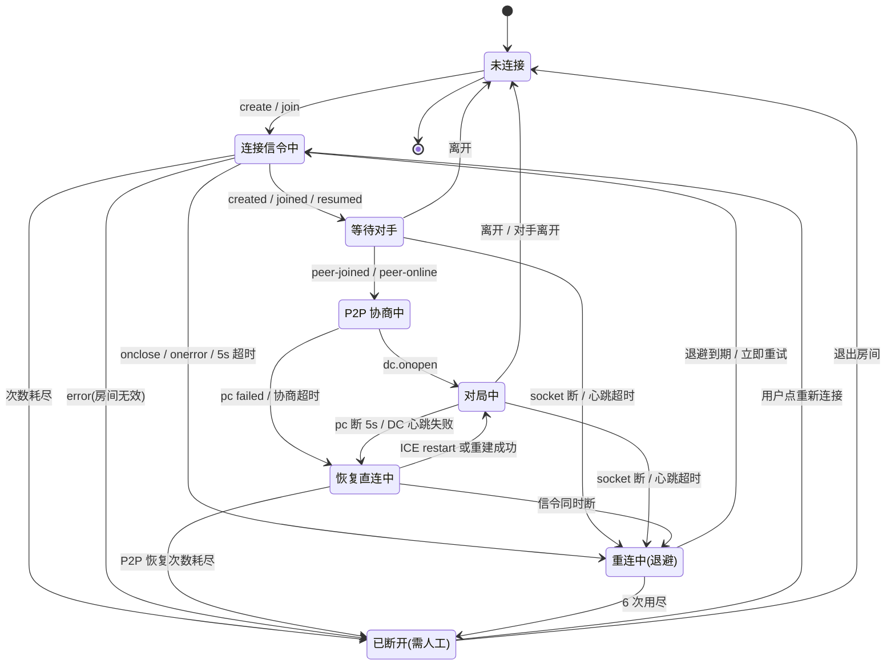

# 自动重连机制 PRD（稳定连接 · Reconnect）

| 项 | 内容 |
|---|---|
| 语言 | 中文 |
| 编程语言 | TypeScript strict（前端 React 19 + CSS Modules + Vitest）；信令侧 TS（`ws`）为主、Rust 版为兼容目标 |
| 项目名称 | `gomoku_reconnect` |
| 作者 | 许清楚（Xu）· 产品经理 |
| 状态 | 历史需求基线；自动重连已实现，后续扩展见下方现状说明 |
| 落点 | `docs/reconnect/prd.md`（设计由架构师产出，实现任务由架构师拆解） |
| 原始需求复述 | 当前设备频繁掉线，需要设计并实现一套稳定可靠的自动重连机制：覆盖掉线检测、重连触发、退避与最大重试、连接状态机、异常处理与日志监控；需说明网络波动 / 服务端异常 / 长时间离线三类场景下的表现；明确模块职责与状态流转；并提供对上层业务透明的接入接口，做到健壮、可扩展、易维护。 |

> **现状（2026-10-22）**：本文的问题清单和源码行号记录实施前基线。当前已实现心跳、退避重试、ICE 恢复、棋谱同步与恢复期禁落子；入口见 [orchestrator](../../packages/shared/src/reconnect/orchestrator.ts)。大厅迭代加入[标签页座位持久化](../../packages/web/src/lobby/storage.ts)与[刷新后 resume](../../packages/web/src/lobby/runtime.ts)，覆盖原 R20。性能指标和未完成需求仍须独立验收。

---

## 1. 背景与问题定义

### 1.1 现状（已按代码核对）

| # | 事实 | 位置 | 后果 |
|---|---|---|---|
| F1 | 信令 WebSocket 只设了 `onopen` / `onmessage`，**没有 `onclose` / `onerror`** | `packages/web/src/App.tsx:507-618` | 服务端重启、网络断开后前端**静默失联**：UI 仍停在「等待对手加入…」，无任何提示，用户不会知道要刷新 |
| F2 | `handleCreateRoom` / `handleJoinRoom` 在 socket 非 OPEN 时**直接覆写 `ws.onopen`** | `App.tsx:638-641`、`App.tsx:654-657` | 覆盖掉 `ensureWsSignaling` 里原有的队列 flush（`App.tsx:507-511`）→ `wsQueueRef`（`App.tsx:485-491`）里待发的 SDP/ICE 永久丢失 → 建连卡死 |
| F3 | 无重连、无退避、无重试上限、无手动重连入口 | 全仓 `grep reconnect` 仅命中 Rust relay 的 Redis 重连（`apps/signaling-rust/src/relay/*`），**P2P/信令侧为零** | 任何一次断开都是终态，只能手动刷新页面 |
| F4 | 无应用层心跳。服务端虽有 30s WS ping + 无 pong 强杀（`apps/server/src/server.ts:165-175`，判定逻辑 `apps/signaling-rust/src/transport/heartbeat.rs:19-21`） | 同上 | ① 浏览器 WebSocket 无法主动 ping / 无法读取 pong，**客户端对服务端心跳完全无感**；② 移动端切后台、NAT 超时造成的「半开连接」（socket 仍 OPEN、实际已死）在客户端**永不发现** |
| F5 | 重连后无会话恢复：服务端 `peerId` 按物理连接随机生成 | `apps/server/src/server.ts:84` | 新连接 = 新 `peerId`，服务端不认识旧身份 |
| F6 | socket 一断就 `leave` 并广播 `peer-left`；房间空即销毁；房间上限 2 人 | `server.ts:152-154`、`apps/server/src/rooms.ts:156-176`、`rooms.ts:48`、`rooms.ts:138-140` | 一次 3 秒抖动 = 对手收到 `peer-left` → 前端 `resetRoomSession()` **清空棋盘与聊天**（`App.tsx:561-566`），一局直接作废；且重连回来必然撞「房间不存在」或「房间已满（仅支持 1v1）」 |
| F7 | DataChannel 断开只 `setConnected(false)` + 清 transport，**无 ICE restart** | `packages/web/src/webrtc.ts:105-119`、`webrtc.ts:148-151`、`App.tsx:241-244` | 即使网络立刻恢复，也必须重走「建房 → 加入 → 交换 SDP」全流程；`initPeer()` 首行就 `this.close()`（`webrtc.ts:86`），当前**不存在**不析构 PC 的恢复路径 |
| F8 | 落子发送结果被丢弃 | `App.tsx:294` 忽略 `sendMessage()` 返回值；`webrtc.ts:175-181` 通道未开时返回 `false` | **本地已落子、对手没收到** → 双方棋谱永久分叉，且无任何一方知情（最严重的数据正确性问题） |
| F9 | 连接状态散落在 `connected` / `roomStatus` / `flow` / `transport` 多个 `useState` | `App.tsx:57`、`App.tsx:71-72`、`App.tsx:80` | 无法表达「重连中 / 退避等待第 2 次 / 已放弃」等中间态；UI 只能二值显示，掉线时提示与实际必然不一致 |
| F10 | 无日志与埋点 | 全仓 | 线上掉线无法归因（网络 / 服务端 / ICE 失败无法区分），也无法验证本次改造效果 |

### 1.2 用户损失（按代码路径可直接推导，非估算）

1. **对局中断**：任意一次 socket 断开，用户看到的是「等待对手加入…」（F1），实际已死；唯一出路是刷新页面 → 棋盘、聊天、房间号全部丢失（`resetRoomSession`，`roomSession.ts:88-105`）。
2. **落子丢失 / 棋谱分叉**：断线瞬间的落子本地生效、对端未收（F8）；恢复后无任何同步机制 → 双方看到不同棋盘，胜负判定失效。
3. **对手被误判为退出**：3 秒抖动即触发 `peer-left` + 清盘（F6），对手侧体验是「对方跑了，这局没了」，属于**社交层面的误伤**，比崩溃更伤口碑。
4. **无法自救**：无手动重连入口（F3），弱网用户（地铁、电梯、WiFi 漫游）只能反复刷新，每次刷新都要重新输入房号。
5. **无法归因**：F10 导致「频繁掉线」这一用户原始诉求**当前无法被测量**，任何优化都无法验证。

> **基线缺失声明**：仓库当前没有任何连接事件埋点，因此无法给出「掉线率 / 平均恢复时长」的历史数据。本 PRD 不编造基线；R6 的埋点是拿到基线的**前置条件**，上线后用它回填 M1–M4 指标。

---

## 2. 产品目标与成功指标

### 2.1 产品目标（3 个正交）

| # | 目标 | 一句话 |
|---|---|---|
| G1 | **掉线可恢复** | 短时网络波动不再毁掉一局棋：自动恢复、不丢子、不需刷新 |
| G2 | **状态可解释** | 任何时刻用户都能看懂「现在怎么了、还要等多久、我能做什么」，不静默、不误报 |
| G3 | **业务无感知** | 重连逻辑收敛为独立模块 + 单一状态源，对局 UI（Board / Chat / GameStatus）零改动接入 |

### 2.2 成功指标（可度量、可验收）

| # | 指标 | 目标值 | 验收方式 |
|---|---|---|---|
| M1 | 短抖动恢复率 | 注入 3s / 8s 网络中断各 100 次，**≥99%** 在 **15s 内**回到「对局中」 | Playwright 双端 + 网络代理注入（复用 `test/e2e.js` 双浏览器框架） |
| M2 | 状态保真 | 恢复前后双方 `moves` 序列 **100% 一致**；「双方棋谱分叉」事故 **0 例** | 注入「落子瞬间断线」100 次，比对 `window.__gomoku.moves` |
| M3 | 提示克制 | 单次掉线：常驻状态条 ≤1 个（文案可更新）+ toast **≤1 条**（仅恢复成功时）；**误报率 < 0.5%**（未真断却提示） | 注入 3s 纯丢包（PC 未断）→ 断言 UI 无任何掉线提示 |
| M4 | 半开检测 | 静默半开（无 close 事件、包被丢弃）在 **≤16s** 内被判定并进入重连 | 代理静默丢包（不 FIN），断言状态机在 16s 内离开「对局中」 |
| M5 | 放弃可解释 | 长离线（> 重试窗口）后 **100%** 落到「已断开」终态并给出可操作项；「永久卡在等待对手加入」**0 例** | 断网 90s 后恢复，断言 UI 出现「重新连接 / 退出房间」 |
| M6 | 无回归 | `pnpm build && pnpm test` 全绿；单测总时长 **< 5s**；**零新增运行时依赖** | CI / 本地命令 |
| M7 | 服务端不被拖垮 | 重连风暴（100 客户端同时断/连）下服务端连接数正常回收、无内存增长 | 压测脚本（P1 归档） |

---

## 3. 用户故事（含 Given-When-Then 验收标准）

### US-1 房主视角：对局中短暂断网

> 作为**房主**，我想在对局中网络抖一下之后自动回到棋局，以便不用重新建房、不用重下已经下过的棋。

- **Given** 房主已与对手 P2P 对局中，棋盘上有 12 手棋
- **When** 房主侧网络中断 6 秒后恢复
- **Then** ① 6 秒内 UI 显示「连接中断，正在重连（第 2/6 次）…」，棋盘与棋子**保持可见**（不清盘）；② 恢复后自动回到「对局中」，toast「已恢复连接」**恰好 1 条**；③ 12 手棋完全一致；④ 房主仍执黑、仍为房主，房间号不变；⑤ 对手侧全程未收到「对手已离开」。

### US-2 加入方视角：对手掉线时我不被误伤

> 作为**加入方**，我想在对手网络抖动时看到「对手正在重连」而不是「对手已离开」，以便知道该等还是该走。

- **Given** 双方对局中，加入方网络正常
- **When** 房主侧断线（30 秒内恢复）
- **Then** ① 加入方看到「对手网络不稳定，正在重连…（最多 60s）」，**棋盘不被清空**、聊天记录保留；② 该期间加入方**不可落子**（`isPlayable=false`，防棋谱分叉）；③ 房主恢复后自动续局，双方棋谱一致，加入方看到「对手已恢复」系统消息；④ 若 60s 内未恢复，才收到「对手已离开」，并按现有逻辑清盘（行为不变）。

### US-3 双方同时抖动

> 作为**任意一方**，我想在两人同时掉线时不会互相把对方挤掉、也不会互相等死。

- **Given** 双方同时断网 8 秒
- **When** 双方几乎同时恢复
- **Then** ① 两端都自动回到「对局中」，**不出现「房间已满」/「房间不存在」错误弹窗**；② 房主负责发起 P2P 恢复（offerer 角色不变），加入方只应答，**无 offer 冲突（glare）**；③ 恢复后棋谱一致；④ 若一方先恢复、另一方 60s 内未恢复，先恢复方保持「对手重连中」，不提前判负、不清盘。

### US-4 移动端切后台 / 息屏

> 作为**手机用户**，我切出去回个微信再回来，希望棋局还在。

- **Given** 对局中，用户把浏览器切到后台 40 秒（iOS 可能冻结定时器）
- **When** 用户回到前台
- **Then** ① 后台期间**不消耗重试次数**、不弹任何 toast；② 回到前台 **1 秒内**发起一次立即探活；③ 若连接已死，立即进入重连（不等待下一个心跳周期）；④ 若连接尚活，直接回到对局，UI 无闪烁。

### US-5 长时间离线（> 重试窗口）

> 作为**用户**，我断网 2 分钟回来，希望系统明确告诉我发生了什么、我能点哪里。

- **Given** 对局中，用户断网 90 秒（超过 6 次 / ≈45s 的重试窗口）
- **When** 用户网络恢复
- **Then** ① UI 显示「已断开，自动重连失败（网络不可用）」，棋盘与棋谱**保留**；② 提供「重新连接」按钮（点击后重置计数、立即重试）与「退出房间」；③ 点击「重新连接」后若服务端房间已销毁，提示「房间已失效」并提供「以房号 A8B2 重新建房 / 重新加入」；④ 全程不出现无限「等待对手加入」。

---

## 4. 需求池（P0 / P1 / P2）

> 用户点名的 7 个关键环节 → R1–R7 一一对应；R8–R12 是让 R1–R7 真正可落地的支撑需求（服务端配合与数据一致性）。

### 4.1 P0（MVP 必做，缺一不可）

#### R1 · 掉线检测策略

**必须**分层检测，任一层判定即触发（避免单层漏判）：

| 层 | 手段 | 参数 | 说明 |
|---|---|---|---|
| L1 信令 socket 事件 | `onclose` / `onerror` | 即时 | 最可靠，网络切换/服务端重启必触发；**当前完全缺失（F1）** |
| L2 信令应用层心跳 | 客户端发 `{t:'ping'}`，等 `{t:'pong'}` | 间隔 5s，单次超时 3s，**连续 2 次**未响应 → 判定半开 | 浏览器 WS 无法 ping / 无法读 pong，**只能应用层做**（F4）；最坏判定时延 ≈16s（对齐 M4） |
| L3 P2P 通道 | `pc.connectionState` + DC 心跳 `{t:'ping'/'pong'}` | `disconnected` 持续 **≥5s** 或 `failed` 立即；DC 心跳 5s/3s ×2 | `disconnected` 会自愈，**必须等 5s** 才算断（防误报，M3） |
| L4 页面生命周期 | `visibilitychange` / `resume` | 恢复可见时立即探活 | 后台冻结后定时器不可信（US-4） |

**禁止**：仅凭 `pc.connectionState === 'disconnected'` 立刻判死；仅凭单次心跳超时判死。

**验收**：静默半开 ≤16s 判定（M4）；3s 纯丢包不进入任何重连状态（M3）。

#### R2 · 重连触发条件

**必须触发**：① L1 socket 非主动关闭；② L2 心跳超时；③ L3 `pc` failed / DC 心跳超时；④ 用户在「已断开」态点击「重新连接」。

**必须不触发**：① 用户主动 `leave` / 换房 / 组件卸载（`App.tsx:263-267` 的 cleanup 路径）；② 对手正常离开（`peer-left` 且未进入 grace）；③ 页面隐藏期间（延迟到可见时）；④ `pc` 短暂 `disconnected` <5s；⑤ 单次心跳超时。

**必须防抖**：同一「故障事件（incident）」内，1s 内多次 close/error **只计 1 次 attempt**，状态迁移合并为 1 次；incident 在回到「对局中」并稳定 10s 后关闭。

**验收**：注入「连续 5 次 close」→ 只消耗 1 次 attempt、只出现 1 次 UI 状态变化。

#### R3 · 重试间隔与退避策略

**必须**为纯函数（注入 clock / random，可毫秒级无网单测）：

```
delay(attempt) = min(base * 2^(attempt-1), cap) * (1 + jitter)，jitter ∈ [-0.2, +0.2]
base = 500ms，cap = 16000ms，maxAttempts = 6
```

- 序列（不含 jitter）：**0.5s → 1s → 2s → 4s → 8s → 16s**，总退避 ≈31.5s，加每次连接超时 5s，**总窗口 ≈45s**。
- 单次连接尝试超时 **5s**（`SIGNAL_CONNECTING` 内未 `onopen` 即放弃本次）。
- **页面隐藏时暂停退避计时且不消耗 attempt**；恢复可见立即执行下一次（不等 delay）。
- 所有参数集中在单一 policy 对象，**禁止散落魔法数字**。

**验收**：`nextDelay(1..6)` 与 cap、jitter 边界单测全绿；隐藏 40s 后恢复，attempt 计数不变（US-4）。

#### R4 · 最大重试次数

| 阶段 | 上限 | 耗尽后 |
|---|---|---|
| 信令 WS | **6 次** / ≈45s 窗口 | 进入终态「已断开」，不静默重试 |
| P2P 恢复 | ICE restart **2 次**（0s / 3s 后）→ 全量重建 PC **1 次** | 若 WS 同时断则并入 WS 重试；否则进入「已断开」 |
| 用户手动 | 无限（每次点击重置计数） | — |

- 终态必须**显式**、可解释、可操作（`重新连接` / `退出房间`），禁止静默。
- **不自动升级**为无限重试（会拖垮服务端，M7）。

**验收**：断网 90s → 恰好 6 次尝试后进入终态（日志可数）、UI 出现两个按钮（M5）。

#### R5 · 连接状态机管理

**必须**单一状态源 + 纯 reducer，状态枚举 8 个（详见 §6）：

`IDLE` / `SIGNAL_CONNECTING` / `ROOM_WAITING` / `NEGOTIATING` / `CONNECTED` / `P2P_RECOVERING` / `RECONNECTING` / `FAILED`（`CLOSED` 由 `IDLE` 表达，见 §6.1）

- 状态对象必须携带：`state`、`attempt`、`nextRetryAtMs`、`reason`（错误分类枚举）、`since`。
- **非法迁移必须被 reducer 拒绝并返回原状态**（不抛异常、不静默跳变）。
- 现有散落状态（`connected` / `roomStatus` / `flow`，F9）**必须**收敛：`connected` 降级为派生值 `isPlayable`，`roomStatus` 降级为状态机文案映射。

**验收**：reducer 单测覆盖全部合法迁移 + 每条非法迁移被拒；`App.tsx` 中不再有 `useState` 拼装连接态。

#### R6 · 异常处理与日志监控

**必须**有错误分类枚举，且**每一类都映射到**「是否计入 attempt / 是否可自动重试 / UI 文案」：

| 分类 | 典型来源 | 计入 attempt | 可自动重试 |
|---|---|---|---|
| `NETWORK_OFFLINE` | `navigator.onLine === false`、连续 connect 失败 | 是 | 是 |
| `WS_CLOSED` | `onclose`（code≠1000） | 是 | 是 |
| `WS_TIMEOUT` | 心跳 2 次超时 | 是 | 是 |
| `SERVER_REJECTED` | `{t:'error'}`：房间不存在 / 已满 / 房号非法 | **否** | **否**（重试无意义，直接终态 + 明确文案） |
| `SERVER_RESTART` | 连上后立刻被踢、房间丢失 | 是 | 是（降级为「以同房号重建/重入」） |
| `ICE_FAILED` | ICE restart 与重建均失败 | 否（走 P2P 计数） | 是（2 次后转终态） |
| `POLICY_EXHAUSTED` | 达到 maxAttempts | — | 否（终态） |
| `USER_CANCELLED` | 用户 leave / 换房 | 否 | 否 |

**日志（P0）**：结构化事件，字段白名单，同一 incident **≤1 条 info 聚合 + 终态 1 条 warn**：

```
conn.state   { from, to, attempt, reason, sinceMs }
conn.retry   { attempt, delayMs, reason, urlHost }        // 仅 host，不带 path/query
conn.restore { attempt, totalMs, via: 'ice-restart'|'rebuild'|'ws-only', movesSynced }
conn.fail    { reason, attempt, totalMs, online, visibility }
```

**脱敏红线**：**禁止**打印 SDP、ICE candidate、IP、TURN 凭证、resume token；房间号打码为 `A**2`；`console.log` 一律禁止（`AGENTS.md §4`），走注入的 `logger` 接口。

**验收**：断网-恢复一次，浏览器控制台**恰好**出现 1 条 `conn.state`（→RECONNECTING）、1 条 `conn.retry`、1 条 `conn.restore`；全量日志 grep 不到 `sdp` / `candidate` / IP 形态字符串。

#### R7 · 对上层业务透明的接入接口

**必须**提供单一入口，业务层只依赖「能不能下棋」和「状态文案」：

```ts
// 契约草案（签名级，实现归工程师；放置位置由架构师定）
interface ConnectionStatus {
  state: ConnState;                 // §6.1
  isPlayable: boolean;              // 唯一的业务判据
  attempt: number;                  // 当前第几次
  maxAttempts: number;
  nextRetryInMs: number | null;     // UI 倒计时
  reason: FailReason | null;
  label: string;                    // 状态条文案（已本地化）
  canRetryNow: boolean;
}

function createConnectionManager(deps: {
  signal: SignalTransport;          // WebSocket 适配器（可注入假实现）
  p2p: P2pTransport;                // WebRTCClient 适配器
  clock: { now(): number; setTimeout(fn, ms): Handle; clearTimeout(h): void };
  random: () => number;             // 注入以保证退避可测
  policy: ReconnectPolicy;
  logger: Logger;
  onStatus(s: ConnectionStatus): void;
  onRestored(info: { via: string; movesSynced: number }): void;
}): {
  start(role: 'host' | 'guest', room?: string): void;
  retryNow(): void;
  leave(): void;
  getStatus(): ConnectionStatus;
};
```

- React 侧只允许一个 `useConnection()` hook 消费它。
- **验收**：`Board.tsx` / `Chat.tsx` / `GameStatus.tsx` **零 import** 重连模块（只读 `isPlayable` / `label` 两个 prop）；`App.tsx` 中 `wsRef`、`wsQueueRef`、`ensureWsSignaling` 全部移出组件。

#### R8 · 会话恢复与服务端座位保持（**P0 阻塞项**）

> 没有 R8，R2/R3/R4 全部无解：重连必然撞「房间已满」或「房间不存在」（F5/F6）。

- **协议增量（向后兼容，仅新增 `t`）**：
  | 方向 | 消息 | 语义 |
  |---|---|---|
  | C→S | `{t:'ping'}` | 应用层心跳，服务端立即回 `pong` |
  | S→C | `{t:'pong'}` | 心跳应答 |
  | S→C | `{t:'peer-offline', graceSec}` | 对手连接断开，进入宽限期（**替代**立即 `peer-left`） |
  | S→C | `{t:'peer-online'}` | 对手在宽限期内恢复 |
  | C→S | `{t:'resume', room, peerId, token}` | 用旧身份占回座位 |
  | S→C | `{t:'resumed', room, peerId, token}` | 恢复成功（可轮换 token） |
  | C↔C | `{t:'sync', moves}` | 恢复后棋谱对齐（走 DataChannel） |
- **服务端宽限期（`offline_grace_secs`，默认 60s，与 `ws_idle_timeout` 60s 对齐）**：socket 断开 → 成员标记 offline、**保留房间与座位**、向对手发 `peer-offline`；宽限内 `resume` 成功 → 发 `peer-online`；超时 → 真正 `leave` + `peer-left`（保持现有语义，`rooms.ts:156-176` 行为仅在超时后生效）。
- **座位安全**：`token` 由服务端生成（≥16 字节随机，随 `created`/`joined` 下发），`resume` 必须校验，防抢座；token 不得进日志、不得进 URL。
- **旧服务端降级**：服务端不支持 `resume` 时返回 `{t:'error'}` → 客户端**必须**降级为「重新 `join` + 新建 PC」，不崩、不无限重试（`SERVER_REJECTED` 路径）。
- **验收**：断线 30s 内恢复 → 对手未收到 `peer-left`、棋盘未被清空；断线 70s → 对手收到 `peer-left`（宽限期生效可观测）。

#### R9 · 棋谱一致性（「不丢子」的实现路径，**P0**）

- **恢复期间禁止落子**：`isPlayable=false` 时 `handleLocalMove` 直接拒绝（复用现有 `connected` 守卫，`App.tsx:273-276`）。P0 **不做**离线落子队列。
- **恢复后强制对账**：由**房主（offerer）为权威**，在 DC 重开后发 `{t:'sync', moves}`；加入方逐手重放（`applyMove` 确定性，`core` 已有胜负/边界测试护航），差异 >0 时补一条系统消息「已与对手同步棋谱」。
- **落子发送失败必须可见**：`sendMessage()` 返回 `false`（`webrtc.ts:175-181`）时**不得**静默（当前 `App.tsx:294` 静默），至少记 `conn.fail{reason:'DC_NOT_OPEN'}` 并触发一次 P2P 检测。
- **验收**：注入「落子瞬间断线」100 次，恢复后双方 `moves` 100% 一致（M2）。

#### R10 · 移动端与页面生命周期（**P0**）

`hidden` 期间：暂停退避、不判死、不弹 toast；`visible`/`resume` 时立即探活 + 立即重试。iOS 后台定时器被冻结时不得产生「假 attempt」。

#### R11 · 双端同时掉线（**P0**）

- **角色固定**：房主恒为 offerer（`initPeer(true)` 侧，`App.tsx:540`），加入方只应答 → **结构性消除 glare**。
- **时序**：房主必须等收到 `peer-online` 后才发 offer / ICE restart；未收到前保持 `P2P_RECOVERING`，最长等 3s 后降级为全量重建。
- **验收**：双端同时断 8s → 两端恢复、无错误弹窗、棋谱一致（US-3）。

#### R12 · 手动重连入口（**P0**）

`FAILED` 态必须有「重新连接」（重置 attempt、立即执行）与「退出房间」；`RECONNECTING` 态必须有「立即重试」与「退出房间」（跳过剩余退避）。

### 4.2 P0 边界（明确先做什么 / 后置什么）

**必须在本次落地**：R1–R12 全部；协议增量 `ping/pong/resume/peer-offline/peer-online/sync`；服务端 60s 宽限；状态机收敛；日志脱敏。

**明确后置**：
- 离线落子队列（P0 选择「恢复期禁落子」，简单且不会分叉）
- 后台低频重试（30s/次）
- 刷新页面续局：原计划后置，现已由大厅会话实现（见 R20、Q5）
- 服务端指标 `/metrics`（TS 版无，Rust 版已有）
- 多标签页/多设备会话互斥

### 4.3 P1（应该做）

| # | 需求 | 说明 |
|---|---|---|
| R13 | 客户端计数器埋点 | `{ drops, restores, failReasons: Record<FailReason, number> }` 暴露到 `window.__gomoku`（E2E 可断言，沿用现有测试钩子 `App.tsx:761-813`），可选上报端点默认关闭 |
| R14 | 诊断面板 | 状态条点开显示：reason / attempt / RTT / via（复用 `transport.summary`） |
| R15 | 后台低频重试 | `FAILED` 后可选 30s/次、最多 10 次，可配置关闭 |
| R16 | 重连耗时分布 | P50 / P95 上报（配合 M1 验证） |
| R17 | 服务端宽限期可配 | 对齐 M3 三层配置（`GOMOKU_OFFLINE_GRACE`），非法值 fail-fast |

### 4.4 P2（Nice to have）

| # | 需求 |
|---|---|
| R18 | 离线落子队列（本地乐观落子 + 恢复后补发 + 冲突回滚） |
| R19 | Service Worker 级保活（收益存疑，见 Q4） |
| R20 | 已实现：大厅会话在当前标签页的 sessionStorage 保存座位与棋谱，刷新后尝试 resume；恢复仍受服务端宽限和凭证有效性约束 |
| R21 | 跨设备会话迁移（换手机继续下） |

---

## 5. 场景矩阵

| 场景 | 检测方式 | 用户可见表现 | 系统行为 | 恢复判据 |
|---|---|---|---|---|
| **A. 短暂丢包（<3s，PC 未断）** | L3 DC 心跳 1 次超时；`pc` 无变化 | **无任何提示**（棋盘照常） | 不进入重连；仅内部计数 | 下一条心跳正常 → incident 不成立（M3 误报基线） |
| **B. WiFi ↔ 4G 切换** | `pc.connectionState` → `disconnected` ≥5s 或 `failed`；DC 心跳 2 次失败 | 「网络波动，正在恢复直连…」常驻条（可操作项：无） | `P2P_RECOVERING`：第 1 次 ICE restart（0s）→ 第 2 次（3s）→ 全量重建（1 次）；房主发起 | DC 重开 + `sync` 完成 → `CONNECTED`，toast「已恢复连接」1 条 |
| **C. 信令 socket 断开（代理/抖动）** | L1 `onclose`/`onerror` | 「连接中断，正在重连（第 1/6 次）… 剩余 0.5s」，按钮：立即重试 / 退出 | `RECONNECTING` → 退避 → `SIGNAL_CONNECTING` → `resume` → `P2P_RECOVERING` | 收到 `resumed` 且 DC 重开 |
| **D. 服务端 5xx / 连接被拒（短时）** | 连接尝试失败 / `onerror` | 同 C，文案附「服务器暂不可用」 | 计入 attempt，退避重试；不区分 5xx 类型 | 6 次内连上 → 恢复 |
| **E. 服务端进程重启 / 发布** | 连接被关闭（1001/1006）+ 重连后 `resume` 返回 error | 「房间已失效，可用房号 A8B2 重新建房 / 重新加入」 | 内存房间已丢 → `SERVER_RESTART` → **终态但保留棋谱**，给出同房号重建/重入按钮 | 用户点击后成功建房/入房（房主重建同码、加入方自动 join 同码） |
| **F. 半开连接（静默丢包、无 close）** | L2 心跳 2 次超时（≤16s） | 同 C（延迟出现） | 主动 `close()` 旧 socket → 走 C 流程 | 同 C（M4 ≤16s） |
| **G. 长时间离线（>45s 窗口）** | 6 次尝试耗尽 | 「已断开，自动重连失败」+ 棋盘保留 + 重新连接 / 退出房间 | `FAILED` 终态，停止自动重试（不烧电、不打服务端） | 用户手动重试；服务端宽限 60s 超时后对端收到 `peer-left` |
| **H. 移动端切后台 / 息屏** | `visibilitychange` / `resume` | 后台无提示；回前台若已死则同 C | 后台暂停退避与 attempt；回前台立即探活 + 立即重试 | 回前台 ≤1s 内探活，≤15s 内恢复（US-4） |
| **I. 双端同时掉线** | 两端各自 L1/L2 | 两端均显示「正在重连…」 | 各自重连 → 各自 `resume` → 房主等 `peer-online`（≤3s）→ 发 offer / ICE restart；加入方只应答 | 两端 `CONNECTED` 且 `sync` 一致（US-3、R11） |

---

## 6. 状态机与用户可见交互

### 6.1 状态枚举

| 状态 | 含义 | `isPlayable` | 是否终态 |
|---|---|---|---|
| `IDLE` | 未连接 / 已主动离开 / 未开始 | ✗ | 否 |
| `SIGNAL_CONNECTING` | 正在建立信令 socket（含首次与重试） | ✗ | 否 |
| `ROOM_WAITING` | 已在房间，等待对手加入 | ✗ | 否 |
| `NEGOTIATING` | 对手已加入，正在交换 SDP/ICE | ✗ | 否 |
| `CONNECTED` | DC 已开，对局中 | ✓ | 否 |
| `P2P_RECOVERING` | 信令正常、P2P 断开，正在 ICE restart / 重建 | ✗ | 否 |
| `RECONNECTING` | 信令断开，退避等待或正在重连 | ✗ | 否 |
| `FAILED` | 自动重连放弃，需人工介入 | ✗ | **是**（仅 `retryNow` / `leave` 可离开） |

> 页面隐藏是**修饰符**（`paused: boolean`），不是状态 —— 避免状态爆炸。

### 6.2 合法迁移

| From | To | 触发 | 守卫 |
|---|---|---|---|
| `IDLE` | `SIGNAL_CONNECTING` | create / join | — |
| `SIGNAL_CONNECTING` | `ROOM_WAITING` | `created` / `joined` / `resumed` | — |
| `SIGNAL_CONNECTING` | `RECONNECTING` | `onclose`/`onerror`/5s 超时 | 非用户取消 |
| `SIGNAL_CONNECTING` | `FAILED` | attempt ≥ maxAttempts | — |
| `SIGNAL_CONNECTING` | `FAILED` | `error`（房号非法/已满/不存在） | `SERVER_REJECTED`，**不计 attempt** |
| `ROOM_WAITING` | `NEGOTIATING` | `peer-joined` / `peer-online` | — |
| `ROOM_WAITING` | `RECONNECTING` | L1/L2 | 同上 |
| `NEGOTIATING` | `CONNECTED` | `dc.onopen` | — |
| `NEGOTIATING` | `P2P_RECOVERING` | `pc` failed / 协商超时 | — |
| `CONNECTED` | `P2P_RECOVERING` | `pc` disconnected ≥5s / failed / DC 心跳 ×2 | 非主动关闭 |
| `CONNECTED` | `RECONNECTING` | L1/L2 | — |
| `P2P_RECOVERING` | `CONNECTED` | DC 重开 + `sync` 完成 | — |
| `P2P_RECOVERING` | `RECONNECTING` | 信令同时断开 | — |
| `P2P_RECOVERING` | `FAILED` | ICE restart ×2 + 重建 ×1 全败 | — |
| `RECONNECTING` | `SIGNAL_CONNECTING` | 退避到期 / `retryNow` | 非 paused |
| `RECONNECTING` | `FAILED` | attempt ≥ maxAttempts | — |
| `FAILED` | `SIGNAL_CONNECTING` | `retryNow` | 重置 attempt |
| 任意 | `IDLE` | `leave` / 对手 `peer-left`（宽限超时） | — |

**非法迁移**（reducer 必须拒绝并返回原状态）：`FAILED → CONNECTED`、`IDLE → CONNECTED`、`CONNECTED → ROOM_WAITING`、`RECONNECTING → NEGOTIATING`（必须先经 `SIGNAL_CONNECTING`）。

### 6.3 状态迁移图



### 6.4 每状态的 UI 文案与可操作项

| 状态 | 主文案（状态条） | 可操作项 | toast |
|---|---|---|---|
| `IDLE` | 「未连接」 | 创建 / 加入房间 | — |
| `SIGNAL_CONNECTING` | 「正在连接服务器…」（重试时：「正在重连（第 N/6 次）… 剩余 Xs」） | 取消 | 首次失败不弹；仅终态弹 1 条 |
| `ROOM_WAITING` | 「房间 A8B2 · 等待对手加入…」 | 复制邀请链接 / 离开 | 建房成功 1 条（现状保留） |
| `NEGOTIATING` | 「对手已加入，正在建立直连…」 | 离开 | — |
| `CONNECTED` | 「已直连」（Header，现状保留） | 落子 / 聊天 / 悔棋 / 重开 | **恢复时**「已恢复连接」1 条 |
| `P2P_RECOVERING` | 「网络波动，正在恢复直连…（自动）」 | 无（棋盘只读） | — |
| `RECONNECTING` | 「连接中断，正在重连（第 2/6 次）… 剩余 8s」 | **立即重试** / 退出房间 | — |
| `FAILED` | 「已断开：<原因文案>。棋盘已保留。」 | **重新连接** / 退出房间（房间失效时追加：以 A8B2 重新建房 / 重新加入） | 1 条（终态） |

**提示纪律（M3 落地口径）**：
- 状态条是**常驻元素**，文案更新不算「新提示」；
- 同一 incident 内 toast ≤1 条（成功 1 条，或终态 1 条，二者不叠加）；
- 纯丢包（PC 未断）**零提示**；
- 禁止在 `RECONNECTING` 期间每次重试都弹 toast。

**原因文案映射**（`FAILED` 态必填）：`NETWORK_OFFLINE`→「网络不可用」；`WS_CLOSED`→「连接被关闭」；`WS_TIMEOUT`→「服务器无响应」；`SERVER_REJECTED`→服务端原文（`rooms.ts` 既有文案，逐字复用）；`SERVER_RESTART`→「服务器已重启，房间失效」；`ICE_FAILED`→「直连建立失败（可能处于对称 NAT）」；`POLICY_EXHAUSTED`→「多次重试失败」。

---

## 7. 非功能需求

| 面 | 要求 | 验收 |
|---|---|---|
| 依赖 | **零新增运行时依赖**；不引入状态管理库；仅用浏览器原生 API + 现有 `ws` | `package.json` diff 为空 |
| 可测性 | 退避 / 状态机 / 错误分类 / 同步对账 **全部为纯函数**，clock / random / timer 注入（`AGENTS.md §2 DIP`、`§3 TDD`）；不启真实网络 | `pnpm test` 全绿且总时长 <5s；`packages/web/test/` 新增用例与源文件对称 |
| 分层 | 纯逻辑放 `shared`（或 `core`）且**零 IO/DOM**；WS/PC 适配放 `web`；依赖方向严格 `web → shared → core`（`AGENTS.md §1`） | 无反向 import；`shared` 单测不 mock DOM |
| 主线程 | 退避用单链 `setTimeout`（禁止 `setInterval` 叠加）；同一时刻最多 1 个在途探测；无忙等 | 重连期间 DevTools 无长任务（>50ms） |
| 省电 | 页面隐藏暂停退避；`FAILED` 停止全部定时器 | 隐藏 5 分钟 CPU 占用 ≈0 |
| 泄漏 | 每次重连必须 close 旧 `ws`/`pc` 并**先解绑再 close**（沿用 `webrtc.ts:393-419` 的防串台模式）；同页面不得残留 >1 个 WebSocket | 连续 20 次重连后 `performance.memory` / `wss.clients` 不增长 |
| 日志安全 | 字段白名单 + 脱敏：**禁止** SDP / candidate / IP / TURN 凭证 / resume token；房间号打码；禁 `console.log` | 日志文本 grep 断言（R6 验收） |
| 兼容 | 旧服务端（不认 `resume`/`ping`）→ 降级为「重新 join + 新建 PC」，不崩不无限重试；单文件 HTML 零服务器路径（手动邀请码）**完全不受影响** | 用旧 `apps/server` 跑通一次降级 |
| 向后兼容 | 协议仅**新增** `t`；既有 6 类消息字段与文案零变更（对齐 `docs/m3-rust-signaling/prd.md §4.1`，但**需回签**见 Q1） | 未升级客户端连新服务端行为不变 |

---

## 8. 待确认问题（需主理人 / 用户拍板）

| # | 问题 | 建议默认立场 |
|---|---|---|
| **Q1** | **协议增量是否获批**：`docs/m3-rust-signaling/prd.md §4.1` 明确声明「M3 不新增 WS 消息类型」。本次必须新增 `ping/pong/resume/peer-offline/peer-online`（+ DC 侧 `sync`），否则 R1/R8 无法实现。 | 建议批准为**纯增量**（旧客户端不受影响，未知 `t` 仍返回「未知消息类型」）；在 M3 PRD 追加修订记录，避免契约漂移 |
| **Q2** | **重试参数取值**：6 次 / 退避 0.5→16s / 总窗口 ≈45s，服务端宽限 60s。地铁等长弱网场景是否可接受 45s 后转人工？ | 建议先按此上线，用 R13 埋点观察 P95 恢复时长后再调；参数集中可配 |
| **Q3** | **长离线（>窗口）后：续局还是重开？** 双方离线期间可能各自操作，棋谱有分叉风险。 | 建议「续局 + 房主权威全量同步」；若对端已离开（宽限超时）则明确提示「对手已离开，是否重开一局」，由用户选择 |
| **Q4** | **宽限期内对手是否锁定落子？** 锁定可彻底避免分叉，代价是对手最多冻结 60s。 | 建议锁定（`isPlayable=false`），文案给倒计时；60s 可配 |
| **Q5** | **刷新页面是否自动续局？** 需把 `resume token` + `roomCode` 存 `sessionStorage`（涉多标签页抢占与安全边界）。 | 原决策后置；大厅迭代已实现标签页座位/棋谱恢复。存储不可用、宽限期过期或凭证失效时不能保证续局 |

---

## 附：对下游的输入

- **架构师**：§4 需求池 + §6 状态机为需求侧约束，模块划分 / 文件落点 / 协议字段细节归你；请特别给出 ① 纯逻辑与适配器的切分边界（必须满足 `shared` 零 IO）② `resume` 的座位与 token 生命周期 ③ ICE restart 与全量重建的判定顺序。
- **工程师**：§6.4 文案与 §7 非功能为硬约束；TDD 先行（先写 `nextDelay` / reducer / 分类器 / `sync` 对账的失败用例）；**禁止**改 `core` 规则代码；`App.tsx` 只做「接线」，重连逻辑必须落在新模块。
- **QA**：§2.2 M1–M7 与 §5 场景矩阵 A–I 为验收基线；注入手段建议基于现有 Playwright 双浏览器框架（`test/e2e.js`）+ CDP `Network.emulateNetworkConditions` / 本地代理静默丢包（验证半开）。
