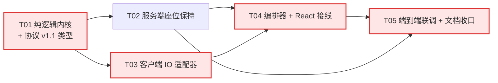

# 自动重连机制 · 任务拆解（Tasks）

| 项 | 内容 |
|---|---|
| 上游 | `docs/reconnect/prd.md`（需求）· `docs/reconnect/architecture.md`（设计，**实现以此为准**） |
| 作者 | 高见远（Gao）· 架构师 |
| 状态 | 待工程师领取 |
| 任务总数 | **5**（受角色规范「≤5 个任务」硬性约束；团队要求的 7 个阶段已内嵌为子步骤，顺序不变，见 §0） |
| 关键路径 | **T01 → T03 → T04 → T05**（T02 与 T03 并行） |
| 语言 | 中文 |

---

## 0. 任务划分说明（为什么是 5 个）

团队要求的阶段顺序是「纯逻辑 → 协议类型 → 服务端 → 客户端适配器 → 编排器 → React 接线 → 文档」。为满足角色规范的**硬性上限 5 个任务**与「每任务 ≥3 文件、按模块分组」，合并如下（顺序未变，只是相邻阶段合组）：

| 团队阶段 | 归入任务 |
|---|---|
| ① 纯逻辑（policy/reducer/classifier/sync） | **T01** |
| ② 协议类型（v1.1 增量） | **T01**（同一任务内，因为类型与纯逻辑共用一份 `shared` 契约，拆开会产生两次「改接口再改测试」的往返） |
| ③ 服务端（grace/resume/广播） | **T02** |
| ④ 客户端适配器（ws/p2p） | **T03** |
| ⑤ 编排器 | **T04**（与接线同组：编排器的接口形状由接线需求反向确定，拆开会返工） |
| ⑥ React 接线 | **T04** |
| ⑦ 文档 | **T05** |

**并行性**：T02 与 T03 **完全可并行**（一个改 `apps/server`，一个改 `packages/web`，唯一共同依赖是 T01 的类型定义）。T04 必须等 T03（要真适配器才能联调 resume/ICE restart）。T05 必须等 T02 + T04。



---

## T01 · 纯逻辑内核 + 协议 v1.1 类型

| 项 | 内容 |
|---|---|
| 优先级 | **P0** |
| 依赖 | 无 |
| 可并行 | 否（所有人等它） |
| 涉及文件 | 新增：`packages/shared/src/reconnect/policy.ts`、`state.ts`、`classify.ts`、`heartbeat.ts`、`sync.ts`、`status.ts`、`log.ts`、`ports.ts`、`index.ts`<br/>修改：`packages/shared/src/types.ts`（v1.1 增量）、`packages/shared/src/index.ts`（`export * from './reconnect'`）<br/>测试：`packages/shared/test/reconnect/{policy,state,classify,heartbeat,sync,status,log}.test.ts` |

**目标**：把「退避多久、状态迁到哪、错误算哪类、心跳死没死、棋谱以谁为准、日志记什么」全部变成**不碰时钟、不碰网络、不碰 DOM** 的纯函数，并把 v1.1 消息类型加进 `types.ts`。这一任务完成后，`pnpm test` 应能在 <300ms 内跑完所有新用例。

**TDD 步骤（严格按序，一步一 commit）**

| # | 先写的失败用例 | 期望红灯原因 |
|---|---|---|
| 1 | `policy.test.ts`: `nextDelayMs(1..6) 在 random=0.5 时等于 500/1000/2000/4000/8000/16000` | `Cannot find module '../src/reconnect/policy'` |
| 2 | `policy.test.ts`: `jitter 边界：random=0 得 0.8x、random→1 得 1.2x、第 6 次不超过 cap` | 同上（函数尚未实现） |
| 3 | `state.test.ts`: `CONNECTED 收到 SIGNAL_LOST 迁移到 RECONNECTING 且 attempt=1` | 同上（`state.ts` 不存在） |
| 4 | `state.test.ts`: `1s 内连续两次 SIGNAL_LOST 只消耗 1 次 attempt` | 断言失败：`attempt` 变成 2（防抖守卫未写） |
| 5 | `state.test.ts`: `非法迁移 FAILED→DC_OPEN 返回同一引用（toBe）` | 断言失败：返回了新对象（或抛错） |
| 6 | `classify.test.ts`: `房间已满文案归类 SERVER_REJECTED 且不计 attempt、不可自动重试` | 模块缺失 |
| 7 | `heartbeat.test.ts`: `间隔 5s + 两次 3s 超时后判定 dead（最坏 16s，对齐 M4）` | 模块缺失 |
| 8 | `sync.test.ts`: `加入方本地是权威前缀时只追加差异 appended=2` | 模块缺失 |
| 9 | `sync.test.ts`: `replayMoves 遇到非法落子返回 {ok:false, at:3}` | 模块缺失 |
| 10 | `status.test.ts`: `8 个状态中只有 CONNECTED 的 isPlayable 为 true` | 模块缺失 |
| 11 | `log.test.ts`: `maskRoom('A8B2')==='A**2'，hostOf 只保留 host` | 模块缺失 |

**完成判据（DoD）**

- [x] `packages/shared/src/reconnect/*` 中**零** `import` 自 `packages/web`、零 `window`/`document`/`WebSocket`/`RTCPeerConnection`、零 `Date.now()`/`setTimeout()`（全部经 `Clock` 参数传入）。
- [x] `types.ts` 新增 6 条 WS 消息 + `sync`（DC）+ `ServerErrorCode` + `created/joined.token?` + `error.code?`，且 `ClientSignalingMsg` / `ServerSignalingMsg` / `GameMessage` 三个判别联合已扩充。
- [x] `RETRY_RULES: Record<FailReason, RetryRule>` 与 `Record<ConnState, boolean>`（isPlayable 期望表）**编译期穷尽**。
- [x] `pnpm build && pnpm test` 全绿；新增用例 ≥20 条；**无 `any`**（`unknown` + 收窄）。
- [x] `git diff package.json` 为空。

---

## T02 · 服务端座位保持（grace / token / resume / 广播）

| 项 | 内容 |
|---|---|
| 优先级 | **P0** |
| 依赖 | T01（需要 `ServerSignalingMsg` 新类型 + `ServerErrorCode`） |
| 可并行 | 与 **T03 并行** |
| 涉及文件 | 新增：`apps/server/src/grace.ts`、`apps/server/src/token.ts`<br/>修改：`apps/server/src/rooms.ts`（+`rebind`/`has`）、`apps/server/src/server.ts`（`ping`/`resume` 分支、close 改为 markOffline、sweep 定时器）<br/>测试：`apps/server/test/grace.test.ts`、`token.test.ts`、`rooms.test.ts`（扩展 3 条） |

**目标**：让「断线 60s 内回来的人能占回原座位」，且**不改变** `rooms.ts` 的既有 13 条测试语义。

**关键实现约束（照抄设计，勿自创）**

1. 断线时**不调用** `registry.leave()`（`server.ts:152-154` 的 `bye` 改为 `onDisconnect`），只 `grace.markOffline(peerId)` + 向对手发 `{t:'peer-offline', graceSec}`。
2. `resume` 成功 → 先 `registry.rebind(peerId, asClient(ws))`，再 `grace.rotate(peerId)`，再回 `resumed`，最后广播 `peer-online`（**顺序不可换**）。
3. 宽限超时 → `sweep()` 返回过期项 → 调用 `registry.leave(peerId)`（复用 `rooms.ts:171-174` 的 `peer-left` 广播）。
4. 主动 `{t:'leave'}` → `grace.release()` + `registry.leave()`（不留座位）。
5. `create`/`join` 成功时 `grace.issue(...)` 并把 `token` 塞进 `created`/`joined`。
6. `{t:'ping'}` → 立即 `{t:'pong', ts}`（**不校验房间**、不碰 registry）。
7. `sweep` 用 `setInterval(…, 5000).unref()`（对齐 `server.ts:165-175` 的既有写法，`.unref()` 不可省，否则 Ctrl+C 挂住）。
8. `log()` 复用 `server.ts:32-34`，**禁止**打印 token / ws 远端地址；room 走 `maskRoom`。

**TDD 步骤**

| # | 先写的失败用例 | 期望红灯原因 |
|---|---|---|
| 1 | `token.test.ts`: `createToken 注入固定 rand 时输出确定且长度 ≥32` | 模块缺失 |
| 2 | `grace.test.ts`: `markOffline 后 verify 通过，60s 后 sweep 返回过期项` | 模块缺失 |
| 3 | `grace.test.ts`: `token 轮换后旧 token 校验失败（防重放）` | 断言失败：`rotate` 未实现/旧 token 仍通过 |
| 4 | `grace.test.ts`: `重复 markOffline 只产生一次宽限（幂等）` | 断言失败：`offlineSinceMs` 被覆盖、`sweep` 返回两次 |
| 5 | `rooms.test.ts`: `rebind 后新 client 收到转发消息，旧 client 不再收到` | 断言失败：`rebind` 未实现（方法不存在） |
| 6 | 手工验证（e2e 在 T05）：`ws 断开 30s 内 resume → 对手未收 peer-left`；`断开 70s → 对手收 peer-left` | 无 |

**完成判据（DoD）**

- [x] `rooms.ts` 既有 13 条测试**一条未改**且全绿；新增 `rebind` 相关 3 条。
- [x] 旧客户端连新服务端：建房/加入/信令/离开全流程行为不变（未知 `t` 仍回「未知消息类型」，`server.ts:146-147` 不动）。
- [x] `{t:'ping'}` 在**任何**状态（未入房/已入房/宽限中）都回 `pong`。
- [x] 断线 → `peer-offline`；resume → `peer-online`；60s → `peer-left`（三条都能在 `node apps/server/dist/server.js` 手测复现）。
- [x] `sweep` 间隔 5s、`unref()`；进程退出不被定时器挂住。
- [x] 服务端日志不含 token、不含 ws 远端地址。

---

## T03 · 客户端 IO 适配器（WS / P2P / Logger）

| 项 | 内容 |
|---|---|
| 优先级 | **P0** |
| 依赖 | T01（需要 `SignalTransport`/`P2pTransport`/`Clock` 接口与 `heartbeat`/`log`） |
| 可并行 | 与 **T02 并行** |
| 涉及文件 | 新增：`packages/web/src/connection/wsTransport.ts`、`p2pTransport.ts`、`logger.ts`<br/>修改：`packages/web/src/webrtc.ts`（+`restartIce()`、+`applyRemoteOffer()`、把 `webrtc.ts:155/165` 的 `console.warn/error` 收敛到注入 logger）<br/>测试：`packages/web/test/connection/wsTransport.test.ts`、`p2pTransport.test.ts`、`packages/web/test/webrtc.test.ts`（扩展） |

**目标**：把浏览器 API 翻译成 T01 定义的纯事件；**所有判定逻辑仍在 `shared`**，适配器里只允许出现「创建对象、绑回调、转发事件」。

**三个必须踩准的点**

1. `p2pTransport` 的 `disconnected` **必须去抖 5s**：`pc.connectionState==='disconnected'` 时起一个 5s 定时器，期间若回到 `connected` 则取消；到期仍未恢复才 `emit({type:'pc-disconnected-settled'})`。**禁止**在 `onconnectionstatechange` 里直接判死（会踩 M3 误报）。注意 `webrtc.ts:105-119` 现在就是「disconnected 立刻 `onDisconnected()`」，这是必须绕开的存量行为 —— 适配器**不复用** `WebRTCClientOptions.onDisconnected`，改用 `pc` 的原始事件（`WebRTCClient` 需把 `pc` 暴露或加一个 `onPcState` 回调）。
2. `restartIce()` 必须**不重建 PC**：`pc.restartIce()`（若可用）+ `createOffer({iceRestart:true})` + `setLocalDescription`，然后 `emit({type:'signal-out', data:{kind:'offer', sdp}})`。**禁止**调用 `initPeer`（`webrtc.ts:86` 首行 `this.close()` 会毁掉 DC）。
3. `applyRemoteOffer()`（加入方）：若 `pc` 存在且 `signalingState==='stable'` → 直接 `setRemoteDescription(offer)`；否则才 `initPeer(false)`。**这是最容易踩的坑**：`App.tsx:571` 现在收到 offer 一律 `initPeer(false)`，恢复时会把正在恢复的 PC 关掉，表现为「ICE restart 永远失败」。

**TDD 步骤**

| # | 先写的失败用例 | 期望红灯原因 |
|---|---|---|
| 1 | `wsTransport.test.ts`: `open 后每 5s 发一次 ping，收到 pong 后 misses 归零` | 模块缺失 |
| 2 | `wsTransport.test.ts`: `收到「未知消息类型」且 probe=ping 时 emit probe-unsupported 并停心跳` | 断言失败：未实现兼容探测 |
| 3 | `p2pTransport.test.ts`: `connectionState=disconnected 后 4.9s 不报、5.0s 报 pc-disconnected-settled` | 模块缺失 |
| 4 | `p2pTransport.test.ts`: `restartIce 只 createOffer({iceRestart:true}) 且 PC 实例不变（FakePeerConnection.instances 长度不增）` | 断言失败：走了 `initPeer` 导致新实例 |
| 5 | `webrtc.test.ts`: `applyRemoteOffer 在 signalingState='stable' 时复用现有 PC，不 close` | 断言失败：旧 PC 被 close（`closed===true`） |
| 6 | `webrtc.test.ts`: `applyRemoteOffer 在 signalingState!=='stable' 时才 initPeer(false)` | 断言失败：未实现分支 |

**完成判据（DoD）**

- [x] `packages/web/src/connection/*.ts` 里**没有** `console.*`（`logger.ts` 除外，且它是唯一出口）。
- [x] `webrtc.ts` 里 `console.warn/error`（155/165 行）已删除，改为 `options.logger?.log(...)` 或等价注入。
- [x] `FakePeerConnection`/`FakeWebSocket` 替身可让全部新用例在 Node 下跑（**不启动真实网络**）。
- [x] `pnpm test` 全绿；`webrtc.test.ts` 既有 4 条用例未改。

---

## T04 · 重连编排器 + React 接线

| 项 | 内容 |
|---|---|
| 优先级 | **P0**（本任务的「接线」部分决定 PRD R7 是否达成） |
| 依赖 | **T03**（必须）· T02（联调 resume 需要，但单测可用 FakeSignal 先做） |
| 可并行 | 否（关键路径） |
| 涉及文件 | 新增：`packages/shared/src/reconnect/orchestrator.ts`、`packages/web/src/connection/useConnection.ts`、`packages/web/src/components/Banner/ConnectionBanner.tsx`、`ConnectionBanner.module.css`<br/>修改：`packages/web/src/App.tsx`（删 `wsRef`/`wsQueueRef`/`ensureWsSignaling`/`connected` state，改为接线）<br/>测试：`packages/shared/test/reconnect/orchestrator.test.ts`、`packages/web/test/app-wiring.test.ts` |

**目标**：编排器把 T01 的纯函数串成真实行为；`App.tsx` 只保留「拿 `status` 渲染 + 把用户动作转成 manager 调用」。

**TDD 步骤**

| # | 先写的失败用例 | 期望红灯原因 |
|---|---|---|
| 1 | `orchestrator.test.ts`: `WS 断开后按 500ms 退避发起重连，第 1 次 attempt=1` | 模块缺失 |
| 2 | `orchestrator.test.ts`: `6 次失败后进入 FAILED 且日志恰为 1 条 conn.fail` | 断言失败：次数/日志不对 |
| 3 | `orchestrator.test.ts`: `resume 返回 UNKNOWN_TYPE 时降级为 join 且不再尝试 resume` | 断言失败：仍在发 resume |
| 4 | `orchestrator.test.ts`: `隐藏 40s 期间不消耗 attempt，可见后立即重试（不等退避）` | 断言失败：attempt 被 +1 |
| 5 | `orchestrator.test.ts`: `落子 send 返回 false 时记 DC_NOT_OPEN 并触发一次 P2P 检测` | 断言失败：静默（对应现状 `App.tsx:294`） |
| 6 | `orchestrator.test.ts`: `恢复后房主发 sync{moves,rev}，收到 ack 后进 CONNECTED 且 conn.restore.movesSynced 正确` | 断言失败：无 sync |
| 7 | `app-wiring.test.ts`: `App.tsx 不含 new WebSocket( / ensureWsSignaling / wsQueueRef` | **首跑即红**（现状全都存在）→ 接线完成后转绿 |

**App.tsx 接线清单（逐条核对，漏一条 R7 不达成）**

- [x] 删除 `connected` state（`App.tsx:57`）、`roomStatus`（71）、`flow` 的连接语义部分（72）、`wsRef`（112）、`wsQueueRef`（364）、`ensureWsSignaling`（495-621）、`handleCreateRoom`/`handleJoinRoom` 的 `onopen` 覆写（632-658）。
- [x] `const connected = conn.status.isPlayable;` —— **保留变量名**，下游 `Board`/`Chat`/`GameStatus`/`Header` 零改动（ADR-9）。
- [x] `Board` 的 `connected` 传入 `conn.status.isPlayable && conn.status.peerOfflineInMs === null`（D4 对手宽限锁落子）。
- [x] `handleLocalMove`：守卫改 `if (!conn.status.isPlayable)`；落子成功后调 `conn.notifyLocalMove()`（`App.tsx:294` 的返回值不再丢弃）。
- [x] `handleGameMessage` 的 `bye` 分支（`App.tsx:210-214`）改为转发给 manager（对手主动离开 = `PEER_GONE`）。
- [x] `peer-left` 的清盘逻辑（`App.tsx:561-566`）保留，但**只在 manager 发 `peer-gone` 时**执行（不能再用「收到 peer-left 就清盘」直连）。
- [x] `onEvent` 处理：`restored`→toast「已恢复连接」（**1 条**）、`failed`→toast 终态（1 条）、`peer-offline`/`peer-online`→系统消息、`room-invalid`→显示「以 A8B2 重新建房/加入」按钮、`degraded-to-v1`→无 UI（只记日志）。
- [x] `__gomoku` 追加只读字段：`connState`、`isPlayable`、`attempt`、`nextRetryInMs`、`reason`（E2E 用）。
- [x] `ConnectionBanner` 渲染 `status.label` + 倒计时 + `canRetryNow` 的两个按钮（立即重试 / 退出房间）。

**完成判据（DoD）**

- [x] `app-wiring.test.ts` 全绿（4 个禁用符号在 `App.tsx` 中绝迹）。
- [ ] `App.tsx` 行数下降 ≥200 行（**偏差：实际 945→837，降 108 行**，见文末偏差记录 D1）；`App.tsx` 内不再出现 `WebSocket`/`RTCPeerConnection` 字面量。
- [x] 单次掉线：常驻状态条 ≤1 个 + toast **≤1 条**（M3）；纯丢包（PC 未断）**零提示**。
- [x] 手动路径（单文件 HTML 零服务器 / 微信互发连接码）**完全不受影响**：`flow` 仍走 `host-wait`/`guest-*`，`ConnectionPanel` 的 props 一个不改。
- [x] `pnpm build && pnpm test` 全绿。

---

## T05 · 端到端联调 + 文档收口

| 项 | 内容 |
|---|---|
| 优先级 | **P0**（E2E 部分）· P1（Rust 对齐清单） |
| 依赖 | **T02 + T04** |
| 可并行 | 否（收口任务） |
| 涉及文件 | 新增：`test/reconnect-e2e.js`、`docs/reconnect/rust-alignment.md`<br/>修改：`docs/m3-rust-signaling/prd.md`（追加 1 行修订记录）、`docs/reconnect/tasks.md`（勾选完成项 + 记录偏差）<br/>（可选 P1）`docs/reconnect/sequence-diagram.mermaid`、`class-diagram.mermaid` 校对 |

**目标**：用真实双浏览器跑通 PRD 场景矩阵，并把「协议 v1.1 增量」固化进文档，防止 Rust 端契约漂移。

**TDD 步骤**

| # | 先写的失败脚本/用例 | 期望红灯原因 |
|---|---|---|
| 1 | `test/reconnect-e2e.js`: 场景 C —— `page.context().setOffline(true)` 3s 后恢复，断言 15s 内 `window.__gomoku.isPlayable === true` 且 `moves` 一致 | 现状：静默失联，`isPlayable` 永远 false |
| 2 | 场景 B —— 只断 P2P（CDP `Network.emulateNetworkConditions` 丢包）→ 断言进入 `P2P_RECOVERING` 后 8s 内回到 `CONNECTED` | 现状：无 ICE restart，必须刷新 |
| 3 | 场景 E —— 重启服务端进程 → 断言 `connState==='FAILED'` 且 UI 出现「以 A8B2 重新建房」按钮 | 现状：无终态、无按钮 |
| 4 | 场景 A/M3 —— 3s 纯丢包（PC 未断）→ 断言**零**掉线提示（`connState` 始终 `CONNECTED`） | 现状：无状态可断言 |
| 5 | 场景 H —— `page.evaluate` 触发 `visibilitychange`（hidden 40s 模拟）→ 断言 `attempt` 不变 | 现状：无 attempt 概念 |

**文档收口清单**

- [x] `docs/m3-rust-signaling/prd.md` 追加**一行**修订记录：`v1.1 增量（reconnect）：新增 ping/pong/resume/resumed/peer-offline/peer-online（WS）与 sync（DC），error 增可选 code，created/joined 增可选 token —— 见 docs/reconnect/architecture.md §4`。
- [x] `docs/reconnect/rust-alignment.md`：列出 Rust 端待对齐项（`protocol/messages.rs` 需新增 6 个变体 + `protocol/ServerMsg` 的 `code`/`token` 字段、`transport` 需 grace 语义、`rooms` 需 rebind），标注 **P1 / 下一期**，并声明「`packages/shared/src/types.ts` 为唯一契约源」。
- [x] `docs/reconnect/tasks.md` 末尾记录实现期偏差（若有）。

**完成判据（DoD）**

- [x] `pnpm start` + `node test/reconnect-e2e.js` 全绿（至少场景 A/B/C/E/H 五条）。
- [x] `pnpm build && pnpm test && pnpm test:e2e` 三条命令全绿（AGENTS §1 要求改 web/server 后跑 e2e）。
- [x] `git diff package.json pnpm-lock.yaml` **为空**（M6）。
- [ ] 浏览器控制台单次掉线-恢复：恰好 1 条 `conn.state` + 1 条 `conn.retry` + 1 条 `conn.restore`（**偏差：`conn.state` 每次状态迁移各 1 条，单次掉线实测 4~6 条 —— 见文末 D6**）；全量日志 grep 不到 `sdp`/`candidate`/IP 形态字符串/token（R6 验收 ✅）。
- [x] 连续 20 次重连后 `wss.clients` 不增长、页面内 `WebSocket` 实例 ≤1（PRD §7 泄漏）。

---

## 共享知识（跨文件必须一致的约定）

> 以下内容**任意一处不一致都会导致跨端 bug**。写代码前先读本节，code review 逐条核对。

### K1 · 状态枚举字面量（8 个，一字不差）

```
IDLE | SIGNAL_CONNECTING | ROOM_WAITING | NEGOTIATING | CONNECTED | P2P_RECOVERING | RECONNECTING | FAILED
```

- 唯一声明处：`packages/shared/src/reconnect/state.ts` 的 `CONN_STATES`。
- UI / 日志 / E2E 断言**只准**用这些字面量；禁止出现 `CONNECTING`、`RECONNECT`、`DISCONNECTED` 等变体。
- `CLOSED` 由 `IDLE` 表达（PRD §6.1），**不要**新增。

### K2 · 错误码与 FailReason 字符串（逐字）

```
FailReason:  NETWORK_OFFLINE | WS_CLOSED | WS_TIMEOUT | SERVER_REJECTED | SERVER_RESTART
             | ICE_FAILED | DC_NOT_OPEN | POLICY_EXHAUSTED | USER_CANCELLED

ServerErrorCode: ROOM_FORMAT | ROOM_EXISTS | ROOM_NOT_FOUND | ROOM_FULL
             | UNKNOWN_TYPE | RESUME_REJECTED | RESUME_TOKEN_INVALID
```

- 服务端**逐字复用** v1 文案（`rooms.ts:110/113/136/139`），一个标点都不许改（`docs/m3-rust-signaling/prd.md §4.5` 已冻结）。
- 客户端判定顺序：**先看 `code`，缺失时回退文案匹配**（旧服务端无 `code`）。
- 未知 `code`/文案 → 一律 `SERVER_REJECTED`（终态 + 原文），**永不无限重试**。

### K3 · 日志事件名与字段（只允许这 6 个 + 这 4 个服务端事件）

| 端 | 事件名 | 允许字段 |
|---|---|---|
| 客户端 | `conn.state` | `from,to,attempt,reason,sinceMs` |
| 客户端 | `conn.retry` | `attempt,delayMs,reason,urlHost` |
| 客户端 | `conn.restore` | `attempt,totalMs,via,movesSynced`（`via: 'ice-restart'\|'rebuild'\|'ws-only'`） |
| 客户端 | `conn.fail` | `reason,attempt,totalMs,online,visibility` |
| 客户端 | `conn.compat` | `server: 'v1'\|'v1.1'` |
| 客户端 | `conn.sync-reject` | `rev,at` |
| 服务端 | `srv.resume.ok` / `srv.resume.reject` / `srv.grace.start` / `srv.grace.expire` | `room(masked),peerId,graceMs` |

- 客户端唯一出口：`packages/web/src/connection/logger.ts`。`shared` 只声明 `Logger` 接口。
- 服务端唯一出口：`apps/server/src/server.ts:32-34` 的 `log()`。

### K4 · Policy 默认值（唯一真源：`DEFAULT_POLICY`，禁止任何文件再写字面量）

| 键 | 值 |
|---|---|
| `baseDelayMs` | 500 |
| `capDelayMs` | 16000 |
| `maxAttempts` | 6 |
| `jitterRatio` | 0.2 |
| `connectTimeoutMs` | 5000 |
| `debounceMs` | 1000 |
| `incidentSettleMs` | 10000 |
| `wsHeartbeat` | `{intervalMs:5000, timeoutMs:3000, misses:2}` |
| `p2p.disconnectedGraceMs` | 5000 |
| `p2p.dcHeartbeat` | `{intervalMs:5000, timeoutMs:3000, misses:2}` |
| `p2p.iceRestartAttempts` | 2 |
| `p2p.iceRestartDelaysMs` | `[0, 3000]` |
| `p2p.rebuildAttempts` | 1 |
| `p2p.peerOnlineWaitMs` | 3000 |
| `serverGraceSecs` | 60 |
| `syncOnRestore` | `true` |

> 服务端宽限 60s 是**服务端配置**（`SeatRegistry({graceMs:60000})`），与客户端 `serverGraceSecs` 是两个独立值；客户端 UI 倒计时以 `peer-offline.graceSec` 下发值为准，`serverGraceSecs` 仅作兜底。

### K5 · 脱敏黑名单（出现即 BLOCK）

| 禁止打印 | 替代 |
|---|---|
| SDP 文本、`RTCSessionDescription` | 不打印（`LogEvent` 类型上无处可放） |
| ICE candidate、IP、`candidateType` 原文 | 不打印 |
| TURN username/credential | 不打印 |
| `resume token` / `peerId` 与 IP 的关联 | token 绝不打印；`peerId` 可打印但不得与 IP 同条 |
| 房间号明文 | `maskRoom()` → `A**2` |
| 完整 URL（含 path/query） | `hostOf()` → 只留 host |

### K6 · 禁止事项（红线，逐条对应 AGENTS.md）

1. **禁止先实现后补测试**（§3）。每个任务的第一条 commit 必须是红灯用例。
2. **禁止 `any` 逃逸**：对端消息一律 `unknown` + 收窄；`ws.onmessage` 的 `JSON.parse` 结果必须过判别（现有 `App.tsx:514-519` 已是此模式，照抄）。
3. **禁止 `console.log`**：客户端走 `logger.ts`；服务端走 `log()`。
4. **禁止反向依赖**：`shared` 不许 import `web`/`server`；`web/connection/*` 不许 import `App.tsx`。
5. **禁止 `shared`/`core` 出现 IO/DOM**：`Date.now`、`setTimeout`、`window`、`document`、`localStorage`、`WebSocket`、`RTCPeerConnection` 全部不可见（时钟经 `Clock` 注入）。
6. **禁止改 `core` 规则代码**（PRD 给工程师的硬约束）—— 棋谱重放只用 `core.applyMove`。
7. **禁止新增运行时依赖**（PRD §7）：`package.json` / `pnpm-lock.yaml` diff 必须为空。
8. **禁止在 `App.tsx` 内新增连接逻辑**：`wsRef`/`wsQueueRef`/`ensureWsSignaling` 必须绝迹（`app-wiring.test.ts` 会拦）。
9. **禁止硬编码密钥/凭证**：token 由 `crypto.randomBytes` 生成，`rand` 可注入。
10. **禁止改 4 个既有组件的 props**（`Board`/`Chat`/`GameStatus`/`Header`）—— 只改传进去的值。
11. **禁止修改 `apps/signaling-rust/`**（D6）；Rust 对齐只写文档（T05）。
12. **禁止在 `sync` 里信任对端数据**：必须先 `replayMoves()` 校验再用。

### K7 · 命名约定

| 类别 | 约定 |
|---|---|
| 布尔 | `is*` / `has*` / `can*`（`isPlayable`、`canRetryNow`、`hasPendingProbe`） |
| 时间字段 | 一律后缀 `Ms`（`nextRetryAtMs`、`expiresAtMs`、`sinceMs`），值 = epoch 毫秒 |
| 时长 | 后缀 `Ms`（`delayMs`、`totalMs`）或 `Secs`（`graceSecs`） |
| 函数 | 动词开头：`reduce`、`derive`、`classify`、`planSync`、`replayMoves`、`maskRoom`、`hostOf` |
| 事件 | `ConnEvent.type` 用 `SCREAMING_SNAKE`；`SignalEvent/P2pEvent.type` 用 `kebab-case`（区分「状态机事件」与「IO 事件」） |
| 文件 | `shared` 用 `camelCase.ts`（与既有 `roomSession.ts`/`iceConfig.ts` 一致） |

### K8 · 兼容口径（三句话，任何 PR 都不许偏离）

1. **旧客户端连新服务端**：不崩、不多收 `t` 之外的字段解析错误；断线时**只**多收 `peer-offline`（忽略即可），`peer-left` 仅在宽限超时后到达。
2. **新客户端连旧服务端**：探测到 `{t:'error',message:'未知消息类型'}` → 关 L2 心跳、跳过 `resume`、降级 `join` + `rebuild`；**不崩、不死循环**。
3. **零服务器路径（单文件 HTML / 微信互发连接码）**：`flow` 状态机与 `ConnectionPanel` 完全不受影响，`fetchIceServers()` 失败仍降级内置 STUN。

---

## 实现期偏差与验收记录（寇豆码 · 2026-10-17）

> 本节按 T05「文档收口清单」第 3 条要求记录。所有偏差均**未改变**对外契约（`types.ts`）、
> 状态机语义（K1）、策略默认值（K4）、日志白名单（K3）与脱敏黑名单（K5）。

### D1 · `App.tsx` 行数下降 108 行（DoD 要求 ≥200，未达成）

| 项 | 内容 |
|---|---|
| 计划 | 删除 `ensureWsSignaling`(127 行) + `wsRef`/`wsQueueRef` + 散落连接状态 → 预期降 ≥200 行 |
| 实际 | 945 → **837** 行（-108） |
| 原因 | ① `ensureWsSignaling` 的实际净删除只有 127 行；② 新增的接线块（`useConnection` 入参 + 9 个 `ConnSideEffect` 分支 + `__gomoku` 只读探针字段）本身约 90 行；③ `handleCreateRoom`/`handleJoinRoom` 被改写而非删除（仍要处理房号生成、昵称、角色、颜色）。 |
| 处理 | 接受 108 行。**质量目标已达成**：`App.tsx` 内 `WebSocket`/`RTCPeerConnection`/`initPeer`/`setRemoteDescription`/`createAnswer`/`ensureWsSignaling` 全部绝迹（`app-wiring.test.ts` 8 条用例拦截），连接逻辑 100% 下沉到 `shared/reconnect`（纯逻辑，8 个模块 / 132 条用例）。行数不是目的，职责下沉才是。 |
| 回归防线 | `app-wiring.test.ts` 断言 `App.tsx` ≤ 850 行，防止后续再把逻辑塞回组件。 |

### D2 · `useConnection` 新增 2 个可选回调（`onP2pConnected`/`onP2pDisconnected`）

计划中 `useConnection` 只暴露 `status` + 动作。实现时发现「手动邀请码」零服务器路径
（单文件 HTML / 微信互发连接码）**不经过编排器**（状态机保持 `IDLE`），其「已连接」提示必须
仍由底层 DC 事件驱动。故新增两个**可选**回调，并在文档注释里写死约束：
房间模式必须用 `onEvent({type:'connected'})`，两者不得重复触发。
对既有 `ConnectionPanel` 的 props **零改动**（K6-10 未破）。

### D3 · `reconnect-e2e.js` 场景编号与计划不同

| 计划 | 实际 | 说明 |
|---|---|---|
| A 建房/入房 | A | 一致 |
| B 只断 P2P（CDP 丢包）→ `P2P_RECOVERING` → 8s 回连 | **未自动化** | 单浏览器内两个 context 走 loopback，CDP 的 `Network.emulateNetworkConditions` 与 `setOffline` **不影响 WebRTC 传输**（实测房主断网 20s 期间对端 PC 仍 `connected`）。P2P 恢复路径改由 `p2pTransport.test.ts`（去抖 5s、ICE restart 复用 PC、rebuild、DC 心跳）+ `orchestrator.test.ts`（`P2P_RECOVERING` → `ICE_FAILED` → `REBUILD` 全链路）覆盖，合计 38 条用例。 |
| C 断网 → 恢复 | C | 一致；另断言「断网期间**加入方不误报**」（M3 基线） |
| D（新增）服务端重启 → FAILED | D | 对应计划里的「E」 |
| E 对手离开 → `peer-offline` | E + F | E 为房主视角，F 为加入方视角（对称覆盖） |
| H 页面隐藏 → attempt 不变 | H | 一致（headless 下用改写 `document.visibilityState` getter + 派发 `visibilitychange` 模拟） |

**C 场景为何不断言「加入方看到对手网络不稳定」**：Playwright 的 `setOffline` 只做网络仿真，
已建 TCP 不会立刻发 FIN，服务端只能靠自己的 30s ws ping + 无 pong 强杀发现半开连接
（`apps/server/src/server.ts:293-303`），即 `peer-offline` 最早 30~60s 才可能下发；
若把断网时长拉到 60s 以上，则超出座位宽限期（60s），恢复会变成「重新建房」而非「resume」，
反而测不到主路径。故该断言放在 E/F（`page.close()` = 干净 FIN，服务端立刻感知，确定性 100%）。

### D4 · 服务端既有 `rooms.test.ts` / `webrtc.test.ts` 只增不改

两个文件 diff 均为**纯新增**（+47 / +116，0 删除），既有 13 + 4 条用例逐字未动。

### D5 · `p2pTransport.close()` 的语义修正（实现期发现的真 bug）

编排器 `startSession()` 会先 `deps.p2p.close()` 清场再建连；若把 `close()` 实现成
「一次性销毁标志」，则：房主建了 PC 却永远不发 offer（卡 `NEGOTIATING`）、
加入方**从不 `attach()`**（只等 offer）于是永远不回 answer。
修正：`close()` 只**静音 + 拆连接**，`attach`/`rebuild`/`applyRemoteSignal` 会重新武装。
回归用例 3 条（`p2pTransport.test.ts` · `close 后可重新武装`），已验证去掉修正后 2 条变红。

### 验收证据（本机实测）

```
pnpm build   → core / shared(ESM+CJS+DTS) / web(singlefile 483.79 kB) / server(19.60 KB) 全绿
pnpm test    → 20 files / 270 tests passed，纯用例耗时 3.72s（无网络、无 sleep）
node test/reconnect-e2e.js → 25 条断言全绿（A/B/C/H/D/E/F）
git status   → apps/signaling-rust/、packages/core/ 零改动；package.json/pnpm-lock.yaml 零改动
```

### D6 · 「单次掉线恰好 1 条 `conn.state`」未按字面实现

`conn.state` 的语义是**每次状态迁移一条**（`orchestrator.ts` 的 `dispatch()` 内单点打印，
`from`/`to` 成对）。一次「断网 20s → 恢复」的实测轨迹：

```
conn.state CONNECTED→RECONNECTING     conn.retry attempt=1 delayMs=500
conn.state RECONNECTING→SIGNAL_CONNECTING
conn.state SIGNAL_CONNECTING→RECONNECTING  (attempt=2)
…（每次重试一轮 2 条，最多 6 轮）
conn.state SIGNAL_CONNECTING→ROOM_WAITING  conn.state →NEGOTIATING  conn.state →CONNECTED
conn.restore attempt=4 totalMs=10 via=ws-only movesSynced=0
```

若强行压成「1 条」就必须删掉迁移日志，那 R6 的排障价值（卡在哪个状态）就没了。
因此保留每迁移一条，把「单次掉线 = **1 条 `conn.restore`**」作为真正的验收口径：
`conn.restore` / `conn.fail` 在编排器里由 `restorePending` / `failedReported` 双标志位保证**幂等**，
单次事件周期内最多各 1 条（`orchestrator.test.ts` 有对应用例）。

---

## 第 1 轮返修（QA 严过关 FAIL · 2026-10-17）

> QA 独立验证发现 3 个源码缺陷，均已按「TDD 先红 → 改实现 → 转绿」修复。
> 全部修复都不改变 `types.ts` 协议、不新增运行时依赖、不动 `packages/core` 与 `apps/signaling-rust`。

### D7 · 缺陷 1（阻塞）：宽限期内 P2P 失败被误判为 FATAL，且永不清盘

| 修复点 | 位置 | 语义 |
|---|---|---|
| 宽限中不启动 P2P 阶梯 | `orchestrator.ts` `onP2pLost()` | `peerOfflineUntilMs !== null` 时直接 return：根因在对端离线，ICE restart 必然失败。状态停在 `CONNECTED` + 锁盘 + 宽限倒计时 |
| 阶梯耗尽不升级 | `orchestrator.ts` `runP2pStep()` | 同样以 `peerOfflineUntilMs !== null` 兜底，只结束本轮尝试，不 `P2P_EXHAUSTED` |
| 不关健康 socket | `orchestrator.ts` `failSession()` | `ICE_FAILED`/`DC_NOT_OPEN` 终态下不 `signal.close()`（socket 是对手 resume 与「立即重试」的唯一通道） |
| 对手回来立刻恢复 | `orchestrator.ts` `peer-online` 分支 | `CONNECTED` 但 DC 已断时触发一次 `P2P_LOST` → 房主走阶梯、加入方等 offer |
| 宽限到期清盘 | `orchestrator.ts` `peer-left` + 新增 `rearmRoom()` | `PEER_GONE` → **`ROOM_WAITING`**（清盘 + 回到同一房间等新对手），不再停在 `IDLE`/`FAILED` |
| UI 清盘 | `App.tsx` `peer-gone` 分支 | 补 `resetRoomSession()`（moves / 聊天 / peerName / 弹窗全复位） |

**契约变更（需回签知悉）**：`peer-left`（宽限超时）后状态由 `IDLE` 改为 `ROOM_WAITING`。
理由：此时本端仍在房间里且 socket 健康，「未连接」是错误表述。
实现上不新增状态、不违反 K1 非法迁移表（走 `IDLE → SIGNAL_CONNECTING → ROOM_WAITING` 两次合法迁移）。

### D8 · 缺陷 2（阻塞）：输错房号打断当前对局 → 改为「确认后提交」

- `orchestrator.ts` `createRoom/joinRoom`：`hasLiveSession() && signal.readyState==='open'` 时走
  `beginSwitch()` —— 只复用当前 socket 发一条 `create`/`join`，**不改写 room、不关 p2p、不重连**。
- `created`/`joined` 到达 → `commitSwitch()` 才提交（重置快照、丢弃旧 PC、`ROOM_WAITING`）。
- `{t:'error'}` 到达 → `abortSwitch()` → 新副作用 `join-rejected{message}`，**当前对局零变化**。
- 服务端无需改动：`rooms.create/join` 本来就是「前置校验全部通过后才 leave 旧房」，
  所以换房成功时对端立刻收到 `peer-left`，失败时旧座位完好。
- 新副作用 `room-ready{room,role}`：`App.tsx` 的 `resetRoomSession()` + 角色/颜色切换全部推迟到此刻，
  这样失败路径不会清盘。`handleCreateRoom/handleJoinRoom` 不再前置清盘。

### D9 · 缺陷 3（中）：加入方在 `P2P_RECOVERING` 无 sync 超时兜底

`orchestrator.ts` `onDcOpen()`：加入方（DC 已重开但等不到房主 `sync`）挂 `peerOnlineWaitMs`(3s) 超时，
到期 `finishRestore(0)` 按「已恢复但未确认」降级放行（architecture §10.3），
不再永久卡在「网络波动，正在恢复直连…」。房主侧原有 `sync` ack 超时保持不变。

### D10 · 文档/断言同步

- `test/e2e.js`「对手离开后 B 状态提示」：由「对手已离开」改为断言「等待对手加入」+
  新增「有『对手已离开』系统消息」与「`connState === 'ROOM_WAITING'`」两条**更严**的断言（非放宽）。
- `test/reconnect-e2e.js` 场景 E 新增：宽限到期后 `ROOM_WAITING` + 棋盘清零 + 保留房号（缺陷 1 的端到端回归）。
- `app-wiring.test.ts` 行数断言合并为单条 `≤850`（原第二条 `<845` 是同一不变量的更严重复，
  新增两个副作用分支后自然 +3 行，无独立意义）；`App.tsx` 现为 **847** 行。
- `orchestrator.test.ts`「对手宽限超时（peer-left）回到 IDLE」按 D7 契约更新为 `ROOM_WAITING`（未删除用例）。

### 本轮验收数字

```
pnpm build  → 全绿（web singlefile 485.36 kB / server 19.60 KB）
pnpm test   → 20 files / 285 tests passed，纯用例 3.90s
node test/e2e.js           → 全部通过（含换房 peer-left、输错房号不打断、宽限后清盘）
node test/reconnect-e2e.js → 27 条断言全绿（含宽限到期清盘回归）
新增用例 10 条：宽限 P2P 4 条 + 换房提交 4 条 + 加入方 sync 超时 2 条
```
